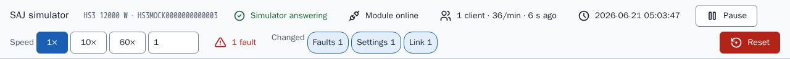
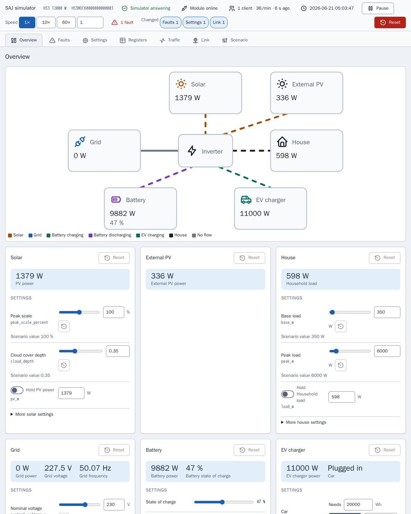
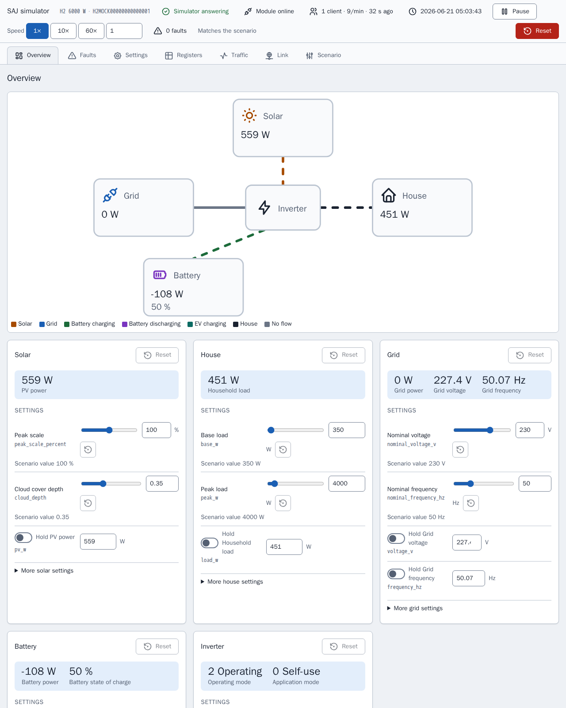
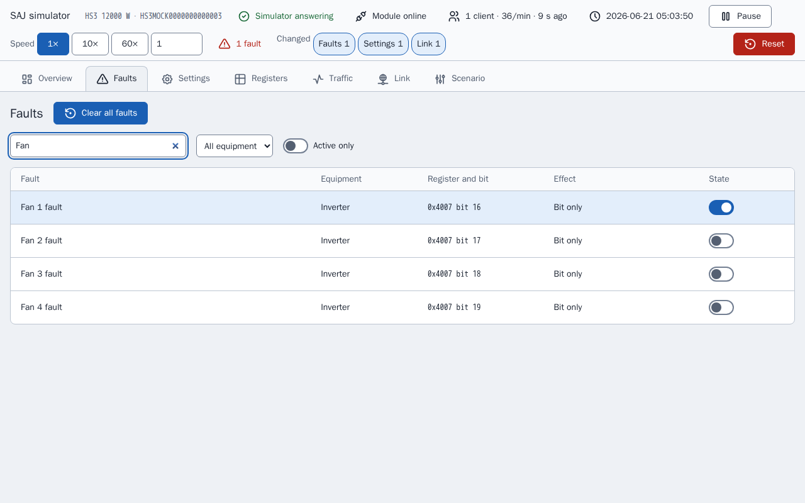
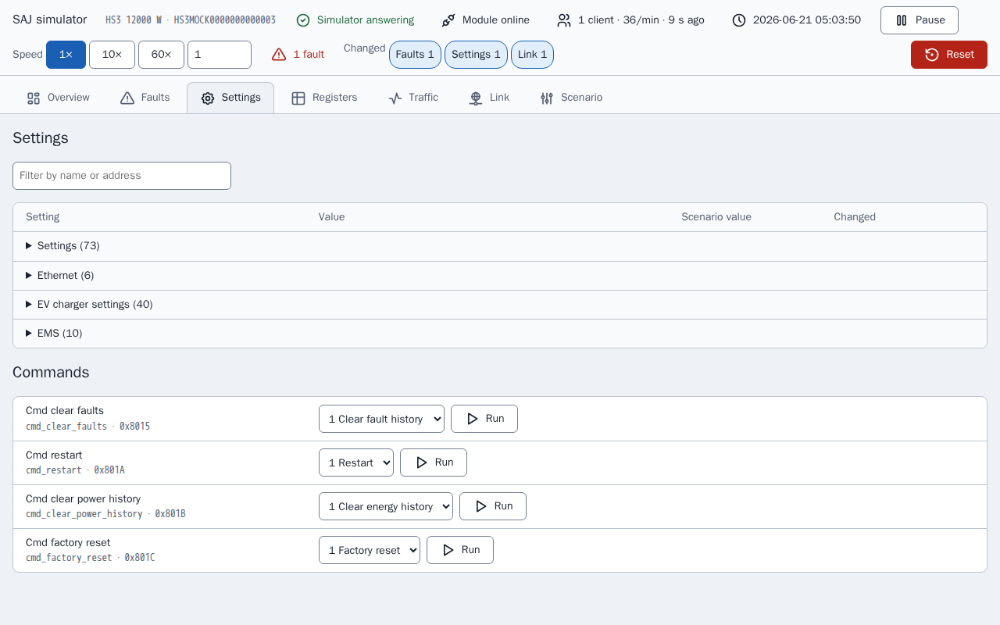
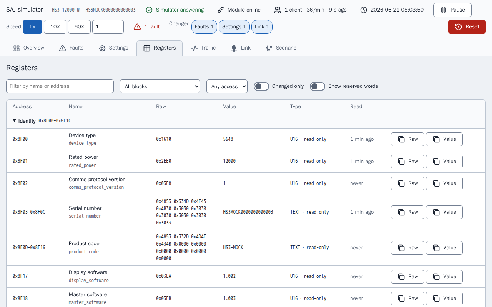
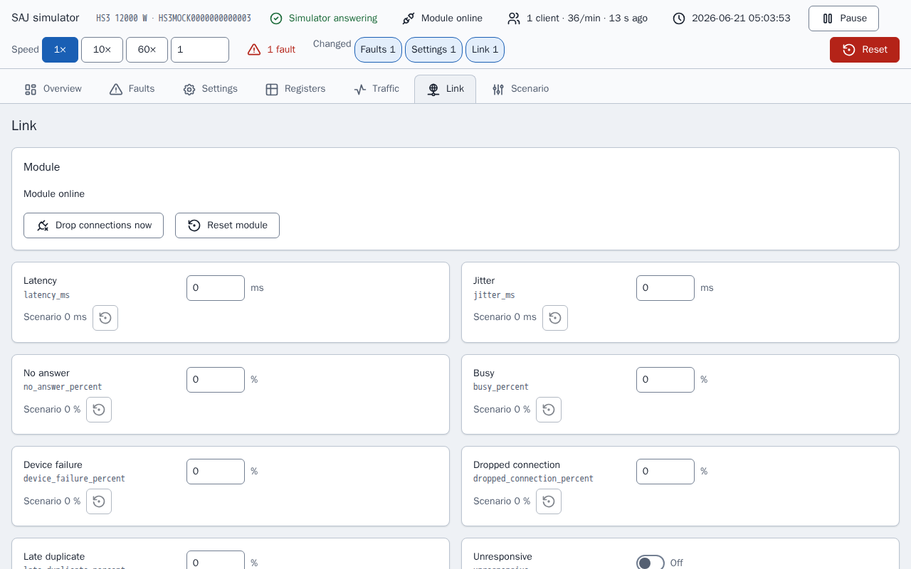
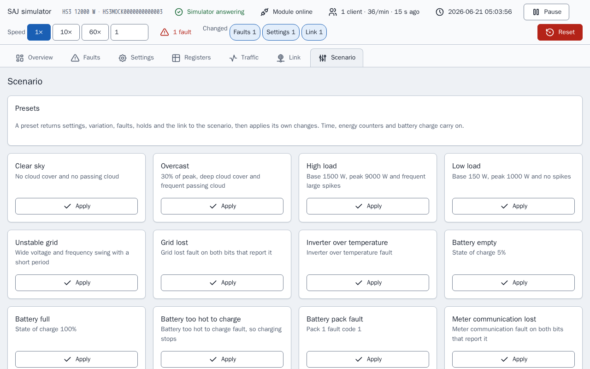
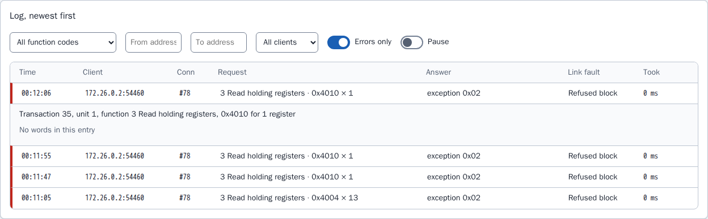

[en](../../en-gb/developer/simulator-page.md) | de | [nl](../../nl/developer/simulator-page.md) | [fr](../../fr/developer/simulator-page.md) | [zh](../../zh-hans/developer/simulator-page.md) | [es](../../es/developer/simulator-page.md) | [it](../../it/developer/simulator-page.md) | [pl](../../pl/developer/simulator-page.md) | [sv](../../sv/developer/simulator-page.md)

# Simulatorseite

Die Steuerseite eines Simulators: Ansichten, Registerinspektor, Verkehrsprotokoll, Verbindungsfehler, Fehlerwirkungen, Voreinstellungen und gespeicherter Zustand. Die Seite selbst ist nur auf Englisch, daher stehen ihre Bezeichnungen in dieser Beschreibung auf Englisch.

Die vollständige Liste dessen, was die Seite abdeckt, steht in den Abschnitten der Funktionsliste [Bedienseite](../../../mock/docs/features.md#control-page), [Zustand und Voreinstellungen](../../../mock/docs/features.md#state-and-presets), [Registerinspektor und Verkehrsprotokoll](../../../mock/docs/features.md#register-inspector-and-traffic-log), [Verbindungsfehler](../../../mock/docs/features.md#link-faults).

Jeder Simulator liefert eine Webseite unter `http://localhost:<panel port>/` aus: `5080` für den HS3 und `5081` für den H2, die `make up` startet (`SAJ_MOCK_PANEL_HOST_PORT` und `SAJ_MOCK_H2_PANEL_HOST_PORT` ändern die Ports). Im Container lauscht der Simulator auf `server.panel_port`, standardmäßig 8080. Es gibt keine Authentifizierung: Der Simulator ist ein Entwicklungswerkzeug.

Die Seite gibt es, damit ein Entwickler sehen kann, was das simulierte System gerade tut, und das System in eine Lage versetzen kann, ohne ein Szenario zu bearbeiten und neu zu starten. Die Seite baut jedes Bedienelement aus der Beschreibung des Geräts auf, daher listet die Seite nur die Ausstattung auf, die eingebaut ist.
Die Seite fragt den Zustand alle 3 Sekunden ab, damit eine Änderung aus Home Assistant erscheint, und die Ansichten Registers und Traffic aktualisieren sich außerdem jede Sekunde, solange die Ansichten offen sind. Ein Bedienelement mit Fokus wird nicht überschrieben. Zwei Clients können gleichzeitig etwas ändern: Der letzte Schreibzugriff gewinnt, wie bei einem echten Gerät. Jede Änderung zeigt eine kurze Bestätigung und jede Ablehnung ihren Grund.

Eine Statusleiste in jeder Ansicht beantwortet, ob der Simulator als sein Szenario läuft oder verändert wurde: ob das Kommunikationsmodul online ist, die verbundenen Clients und ihre Anfragerate, die simulierte Zeit, Lauf und Pause, die Geschwindigkeit, die aktiven Fehler und je einen Chip für jede Art von Änderung gegenüber dem Szenario, die in Kraft ist. Dieselbe Zusammenfassung (`changes` im Zustand) markiert die geänderten Zeilen und Karten. Pause setzt die Geschwindigkeit auf 0 und Play stellt die frühere Geschwindigkeit wieder her, daher geht die Geschwindigkeit beim Pausieren nicht verloren.



Die aktuelle Ansicht steht im URL-Fragment (`#registers`), daher bleibt sie nach einem Neuladen erhalten. Im Browser wird nichts gespeichert. Die Screenshots der folgenden Ansichten werden aufgenommen, nachdem ein Fehler, „Fan 1 fault“, gesetzt wurde und nachdem der Simulator ein Register verweigert hat, daher zeigt jede Ansicht eine Änderung gegenüber dem Szenario.

Die Seite leitet lesbare Namen aus Feldnamen ab und rundet jeden skalierten Wert auf die Nachkommastellen seiner Skala, sodass ein roher Wert 65535 bei der Skala 0.0001 als 6.5535 erscheint und kein Gleitkomma-Rauschen zeigt.

## Ansichten

### Übersicht (Overview)

Ein Energiefluss-Diagramm der eingebauten Ausstattung, nach Richtung eingefärbt und animiert, über einer Karte pro Ausstattungsteil. Eine Karte enthält den Live-Messwert, die Bedienelemente, die den Messwert setzen, und die Fehler der Ausstattung, mit einem Zurücksetzen auf das Szenario für diese Karte.



Die Seite des H2 hat weniger Karten als die Seite des HS3 oben, weil das H2-Szenario weniger Ausstattung einbaut.



Eine Karte hält das, was ein Bedienelement setzt, getrennt vom Messwert, den das Bedienelement erzeugt, weil sich beide unterscheiden, sobald ein Halten, ein Fehler oder der Ladezustand im Spiel ist: Eine Spitzenskala von 100 % bedeutet nicht 100 % der PV-Leistung. Das Zurücksetzen einer Karte stellt die Variation, die Haltewerte und die Fehlerbits der Karte zurück und lässt den Ladezustand, das Auto, die Uhr und die Energiezähler unberührt, aus demselben Grund wie bei den Voreinstellungen. Eine Karte mit einem aktiven Fehler ist markiert, wie bei der Karte unten.


### Fehler (Faults)

Jedes Fehlerbit der eingebauten Ausstattung, durchsuchbar, mit dem, was der Simulator tut, wenn das Bit gesetzt ist. Bits, die das Dokument nicht benennt, sind als reserviert aufgeführt, damit der Pfad der Integration für nicht erkannte Fehler ausprobiert werden kann.

Das Bild zeigt die Suche „Fan“, mit den vier Lüfterfehlern und dem Schalter des gesetzten Fehlers „Fan 1 fault“ auf an.



### Einstellungen (Settings)

Die schreibbaren Einstellungen und Befehle, mit Namen für die Rohwerte und dem Szenariowert jeder Einstellung.



### Register (Registers)

Der Registerinspektor, unten beschrieben.



### Verkehr (Traffic)

Das Verkehrsprotokoll, unten beschrieben.


### Verbindung (Link)

Die Verbindungsfehler und der Zustand des Moduls, unten beschrieben.



### Szenario (Scenario)

Voreinstellungen, die simulierte Zeit, die Energiezähler, Zurücksetzen und Export.



## Registerinspektor

`GET /api/registers` listet jeden Block des Geräts auf und für jedes Feld eines Blocks, der antwortet, die rohen Wörter, den dekodierten Wert mit seiner Bezeichnung, den Zugriff (nur lesen, schreibbar oder Befehl) und wann ein Client das Feld zuletzt gelesen hat. Die Ansicht Registers zeigt die Liste als Tabelle mit einem Filter, einem Schalter „changed only“ und einer Hervorhebung eines Werts, der sich gerade geändert hat, sodass die Wirkung eines Fehlers oder eines Schreibzugriffs auf die Register ohne Modbus-Client sichtbar ist.

Der Inspektor zeigt nur an. Der Inspektor liest das Gerät ohne den Beobachter des Geräts, daher ist das Ansehen eines Registers kein Lesezugriff eines Clients: Das Ansehen zählt nicht als Keep-alive, berührt nicht das Feld, das ein Lesezugriff berühren würde, und wird nicht im Verkehr aufgezeichnet. Ein Register wird nur über die Bedienelemente geschrieben, die dieselbe Validierung durchlaufen wie ein Modbus-Schreibzugriff.

## Verkehrsprotokoll

Der Modbus-Server meldet jedes Verbindungsereignis und jede Anfrage mit ihrer Antwort an einen Aufzeichner (`traffic.py`). `GET /api/traffic?after=<sequence>` liefert die Einträge nach einer Sequenznummer, sodass die Seite nur nach dem fragt, was neu ist, zusammen mit den Zählern und einem Verlauf von 30 Minuten in Eimern von 10 Sekunden. `POST /api/traffic/reset` löscht sie. Die Ansicht Traffic zeigt die Live-Anfragerate, ein Diagramm der Anfragen über die Zeit, die Zähler pro Client und das Protokoll, das gefiltert und für die gelesenen oder geschriebenen Wörter geöffnet werden kann. Das Bild zeigt das Protokoll mit nur den aufgelisteten Fehlern und einer geöffneten verweigerten Anfrage: Eine verweigerte Anfrage hat keine Wörter, daher sagt der Eintrag das und nennt den Verbindungsfehler, der die Anfrage verweigert hat.



Zähler zählen Anfragen und Register, weil Feldberichte die Last eines Moduls so beschreiben, und beide werden gezeigt, weil nicht bekannt ist, ob auch die Größe einer Anfrage eine Rolle spielt. Der Aufzeichner behält die letzten 2000 Einträge im Speicher und speichert sie nicht: Das Protokoll beschreibt, was dem aktuellen Lauf des Simulators geschehen ist, und ein Neustart ist ein neuer Lauf.

## Verbindungsfehler

Die Ansicht Link und der Abschnitt `link` eines Szenarios legen fest, wie sich das simulierte Modul fehlverhält. Jede Einstellung reproduziert einen Fehler, den Feldberichte von Kommunikationsmodulen von SAJ beschreiben, und keine ist gesetzt, solange sie nicht ein Szenario oder die Seite setzt.

| Schlüssel | Wirkung |
| --- | --- |
| `latency_ms`, `jitter_ms` | Jede Antwort wartet die Latenz plus oder minus bis zum Jitter, 0 bis 60000 ms |
| `no_answer_percent` | Die Anfrage wird gelesen und nie beantwortet, und die Verbindung bleibt offen |
| `busy_percent`, `device_failure_percent` | Die Antwort ist die Ausnahme `0x06` oder `0x04` |
| `dropped_connection_percent` | Das Modul schließt die Verbindung, statt zu antworten |
| `late_duplicate_percent` | Nach einer Ausnahmeantwort wird derselbe Frame kurz vor der nächsten Antwort auf dieser Verbindung erneut gesendet |
| `refused_blocks` | Eine Liste aus `start`, `end` und `code` (0 bis 255). Eine Anfrage, die den Block berührt, wird mit diesem Code beantwortet, sodass auch Geräte nachgebildet werden können, die nicht standardkonforme Codes senden, einschließlich 0 |
| `unresponsive` | Verbindungen werden angenommen und nie beantwortet |
| `offline` | Das Modul hört auf zu lauschen und schließt jede Verbindung |
| `offline_seconds`, `offline_period_seconds` | In den ersten `offline_seconds` jeder Periode offline, die mindestens so lang sein muss |
| `lockout_requests`, `lockout_window_seconds`, `lockout_whole_port` | Ein Client, der innerhalb des Fensters mehr als `lockout_requests` Anfragen sendet, bekommt seine Verbindung geschlossen und seine Adresse verweigert, oder jeder Client, wenn `lockout_whole_port` gesetzt ist, bis das Modul zurückgesetzt wird. Ein Fenster ist erforderlich, wenn ein Schwellenwert gesetzt ist |

<!-- jscpd:ignore-start -->
```yaml
link:
  latency_ms: 800
  jitter_ms: 400
  busy_percent: 10
  refused_blocks:
    - {start: 0x4000, end: 0x40FF, code: 0}
```
<!-- jscpd:ignore-end -->

Prozentwerte sind 0 bis 100. Ein falscher Wert oder eine Kombination, die nicht funktionieren kann, hält den Simulator beim Start an und nennt den Schlüssel, etwa `link.offline_seconds`.

Die Entscheidungen fallen in `link.py` und werden vom Transport ausgeführt, der die Verbindung fragt, bevor er eine Verbindung annimmt und bevor er antwortet. Die erste zutreffende Prüfung entscheidet, in dieser Reihenfolge: offline, unresponsive, Sperre, abgebrochene Verbindung, keine Antwort, verweigerter Block, Gerätefehler, busy. Die Latenz gilt für jede Antwort, die gesendet wird. Ob eine Wahrscheinlichkeit zutrifft, wird aus dem Seed der Simulation und der Sequenznummer der Anfrage gezogen, daher geben derselbe Seed und dieselben Anfragen dieselben Fehler, und ein beim Debuggen gefundener Fehler lässt sich reproduzieren. Latenz, die Offline-Periode und das Sperrfenster laufen auf Wanduhrzeit, nicht auf simulierter Zeit, weil die Einstellungen die Verbindung so beschreiben, wie der Client sie sieht, und die Uhrgeschwindigkeit sie nicht ändern darf.

Verbindungseinstellungen und eine Sperre bleiben über Neustarts erhalten und werden mit dem Szenario exportiert. Eine Sperre wird nur von „Reset module“, von Reset oder von einer Voreinstellung aufgehoben, weil Feldberichte eine Sperre beschreiben, die anhielt, bis das Modul eine neue Adresse bekam, und „Reset module“ steht für die neue Adresse. „Drop connections now“ schließt jede offene Verbindung einmal. Die Routen sind `POST /api/link`, `/api/link/drop` und `/api/link/reset`.

Der Verkehrsaufzeichner zeigt, welcher Fehler auf jede Anfrage angewendet wurde, daher lässt sich die Wirkung einer Einstellung auf den Client aus dem Protokoll ablesen.

## Fehlerwirkungen

Manche Fehler tun mehr, als ihr Bit zu setzen, wo ein echtes System es täte. Ein Fehler, der einen Netz-, PV-, DC-Bus-, Batterieanschluss-, Temperatur-, Relais-, Sensor- oder Isolationszustand nennt, stoppt den Wechselrichter, Netzausfall lässt den Wechselrichter im Inselbetrieb laufen, ein Verlust der Zählerkommunikation macht Zähler A stumm, manche Batteriefehler stoppen Laden oder Entladen, jeder Pack-Fehlercode ungleich 0 stoppt beides, und ein Fehler der Wallbox stoppt die Wallbox. Jeder andere Fehler und jedes reservierte Bit setzt nur das Bit. Die Tabellen stehen in `mock/saj_local_mock/profiles/fault_tables.py`, und die Wirkungen werden von `simulation/faults.py` angewendet.

## Voreinstellungen, gespeicherter Zustand und Export

**Voreinstellungen** setzen zuerst die Einstellungen, die Variation, den Seed, die Fehler und die Haltewerte auf das Szenario zurück und wenden dann ihre Änderungen an, sodass jede dieselben Bedingungen ergibt, wie auch immer der Simulator verlassen wurde. Die simulierte Zeit, die Uhrgeschwindigkeit, die Energiezähler und der Ladezustand der Batterie laufen weiter, sofern die Voreinstellung die Werte nicht setzt, damit Home Assistant weder die Uhr zurückspringen noch die Lebensdauersummen fallen sieht. **Reset** ist die Funktion, die alles zurückspult. Ausstattung, die nicht eingebaut ist, hat keine Voreinstellungen, und ein Modell, dessen Tabellen den Fehler nicht benennen, auch nicht. Eine Voreinstellung setzt außerdem die Verbindung auf das Szenario zurück, setzt dann ihre eigenen Änderungen an der Verbindung, und eine Sperre wird aufgehoben. Die Verbindungs-Voreinstellungen werden bei jedem Modell angeboten: Slow link, Flaky link, Busy module, Module offline und Module locked out. Kein Feldbericht nennt die Last, bei der ein Modul sperrt, daher ist der Schwellenwert von Module locked out ein Ausgangspunkt, den du auf der Seite ändern kannst, und stammt nicht aus einer Grenze der Integration.

**Gespeicherter Zustand.** Änderungen bleiben über Neustarts in `/data/state.json` erhalten, in einem eingebundenen Ordner pro Dienst in [compose.yaml](../../../compose.yaml): `mock/state/hs3/` und `mock/state/h2/`, zurückgesetzt durch Löschen des Ordnerinhalts. Verbindungseinstellungen und eine Sperre werden mit dem Zustand gespeichert. Ein Zustand, der für ein anderes Szenario gespeichert wurde, wird ignoriert und einmal protokolliert, weil es falsch wäre, ihn auf ein anderes System anzuwenden. Ein Zustand, der nicht gelesen werden kann, wird auf dieselbe Weise ignoriert, und die Datei bleibt erhalten. Nur die Einstellungen, die ein Client schreiben kann, werden gespeichert, daher wird eine Änderung an einem festen Register im Code nie von einer alten Datei verdeckt, und die Energiezähler werden mit dem Beginn jedes Tages, Monats und Jahres gespeichert, sodass ein Neustart kein Zurücksetzen der Zähler ist. Ohne eingebundenen Ordner protokolliert der Simulator eine Zeile, dass Änderungen nicht behalten werden, und läuft weiter. **Reset** löscht die Datei und kehrt zum Szenario zurück. Der Playwright-Stack bindet keinen Ordner ein, daher beginnt jeder Lauf beim Szenario.

**Export** lädt den laufenden Seed, die Variation, die Fehler, die Verbindung und die Uhr als Szenario herunter, sodass ein abgestimmter Zustand committet und in einem frischen Simulator mit derselben Variation erneut ausgeführt werden kann.

## Symbole

Die Symbole der Seite stammen aus dem Symbolsatz Tabler unter `mock/static/vendor/tabler/`, weil der Simulator eigenständig sein muss und nichts von außen laden darf. Nur die Symbole, die die Seite verwendet, bleiben erhalten, als originale SVG-Dateien, damit der Satz gegen die Quelle geprüft werden kann. Der Ordner enthält außerdem die `LICENSE` des Satzes und eine `README.md`, die die Version der Symbole nennt. Die Seite bindet die Symbole inline ein, damit die Symbole die Textfarbe annehmen; eine Symbolschrift oder ein Emoji wird nicht verwendet. Jeder Satz unter der MIT- oder ISC-Lizenz darf auf diese Weise eingebunden werden, mit seiner Lizenz daneben.
