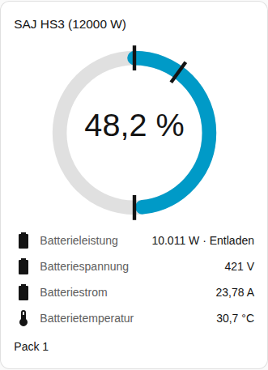
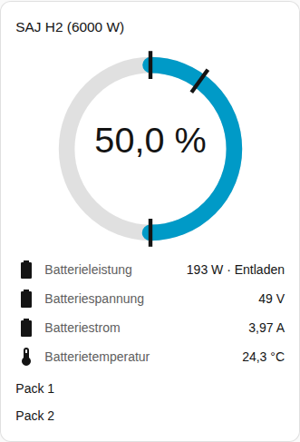

[en](../../../en-gb/user/cards/battery-card.md) | de | [nl](../../../nl/user/cards/battery-card.md) | [fr](../../../fr/user/cards/battery-card.md) | [zh](../../../zh-hans/user/cards/battery-card.md) | [es](../../../es/user/cards/battery-card.md) | [it](../../../it/user/cards/battery-card.md) | [pl](../../../pl/user/cards/battery-card.md) | [sv](../../../sv/user/cards/battery-card.md)

# Batterie-Karte

Die Seite Batterie-Karte erklärt die Batterie-Karte, die die Ladung, die Leistung und die Werte der Batterie zeigt. Die vollständige Liste steht im Abschnitt [Batterie-Karte](../../../../frontend/docs/features.md#battery-card) der Funktionsliste der Karten. [Ein Element hinzufügen](README.md#ein-element-hinzufügen) erklärt, wie du die Karte hinzufügst und ein System wählst.

## Was die Karte zeigt

- Ein Ring zeigt den Ladezustand. Markierungen auf dem Ring zeigen die Notstrom-Reserve, die Ladegrenze und die Entladegrenze am Netz.
- Die Batterieleistung erscheint mit der Angabe, ob die Batterie lädt oder entlädt, und unter der Leistung die Spannung, der Strom, die Temperatur und die nutzbare Kapazität. Die Richtungen folgen dem [Vorzeichen der Leistung](../entities-and-prefix.md#vorzeichen-der-leistung).
- Bei eingeschaltetem Batteriepacks anzeigen, was der Standard ist, bekommt jedes Pack eine Zeilengruppe mit Ladezustand, Gesundheit, Spannung, Strom, Temperatur, Zyklen, Fehler und Warnung. Ein Pack-Messwert erscheint nur, wenn die Entität des Messwerts aktiviert ist. Die meisten Pack-Messwerte werden deaktiviert erstellt, weshalb der Screenshot nur den Namen des Packs zeigt. Aktiviere die gewünschten Entitäten in Home Assistant. Die [Batteriepack-Entitäten](../entities/battery-packs.md) stehen in der Entitätsreferenz.
- Eine Zeile zeigt die Zeit bis Batterie voll, solange die Batterie lädt, und die Zeit bis Batterie leer, solange die Batterie entlädt. Die Zeile entfällt, wenn die Batterie ruht oder das System keine solche Entität hat. Die [berechneten Sensoren](../entities-and-prefix.md#berechnete-sensoren) erklären die Schätzwerte.
- Ein System ohne Batterie sagt das.

## Unterschiede zwischen den Modellen

- **HS3:** ein Pack.
- **H2:** eine Zeilengruppe für jedes Pack, das der Wechselrichter meldet, bis zu fünf. Der Screenshot zeigt einen H2 mit zwei Packs. Siehe [optionale Ausstattung](../optional-equipment.md#batteriepacks).

Die [Fehler-Karte](faults-card.md) listet den aktiven Fehler und die aktive Warnung jedes Packs auf. Die Fehler- und Warnungs-Entitäten sind standardmäßig aktiviert.

## Optionen

| Option im Editor | YAML-Schlüssel | Standard |
| --- | --- | --- |
| System | `device` | Das erste System |
| Batteriepacks anzeigen | `show_packs` | Ein |

## Noch nicht unterstützt

- Eine Batterieeinstellung von der Karte aus ändern. Die Batterie-Karte zeigt nur Messwerte. Verwende die [Steuerungs-Karte](controls-card.md) für die Batteriegrenzen.
