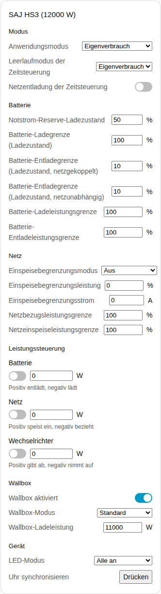
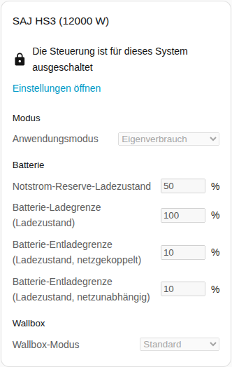
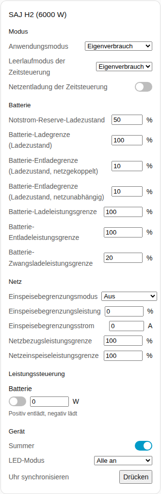

[en](../../../en-gb/user/cards/controls-card.md) | de | [nl](../../../nl/user/cards/controls-card.md) | [fr](../../../fr/user/cards/controls-card.md) | [zh](../../../zh-hans/user/cards/controls-card.md) | [es](../../../es/user/cards/controls-card.md) | [it](../../../it/user/cards/controls-card.md) | [pl](../../../pl/user/cards/controls-card.md) | [sv](../../../sv/user/cards/controls-card.md)

# Steuerungs-Karte

Die Seite Steuerungs-Karte erklärt die Steuerungs-Karte, die die Einstellungen eines Systems in Abschnitten bündelt, damit du die Einstellungen von einem Dashboard aus ändern kannst. Die vollständige Liste steht im Abschnitt [Steuerungs-Karte](../../../../frontend/docs/features.md#controls-card) der Funktionsliste der Karten. [Ein Element hinzufügen](README.md#ein-element-hinzufügen) erklärt, wie du die Karte hinzufügst und ein System wählst. Die Einstellungen hinter den Bedienelementen sind unter [Einstellungen ändern](../changing-settings.md) beschrieben.

## Was die Karte zeigt

- Die Abschnitte sind Modus, Batterie, Netz, Leistungssteuerung, Wallbox und Gerät. Ein Abschnitt ohne etwas zu zeigen wird ausgelassen.
- **Modus:** der Anwendungsmodus und die Einstellungen der Zeitsteuerung.
- **Batterie:** die Notstrom-Reserve und die Lade- und Entladegrenzen.
- **Netz:** die Einstellungen der Einspeisegrenze und die Netzleistungsgrenzen.
- **Leistungssteuerung:** jede Funktion der [Leistungssteuerung](../power-control.md), die das System hat, mit einem Schalter, einem Leistungsziel und einem Hinweis darauf, was eine positive und eine negative Leistung bewirken.
- **Wallbox:** der Schalter, der Modus und die Ladeleistung der Wallbox.
- **Gerät:** der Summer, der LED-Modus und die Uhrensynchronisierung.
- Jede Einstellung verwendet das Bedienelement, das zur Einstellung passt: einen Schieberegler oder ein Zahlenfeld, eine Liste, einen Schalter, ein Zeitfeld oder eine Schaltfläche.
- Ein Bedienelement ändert den Wechselrichter einmal pro Entscheidung und zeigt dann den Wert, den der Wechselrichter hält. Eine abgelehnte Änderung erscheint unter dem Bedienelement.
- Die Karte hat keine Schaltfläche Wechselrichter neu starten, damit ein Tippen auf einem Dashboard den Wechselrichter nicht neu starten kann. Der Neustart bleibt eine Entität.

## Wenn die Steuerung nicht zugelassen ist

Solange [Steuerung zulassen](../changing-settings.md#steuerung-zulassen) für das System aus ist, ist jedes Bedienelement deaktiviert. Ein Schloss über den Bedienelementen verweist auf die Einstellungen der Integration, wo du Steuerung zulassen einschaltest.

## Unterschiede zwischen den Modellen

- **Nur HS3:** der Abschnitt Wallbox und die Leistungssteuerungs-Funktionen Netz und Wechselrichter.
- **Nur H2:** der Summer und die Leistungsgrenze der erzwungenen Batterieladung. Der H2 hat nur die Leistungssteuerungs-Funktion Batterie.

## Optionen

| Option im Editor | YAML-Schlüssel | Standard |
| --- | --- | --- |
| System | `device` | Das erste System |
| Abschnitte | `sections`, eine Liste aus `mode`, `battery`, `grid`, `power_control`, `ev_charger` und `device` | Alle Abschnitte |

## Noch nicht unterstützt

- Eine Schaltfläche Wechselrichter neu starten. Der Neustart bleibt eine Entität.
- Zeitpläne der Leistungssteuerung. Richte die Zeitpläne auf der Integrationsseite ein, siehe [Leistungssteuerung](../power-control.md#einem-zeitplan-folgen).
