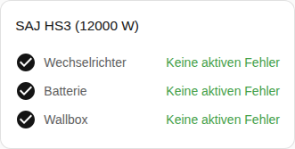

[en](../../../en-gb/user/cards/faults-card.md) | de | [nl](../../../nl/user/cards/faults-card.md) | [fr](../../../fr/user/cards/faults-card.md) | [zh](../../../zh-hans/user/cards/faults-card.md) | [es](../../../es/user/cards/faults-card.md) | [it](../../../it/user/cards/faults-card.md) | [pl](../../../pl/user/cards/faults-card.md) | [sv](../../../sv/user/cards/faults-card.md)

# Fehler-Karte

Die Seite Fehler-Karte erklärt die Fehler-Karte, die die aktiven Fehler jedes Ausstattungsteils auflistet. Die vollständige Liste steht im Abschnitt [Fehler-Karte](../../../../frontend/docs/features.md#faults-card) der Funktionsliste der Karten. [Ein Element hinzufügen](README.md#ein-element-hinzufügen) erklärt, wie du die Karte hinzufügst und ein System wählst. Die Fehler kommen aus den [Gerätefehler-Entitäten](../faults-and-repairs.md#gerätefehler).

## Was die Karte zeigt

- Fehler sind nach Wechselrichter, Batterie und Wallbox gruppiert, und jeder aktive Fehler zeigt, wie lange der Fehler zurückliegt. Die Fehler und Warnungen der Batteriepacks stehen in der Batteriegruppe.
- Ein nicht erkannter Fehler sagt, dass du das Register und das Bit im [Diagnosedownload](../troubleshooting.md#diagnose-herunterladen) nachschlagen sollst.
- Eine Schaltfläche Fehler quittieren steht unter den aktiven Fehlern des Wechselrichters. Die Schaltfläche sendet den Befehl Aktuellen Fehler quittieren. Solange die Steuerung für das System nicht zugelassen ist, ist die Schaltfläche deaktiviert, und ein Schloss verweist auf die Einstellungen der Integration. Siehe [Steuerung zulassen](../changing-settings.md#steuerung-zulassen).
- Bei eingeschaltetem Gruppen ohne Fehler anzeigen, was der Standard ist, erscheint eine Gruppe ohne aktiven Fehler als in Ordnung, wie im Screenshot. Bei ausgeschalteter Option zeigt die Karte nur die Gruppen mit einem aktiven Fehler.

Ein System ohne Batterie oder Wallbox hat für die fehlende Ausstattung keine Fehler zu zeigen, daher zeichnet die Karte die Gruppe der Ausstattung nicht.

## Optionen

| Option im Editor | YAML-Schlüssel | Standard |
| --- | --- | --- |
| System | `device` | Das erste System |
| Gruppen ohne Fehler anzeigen | `show_groups_without_faults` | Ein |

## Noch nicht unterstützt

- Die Fehler der Batterie oder der Wallbox von der Karte aus quittieren. Die Schaltfläche Fehler quittieren steht nur unter den aktiven Fehlern des Wechselrichters.
