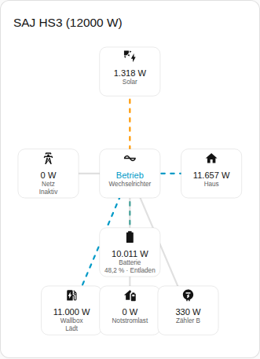
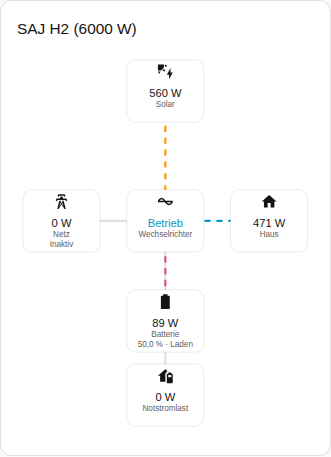

[en](../../../en-gb/user/cards/power-flow-card.md) | de | [nl](../../../nl/user/cards/power-flow-card.md) | [fr](../../../fr/user/cards/power-flow-card.md) | [zh](../../../zh-hans/user/cards/power-flow-card.md) | [es](../../../es/user/cards/power-flow-card.md) | [it](../../../it/user/cards/power-flow-card.md) | [pl](../../../pl/user/cards/power-flow-card.md) | [sv](../../../sv/user/cards/power-flow-card.md)

# Energiefluss-Karte

Die Seite Energiefluss-Karte erklärt die Energiefluss-Karte, die die Live-Leistung zwischen Solar, Batterie, Netz, Haus und der optionalen Ausstattung zeichnet. Die vollständige Liste steht im Abschnitt [Energiefluss-Karte](../../../../frontend/docs/features.md#power-flow-card) der Funktionsliste der Karten. [Ein Element hinzufügen](README.md#ein-element-hinzufügen) erklärt, wie du die Karte hinzufügst und ein System wählst.



## Was die Karte zeigt

- Solar, Batterie, Netz und Haus sind um den Wechselrichter gezeichnet, der den Betriebszustand zeigt.
- Jede Linie zeigt die Richtung des Flusses und bewegt sich schneller, wenn die Leistung wächst. Eine Leistung von 10 W oder weniger wird als inaktiv gezeichnet.
- Die Batterie zeigt den Ladezustand und ob die Batterie lädt oder entlädt. Das Netz zeigt, ob das System Netzbezug hat oder einspeist. Die Richtungen folgen dem [Vorzeichen der Leistung](../entities-and-prefix.md#vorzeichen-der-leistung).
- Bei eingeschaltetem Optionale Ausstattung anzeigen, was der Standard ist, zeichnet die Karte auch die Notstromlast, Zähler B und die Wallbox, wenn das System die Ausstattung hat. Zähler B ist ein Messwert ohne Richtung.
- Bei eingeschaltetem Solar-Strings anzeigen wird die Leistung jedes Solar-Strings aufgelistet. Die Option ist standardmäßig aus.
- Umfang wählt zwischen den Messwerten des Systems, was der Standard ist, und den Messwerten des Parallelsystems. Ein System ohne Parallel-Messwerte zeigt beim Umfang Parallelsystem den leeren Zustand.

## Unterschiede zwischen den Modellen

- **Nur HS3:** die Wallbox, wie im Screenshot oben.
- **H2:** Die Karte zeichnet die Teile der HS3-Karte, außer der Wallbox. Der Screenshot unten zeigt einen H2, der die Batterie lädt.



## Optionen

| Option im Editor | YAML-Schlüssel | Standard |
| --- | --- | --- |
| System | `device` | Das erste System |
| Solar-Strings anzeigen | `show_strings` | Aus |
| Optionale Ausstattung anzeigen | `show_optional_equipment` | Ein |
| Umfang | `scope` (`system` oder `parallel`) | `system` |

<!-- jscpd:ignore-start -->
```yaml
type: custom:saj-local-power-flow-card
device: 0123456789abcdef0123456789abcdef
show_strings: false
show_optional_equipment: true
scope: system
```
<!-- jscpd:ignore-end -->

Der Wert `device` ist die ID des Geräts in Home Assistant. Der visuelle Editor trägt den Wert für dich ein. Die Namen der Entitäten hinter jedem Teil stehen in der [Entitätsreferenz](../entities/README.md).

## Noch nicht unterstützt

- Eine Richtung für Zähler B. Die Karte zeichnet Zähler B als Messwert ohne Richtung.
