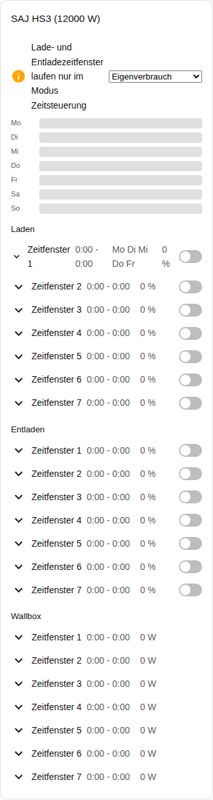
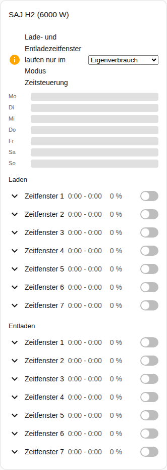

[en](../../../en-gb/user/cards/schedule-card.md) | de | [nl](../../../nl/user/cards/schedule-card.md) | [fr](../../../fr/user/cards/schedule-card.md) | [zh](../../../zh-hans/user/cards/schedule-card.md) | [es](../../../es/user/cards/schedule-card.md) | [it](../../../it/user/cards/schedule-card.md) | [pl](../../../pl/user/cards/schedule-card.md) | [sv](../../../sv/user/cards/schedule-card.md)

# Zeitplan-Karte

Die Seite Zeitplan-Karte erklärt die Zeitplan-Karte, die die Zeitfenster für Laden, Entladen und Wallbox zeigt und bearbeitet. Die vollständige Liste steht im Abschnitt [Zeitplan-Karte](../../../../frontend/docs/features.md#schedule-card) der Funktionsliste der Karten. [Ein Element hinzufügen](README.md#ein-element-hinzufügen) erklärt, wie du die Karte hinzufügst und ein System wählst.

## Was die Karte zeigt

- Die Zeitfenster für Laden, Entladen und Wallbox, jeweils mit den Zeiten, der Leistung, den Tagen und der Angabe, ob das Zeitfenster an ist. Die Option Zeitfensterarten wählt, welche Arten die Karte zeigt.
- Bei eingeschaltetem Wochenzeitleiste anzeigen, was der Standard ist, zeichnet eine Wochenzeitleiste jedes Zeitfenster als Balken. Tippe auf einen Balken, um das Zeitfenster zu öffnen.
- Ein geöffnetes Zeitfenster hat einen Editor für den Start, das Ende, die Leistung, die Tage und die anderen Einstellungen des Zeitfensters.
- Ein Zeitfenster erscheint nur, wenn jede Entität des Zeitfensters aktiviert ist, und die Karte zählt die Zeitfenster, die die Karte auslässt. Das Einschalten von [Steuerung zulassen](../changing-settings.md#der-steuerungssatz) aktiviert die Entitäten der Zeitfenster.
- Zeitfenster für Laden und Entladen laufen nur in einem Anwendungsmodus der Zeitsteuerung. Wenn der Anwendungsmodus ein anderer Modus ist, sagt ein Hinweis das und zeigt die Modusliste neben dem Hinweis. Zeitsteuerung und Zeitsteuerung (BMS) zählen beide.
- Solange die Steuerung für das System nicht zugelassen ist, ist jedes Bedienelement auf der Karte deaktiviert, und ein Schloss verweist auf die Einstellungen der Integration. Siehe [Steuerung zulassen](../changing-settings.md#steuerung-zulassen).

## Unterschiede zwischen den Modellen

- **Nur HS3:** die Wallbox-Zeitfenster.
- **H2:** nur Zeitfenster für Laden und Entladen, wie der Screenshot unten zeigt.

Die Tagesschaltflächen eines Zeitfensters sind die Schaltflächen der [Wochentage-Funktion für Kachel-Karten](weekdays-feature.md).

## Optionen

| Option im Editor | YAML-Schlüssel | Standard |
| --- | --- | --- |
| System | `device` | Das erste System |
| Zeitfensterarten | `slot_kinds`, eine Liste aus `charge`, `discharge` und `ev_charger` | Alle Arten |
| Wochenzeitleiste anzeigen | `show_timeline` | Ein |

## Noch nicht unterstützt

- Zeitpläne der Leistungssteuerung. Ein Zeitplan der Leistungssteuerung folgt einem Zeitplan-Helfer von Home Assistant, siehe [Leistungssteuerung](../power-control.md#einem-zeitplan-folgen).
