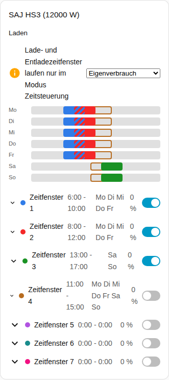
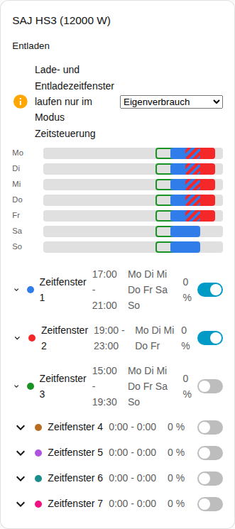
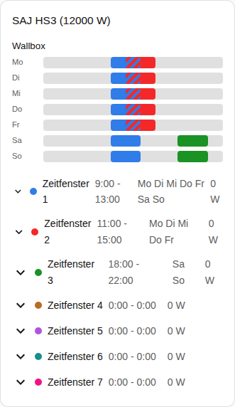

[en](../../../en-gb/user/cards/schedule-cards.md) | de | [nl](../../../nl/user/cards/schedule-cards.md) | [fr](../../../fr/user/cards/schedule-cards.md) | [zh](../../../zh-hans/user/cards/schedule-cards.md) | [es](../../../es/user/cards/schedule-cards.md) | [it](../../../it/user/cards/schedule-cards.md) | [pl](../../../pl/user/cards/schedule-cards.md) | [sv](../../../sv/user/cards/schedule-cards.md)

# Zeitplan-Karten

Die Seite Zeitplan-Karten erklärt die drei Zeitplan-Karten. Jede Karte zeigt und bearbeitet die Zeitfenster einer Art: Laden, Entladen oder Wallbox. Die vollständige Liste steht im Abschnitt [Schedule cards](../../../../frontend/docs/features.md#schedule-cards) der Funktionsliste der Karten. [Ein Element hinzufügen](README.md#ein-element-hinzufügen) erklärt, wie du eine Karte hinzufügst und ein System wählst.

## Was jede Zeitplan-Karte zeigt

- Den Titel der Karte und unter dem Titel eine Überschrift mit der Art der Karte.
- Die Zeitfenster der Art, jeweils mit den Zeiten, der Leistung, den Tagen und der Angabe, ob das Zeitfenster an ist.
- Eine Farbe für jede Zeitfensternummer. Zeitfenster 1 hat auf allen drei Karten dieselbe Farbe. Jede Zeile eines Zeitfensters beginnt mit einer Farbmarke in der Farbe des Zeitfensters.
- Bei eingeschaltetem Wochenzeitleiste anzeigen, was der Standard ist, zeichnet eine Wochenzeitleiste jedes Zeitfenster als Balken in der Farbe des Zeitfensters. Tippe auf einen Balken, um das Zeitfenster zu öffnen.
- Ein Zeitfenster, das ausgeschaltet ist, ist ein Umriss in der Farbe des Zeitfensters, ohne Füllung. Der Balken eines Zeitfensters, das eingeschaltet ist, verdeckt den Teil eines Umrisses, den er kreuzt. Wo sich zwei oder mehr eingeschaltete Zeitfenster an einem Tag überlappen, zeichnet die Zeitleiste die Überlappung als Streifen in den Farben der überlappenden Zeitfenster. Ein ausgeschaltetes Zeitfenster bildet keine Überlappung. Tippe auf eine Überlappung, um das überlappende Zeitfenster mit der niedrigsten Nummer zu öffnen.
- Ein geöffnetes Zeitfenster hat einen Editor für den Start, das Ende, die Leistung, die Tage und die anderen Einstellungen des Zeitfensters.
- Ein Zeitfenster erscheint nur, wenn jede Entität des Zeitfensters aktiviert ist, und die Karte zählt die Zeitfenster, die die Karte auslässt. Das Einschalten von [Steuerung zulassen](../changing-settings.md#der-steuerungssatz) aktiviert die Entitäten der Zeitfenster.
- Solange die Steuerung für das System nicht zugelassen ist, ist jedes Bedienelement auf der Karte deaktiviert, und ein Schloss verweist auf die Einstellungen der Integration. Siehe [Steuerung zulassen](../changing-settings.md#steuerung-zulassen).

Die Tagesschaltflächen eines Zeitfensters sind die Schaltflächen der [Wochentage-Funktion für Kachel-Karten](weekdays-feature.md).

## Optionen

Alle drei Karten haben dieselben Optionen.

| Option im Editor | YAML-Schlüssel | Standard |
| --- | --- | --- |
| System | `device` | Das erste System |
| Wochenzeitleiste anzeigen | `show_timeline` | Ein |

## Zeitplan-Karte Laden

Die Karte Zeitplan-Karte Laden zeigt die Zeitfenster für Laden.

Zeitfenster für Laden laufen nur in einem Anwendungsmodus der Zeitsteuerung. Wenn der Anwendungsmodus ein anderer Modus ist, sagt ein Hinweis das und zeigt die Modusliste neben dem Hinweis. Zeitsteuerung und Zeitsteuerung (BMS) zählen beide.

## Zeitplan-Karte Entladen

Die Karte Zeitplan-Karte Entladen zeigt die Zeitfenster für Entladen.

Zeitfenster für Entladen laufen nur in einem Anwendungsmodus der Zeitsteuerung, daher zeigt die Karte denselben Hinweis wie die Karte Zeitplan-Karte Laden.

## Zeitplan-Karte Wallbox

Die Karte Zeitplan-Karte Wallbox zeigt die Wallbox-Zeitfenster. Die Karte zeigt keinen Hinweis zum Modus Zeitsteuerung.

## Unterschiede zwischen den Modellen

- **Nur HS3:** die Wallbox-Zeitfenster. Beim H2 zeigt die Karte Zeitplan-Karte Wallbox den leeren Zustand, der sagt, welche Art von Entität zu aktivieren ist.
- **H2:** nur Zeitfenster für Laden und Entladen.

## Noch nicht unterstützt

- Zeitpläne der Leistungssteuerung. Ein Zeitplan der Leistungssteuerung folgt einem Zeitplan-Helfer von Home Assistant, siehe [Leistungssteuerung](../power-control.md#einem-zeitplan-folgen).
