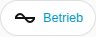

[en](../../../en-gb/user/cards/status-badge.md) | de | [nl](../../../nl/user/cards/status-badge.md) | [fr](../../../fr/user/cards/status-badge.md) | [zh](../../../zh-hans/user/cards/status-badge.md) | [es](../../../es/user/cards/status-badge.md) | [it](../../../it/user/cards/status-badge.md) | [pl](../../../pl/user/cards/status-badge.md) | [sv](../../../sv/user/cards/status-badge.md)

# Status-Badge

Die Seite Status-Badge erklärt das Status-Badge, das den Zustand eines Systems in der Badge-Zeile eines Dashboards zeigt. Die vollständige Liste steht im Abschnitt [Status-Badge](../../../../frontend/docs/features.md#status-badge) der Funktionsliste der Karten. [Ein Element hinzufügen](README.md#ein-element-hinzufügen) erklärt, wie du das Badge hinzufügst und ein System wählst.



## Was das Badge zeigt

- Den Betriebszustand, eingefärbt danach, wie gesund der Zustand ist, und die Anzahl der Ausstattungsteile mit einem aktiven Fehler. Das Badge zeigt die Zahl nur, wenn ein Fehler aktiv ist, daher zeigt der Screenshot den Zustand allein.
- Das Badge sagt Antwortet nicht, wenn das System nicht antwortet.
- Das Tippen auf das Badge öffnet die Details des Betriebszustands.

## Optionen

| Option im Editor | YAML-Schlüssel | Standard |
| --- | --- | --- |
| System | `device` | Das erste System |

```yaml
type: custom:saj-local-status-badge
device: 0123456789abcdef0123456789abcdef
```

Der Wert `device` ist die ID des Geräts in Home Assistant. Der visuelle Editor trägt den Wert für dich ein.

## Noch nicht unterstützt

- Andere Optionen als das System.
