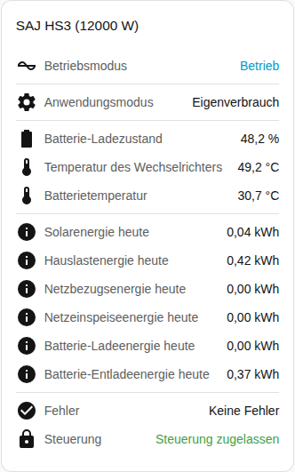

[en](../../../en-gb/user/cards/status-card.md) | de | [nl](../../../nl/user/cards/status-card.md) | [fr](../../../fr/user/cards/status-card.md) | [zh](../../../zh-hans/user/cards/status-card.md) | [es](../../../es/user/cards/status-card.md) | [it](../../../it/user/cards/status-card.md) | [pl](../../../pl/user/cards/status-card.md) | [sv](../../../sv/user/cards/status-card.md)

# Status-Karte

Die Seite Status-Karte erklärt die Status-Karte, die ein System an einer Stelle zusammenfasst. Die vollständige Liste steht im Abschnitt [Status-Karte](../../../../frontend/docs/features.md#status-card) der Funktionsliste der Karten. [Ein Element hinzufügen](README.md#ein-element-hinzufügen) erklärt, wie du die Karte hinzufügst und ein System wählst.

## Was die Karte zeigt

- Den Betriebszustand, eingefärbt danach, wie gesund der Zustand ist, und den Anwendungsmodus.
- Den Batterie-Ladezustand, die Temperaturen von Wechselrichter und Batterie und den netzunabhängigen Modus.
- Bei eingeschaltetem Energie von heute anzeigen, was der Standard ist, zeigt die Karte die heutige Energie aus Solar, Last, Netzbezug, Einspeisung, Batterieladung und Batterieentladung.
- Die Anzahl der Ausstattungsteile mit einem aktiven Fehler oder dass es keine Fehler gibt. Siehe [Gerätefehler](../faults-and-repairs.md#gerätefehler).
- Ob die Steuerung für das System zugelassen ist. Siehe [Steuerung zulassen](../changing-settings.md#steuerung-zulassen).

## Unterschiede zwischen den Modellen

- **Nur H2:** Wenn sich der Anwendungsmodus, den der Wechselrichter fährt, vom gewählten Modus unterscheidet, zeigt die Karte zusätzlich den Modus, der jetzt läuft. Die Zeile erscheint nur, wenn die Entität Anwendungsmodus (wirksam) aktiviert ist. Diese Entität wird deaktiviert erstellt. Siehe die [Entitätsreferenz](../entities/README.md).

## Optionen

| Option im Editor | YAML-Schlüssel | Standard |
| --- | --- | --- |
| System | `device` | Das erste System |
| Energie von heute anzeigen | `show_energy` | Ein |

## Noch nicht unterstützt

- Eine Einstellung von der Karte aus ändern. Die Status-Karte zeigt nur an. Verwende die [Steuerungs-Karte](controls-card.md), um Einstellungen zu ändern.
