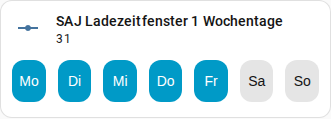

[en](../../../en-gb/user/cards/weekdays-feature.md) | de | [nl](../../../nl/user/cards/weekdays-feature.md) | [fr](../../../fr/user/cards/weekdays-feature.md) | [zh](../../../zh-hans/user/cards/weekdays-feature.md) | [es](../../../es/user/cards/weekdays-feature.md) | [it](../../../it/user/cards/weekdays-feature.md) | [pl](../../../pl/user/cards/weekdays-feature.md) | [sv](../../../sv/user/cards/weekdays-feature.md)

# Wochentage-Funktion für Kachel-Karten

Die Seite Wochentage-Funktion für Kachel-Karten erklärt die Wochentage-Funktion, die sieben Tagesschaltflächen auf eine Kachel-Karte setzt, um die Tage eines Zeitfensters festzulegen. Die vollständige Liste steht im Abschnitt [Wochentage-Funktion für Kachel-Karten](../../../../frontend/docs/features.md#weekdays-tile-card-feature) der Funktionsliste der Karten. Die Tage eines Zeitfensters sind die Wochentage-Entitäten der Zeitfenster für Laden, Entladen und Wallbox, aufgelistet in den Bereichen [Batterie](../entities/battery.md) und [Wallbox](../entities/ev-charger.md) der Entitätsreferenz.



## Die Funktion hinzufügen

1. Füge einem Dashboard eine Kachel-Karte hinzu und wähle die Wochentage-Entität eines Zeitfensters als Entität der Kachel-Karte.
2. Öffne die Funktionen der Kachel-Karte, wähle Funktion hinzufügen und wähle SAJ-Local-Wochentage.

Die Funktion wird nur für eine Kachel-Karte angeboten, deren Entität die Wochentage-Entität eines Zeitfensters ist. Die Funktion hat keine Optionen.

```yaml
type: tile
entity: number.saj_charge_slot_1_days
features:
  - type: custom:saj-local-weekdays-feature
```

Die Entitäts-ID im Beispiel hat kein Präfix. Wenn du ein [Präfix](../entities-and-prefix.md#das-präfix) festlegst, hat die ID der Entität das Präfix nach `saj_`.

## Wie die Schaltflächen funktionieren

- Sieben benannte Tagesschaltflächen beginnen mit deinem ersten Tag der Woche, der aus den Einstellungen von Home Assistant oder aus deiner Sprache kommt.
- SAJ Local sendet die Änderung 1,5 Sekunden nach dem letzten Drücken, sodass du mehrere Tage in einer Änderung wählen kannst.
- Der Wechselrichter speichert die Tage als eine Zahl, die sich nicht mit deinem ersten Tag der Woche verschiebt. Montag ist auf jedem Modell das niedrigste Bit und Sonntag das höchste, daher ist Montag bis Freitag 31, wie im Screenshot, und Montag, Mittwoch und Freitag ist 21.
- Die Schaltflächen sind deaktiviert, solange [Steuerung zulassen](../changing-settings.md#steuerung-zulassen) für das System aus ist.

Die [Zeitplan-Karte](schedule-card.md) verwendet die Schaltflächen im Zeitfenster-Editor.

## Noch nicht unterstützt

- Jede andere Entität als die Wochentage-Entität eines Zeitfensters. SAJ Local bietet die Funktion für andere Kachel-Karten nicht an.
