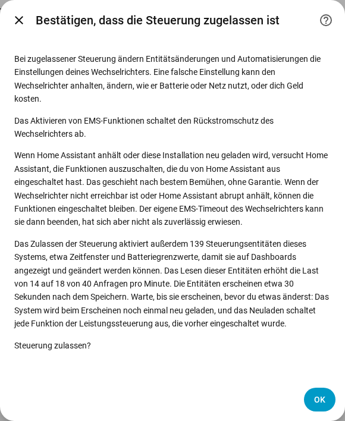

[en](../../en-gb/user/changing-settings.md) | de | [nl](../../nl/user/changing-settings.md) | [fr](../../fr/user/changing-settings.md) | [zh](../../zh-hans/user/changing-settings.md) | [es](../../es/user/changing-settings.md) | [it](../../it/user/changing-settings.md) | [pl](../../pl/user/changing-settings.md) | [sv](../../sv/user/changing-settings.md)

# Einstellungen ändern

Die Seite Einstellungen ändern erklärt, wie du SAJ Local erlaubst, die Einstellungen deines Wechselrichters zu ändern, was mit einer Änderung geschieht und welche Änderungen immer abgelehnt werden. Die vollständigen Listen stehen in den Abschnitten [Einstellungen ändern](../../../custom_components/saj_local/docs/features.md#changing-settings) und [EMS](../../../custom_components/saj_local/docs/features.md#ems) der Funktionsliste der Integration. Die Einstellungen und Befehle verteilen sich auf die Bereiche der [Entitätsreferenz](entities/README.md), vor allem [Einstellungen](entities/settings.md) und [Batterie](entities/battery.md).

Das Schreiben in den Wechselrichter ist aus, bis du die Steuerung für ein System zulässt. Solange Steuerung zulassen aus ist, zeigen Einstellungen den aktuellen Wert, lehnen aber jede Änderung ab, mit einer Meldung, die sagt, wo du die Steuerung einschaltest. Es wird nichts an den Wechselrichter gesendet.

## Steuerung zulassen

1. Öffne Konfigurieren, das Zahnrad in der Zeile des Systems auf der Seite der SAJ-Local-Integration. Du kannst Steuerung zulassen auch einschalten, während du das System hinzufügst.
2. Schalte Steuerung zulassen ein und wähle Absenden.
3. Lies die Bestätigung und wähle dann erneut Absenden.

Die Bestätigung warnt, dass eine falsche Einstellung den Wechselrichter anhalten, ändern kann, wie der Wechselrichter die Batterie oder das Netz nutzt, oder dich Geld kosten kann. Die Bestätigung sagt außerdem:

- Das Aktivieren von EMS-Funktionen schaltet den Rückstromschutz des Wechselrichters ab.
- Wenn Home Assistant anhält oder das System neu geladen wird, versucht SAJ Local, die Funktionen auszuschalten, die du von Home Assistant aus eingeschaltet hast. Das Ausschalten geschieht nach bestem Bemühen und ist keine Garantie.
- Das Zulassen der Steuerung aktiviert Steuerungsentitäten, und das Lesen der Entitäten erhöht die Anfragelast. Der Dialog zeigt die Anzahl der Entitäten und die Last davor und danach.

Nur HS3: Die Bestätigung bei der Einrichtung fragt außerdem nach dem EMS-Heartbeat. In Konfigurieren ist der Heartbeat ein Feld im Hauptformular. Siehe [EMS](#ems).

Das Ausschalten von Steuerung zulassen braucht keine Bestätigung. Jedes System hat einen Binärsensor Steuerung zugelassen in der Kategorie Diagnose, der an ist, solange das System Änderungen annimmt. Die [Dashboard-Karten](cards/README.md) lesen den Sensor und sperren die Bedienelemente, solange der Sensor aus ist. Der Sensor ist nur lesbar, weil ein Schalter auf einem Dashboard das Schreiben ohne die Warnung einschalten würde.

## Der Steuerungssatz

Die meisten Zeitfenster und viele Einstellungen werden deaktiviert erstellt, daher hätte eine Dashboard-Karte nichts anzuzeigen oder zu ändern. Das Einschalten von Steuerung zulassen aktiviert deshalb auch den Steuerungssatz des Systems:

- die Zeitfenster für Laden, Entladen und Wallbox (die Wallbox-Zeitfenster gibt es nur beim HS3);
- den Anwendungsmodus und die Einstellungen der Zeitsteuerung;
- die Batteriegrenzwerte und die Netzgrenzwerte;
- die Wallbox-Einstellungen (nur HS3);
- die Schalter und Ziele der Leistungssteuerung, siehe [Leistungssteuerung](power-control.md);
- den LED-Modus, den Summer (nur H2) und die Schaltflächen Uhr synchronisieren und Aktuellen Fehler quittieren.

Messwerte der Batteriepacks und andere nur lesbare Entitäten gehören nicht zum Satz.

- **Die Entitäten erscheinen nach etwa 30 Sekunden.** Home Assistant lädt ein System 30 Sekunden nach dem Aktivieren einer Entität des Systems neu. Warte, bis die Entitäten erscheinen, bevor du etwas änderst, denn das Neuladen schaltet jede Funktion der Leistungssteuerung aus, die du in der Zwischenzeit eingeschaltet hast. Ein weiteres Neuladen folgt, wenn später ein neues Mitglied des Satzes erscheint, etwa die Wallbox-Zeitfenster, nachdem eine Wallbox erkannt wurde.
- **Das Ausschalten von Steuerung zulassen** deaktiviert die Entitäten, die SAJ Local aktiviert hat, und es folgt kein Neuladen.
- **Deine Wahl gilt.** Eine Entität, die du vor dem Einschalten der Steuerung deaktiviert hast, bleibt deaktiviert, und eine Entität, die du selbst aktiviert hast, bleibt aktiviert. Eine Karte zählt ein Zeitfenster mit einer deaktivierten Entität als ausgelassen.

## Was mit einer Änderung geschieht

SAJ Local prüft eine Änderung, bevor SAJ Local etwas sendet. SAJ Local lehnt die Änderung ab, mit einer eigenen Meldung für jeden Fall, wenn:

- Steuerung zulassen aus ist;
- das Modell ungeprüft ist. Ein System mit einem Modell, das nicht geprüft werden konnte, wird nie beschrieben, siehe [Erste Schritte](getting-started.md#wenn-der-wechselrichter-nicht-erkannt-wird);
- die Einstellung eine Inbetriebnahme-Einstellung ist;
- der Wert ungültig ist;
- der Wechselrichter nicht erreichbar ist;
- das Schreiblimit erreicht ist. Höchstens 20 Änderungen gehen in beliebigen 60 Sekunden an eine Wechselrichter-Adresse, und eine Änderung über dem Limit wird abgelehnt und nicht in eine Warteschlange gestellt.

Jede Meldung sagt, dass der Wechselrichter nicht geändert wurde. Andernfalls schreibt SAJ Local die Änderung einmal und liest den Wert zurück, und die Entität zeigt den Wert, den der Wechselrichter hält.

| Was geschah | Was du siehst |
| --- | --- |
| Der Wechselrichter hat die Änderung abgelehnt | Die Meldung nennt den Ausnahmecode. |
| Der Wechselrichter hat nicht geantwortet | Die Meldung sagt, dass die Änderung angewendet worden sein kann oder nicht. SAJ Local sendet nichts erneut und liest den Wechselrichter nach dem Wiederverbinden erneut. |
| Der Wechselrichter hält einen anderen Wert | Die Entität zeigt den Wert, den der Wechselrichter hält, und die Änderung schlägt fehl. |

Eine Änderung an einer Einstellung eines Registers, das mehrere Einstellungen enthält, lässt die anderen Einstellungen des Registers unverändert.

## Was du ändern kannst

- Den Anwendungsmodus, sieben Ladezeitfenster und sieben Entladezeitfenster (jeweils mit Start, Ende, Leistung, Tagen und Ein oder Aus), den Leerlaufmodus der Zeitsteuerung und die Netz-Entladung, sowie die Notstrom-Reserve.
- Die Lade- und Entladegrenzen der Batterie, das automatische Aufwecken der Batterie, die Einspeisegrenze, die Grenzen für Netzbezugs- und Einspeiseleistung und die Leistungen des Passivmodus.
- Nur HS3: die Wallbox-Einstellungen und sieben Wallbox-Zeitfenster.
- Nur H2: den Summer und die Leistungsgrenze der erzwungenen Batterieladung. Beide Modelle haben den LED-Modus.
- Befehle als Schaltflächen, die deaktiviert erstellt werden: Aktuellen Fehler quittieren, Wechselrichter neu starten und Uhr synchronisieren, was die lokale Zeit von Home Assistant sendet. Nur HS3: EMS-Solarleistungsgrenze entfernen.

Die [Dashboard-Karten](cards/controls-card.md) bieten die gemeinsamen Einstellungen an einer Stelle. Die Steuerungs-Karte hat keine Neustart-Schaltfläche, damit ein Tippen auf einem Dashboard den Wechselrichter nicht neu starten kann.

## Inbetriebnahme-Einstellungen

Inbetriebnahme-Einstellungen werden angezeigt und können nicht von Home Assistant aus geändert werden: der Zähler, RS485, das Batterieprotokoll, das Netzwerk und die Verbindung zur Wallbox, und beim H2 außerdem die Netzart, der Parallelaufbau, die Eingangsmodi, die Schutzgrenzen und andere Installateureinstellungen. Ein falscher Wert kann den Wechselrichter vom Zähler, von der Batterie, von der Wallbox oder von Home Assistant trennen. Inbetriebnahme-Einstellungen sind nur lesbare Sensoren in der Kategorie Diagnose. Nimm solche Änderungen in der SAJ-App elekeeper vor, siehe die [Anforderung](../../../custom_components/saj_local/docs/requirements.md#changing-settings).

## Noch nicht unterstützt

- Werksreset und Löschen des Energieverlaufs. SAJ Local bietet beides nicht an.
- Inbetriebnahme-Einstellungen ändern.
- Einstellungen ändern bei einem System, dessen Modell ungeprüft ist.

## EMS

Nur HS3: EMS stellt den Wechselrichter unter externe Steuerung. Der H2 hat keine EMS-Entitäten. SAJ Local bietet den EMS-Timeout und fünf Grenzwerte als Entitäten an: den Lade- und Entladestrom der Batterie, die Import- und Exportleistung des Wechselrichters und die Solarleistung. Die Grenzwerte können gesetzt werden, und SAJ Local fragt die Grenzwerte nicht ab. Zwischen den Heartbeats zeigen die Grenzwerte den letzten Wert, den SAJ Local gesendet hat, und vor der ersten Änderung sind die Grenzwerte unbekannt. Die [Leistungssteuerung](power-control.md) schaltet die EMS-Funktionen ein und aus.

- **Der Heartbeat hält eine Funktion am Leben.** SAJ Local liest in jedem Heartbeat-Intervall das Ziel jeder EMS-Funktion, die du von Home Assistant aus eingeschaltet hast, und die Grenzwerte. Das Lesen zählt als EMS-Aktivität, daher schreibt der Heartbeat nichts.
- **Das Intervall beträgt standardmäßig 60 Sekunden.** Du kannst 30 bis 3600 Sekunden einstellen, in der Bestätigung von Steuerung zulassen bei der Einrichtung und in Konfigurieren.
- **Der Timeout muss länger sein als der Heartbeat.** Eine Funktion kann nicht eingeschaltet werden, solange der EMS-Timeout des Wechselrichters nicht länger ist als der Heartbeat, und der Timeout kann nicht so niedrig gesetzt werden.
- **Ausschalten beim Beenden.** Wenn SAJ Local entladen wird oder Home Assistant anhält, schaltet SAJ Local die EMS-Funktionen aus, die du eingeschaltet hast. Eine Funktion, die schon an war, als SAJ Local geladen wurde, bleibt unberührt.
- **Das Ausschalten geschieht nach bestem Bemühen.** Wenn der Wechselrichter nicht erreichbar ist oder Home Assistant abrupt anhält, bleiben die Funktionen an. Der EMS-Timeout des Wechselrichters kann die Funktionen beenden, aber SAJ Local verlässt sich nicht auf den Timeout, siehe [auf Hardware getestet](#auf-hardware-getestet).

## Auf Hardware getestet

Die Hinweise unten sagen, welche Einstellungen an einem echten Wechselrichter ausprobiert wurden und welche allein auf Feldberichten oder den SAJ-Protokolldokumenten beruhen.

HS3, Register für Register an einem echten HS3 geschrieben und zurückgelesen:

- Der Anwendungsmodus, Notstrom-Reserve Ladezustand, Passivmodus Batterie-Ladeleistung, der EMS-Timeout, die vier EMS-Aktivierungsbits, die die [Leistungssteuerung](power-control.md) schreibt, und die drei EMS-Ziele und fünf EMS-Grenzwerte.
- Beim HS3 legt Passivmodus Batterie-Ladeleistung die Leistung des Modus Notstrom fest.
- Der Anwendungsmodus EMS allein lässt den Wechselrichter im Leerlauf, mit dem Haus am Netz, und der Wechselrichter verlässt EMS nicht von selbst.
- Der EMS-Timeout beendete EMS nach 5 Sekunden, beendete EMS aber nicht bei 20 oder 60 Sekunden, während ein anderer Client den Wechselrichter abfragte. SAJ Local verlässt sich nicht auf den Timeout.
- Die Solarleistungsgrenze wirkt nur, solange eine EMS-Funktion an ist.
- Wenn eine EMS-Funktion endet, kehrt der Wechselrichter zum Anwendungsmodus zurück, in dem er vorher lief.
- Zeitsteuerung (BMS) ist der Modus, den der HS3 meldet, wenn die SAJ-App den TOU-(BMS)-Modus der App wählt, der nicht der Zeitsteuerungsmodus der App ist. SAJ Local hat Zeitsteuerung (BMS) nie in einen Wechselrichter geschrieben.

H2, aus Feldberichten von H2-Geräten und dem H2-Protokolldokument aufgebaut und von diesem Projekt nicht ausprobiert:

- Leistungssteuerung, die den Passivmodus, die Zeitfenster, den Anwendungsmodus, die Leistungen des Passivmodus, die Batteriegrenzen, die Netzleistungsgrenzen und die Einspeisegrenze nutzt.
- Spitzenlastkappung: Feldberichte zeigen, dass Spitzenlastkappung in der SAJ-App gewählt, über Modbus zurückgelesen und geschrieben wurde. Das H2-Protokolldokument führt Spitzenlastkappung nicht auf.
- KI-Sparmodus ist der Modus, den der H2 meldet, wenn die SAJ-App AI saving wählt. SAJ Local hat KI-Sparmodus nie in einen Wechselrichter geschrieben.

Nie an einem echten Wechselrichter ausprobiert:

- der LED-Modus, der Summer des H2 und die Leistungsgrenze der erzwungenen Batterieladung des H2;
- jede andere Einstellung, die in diesem Abschnitt nicht genannt ist;
- jede Änderung, die mehr als ein Register schreibt;
- jeder Befehl.
