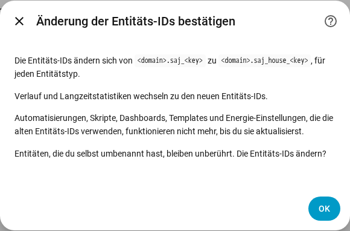

[en](../../en-gb/user/entities-and-prefix.md) | de | [nl](../../nl/user/entities-and-prefix.md) | [fr](../../fr/user/entities-and-prefix.md) | [zh](../../zh-hans/user/entities-and-prefix.md) | [es](../../es/user/entities-and-prefix.md) | [it](../../it/user/entities-and-prefix.md) | [pl](../../pl/user/entities-and-prefix.md) | [sv](../../sv/user/entities-and-prefix.md)

# Entitäten und das Präfix

Die Seite Entitäten und das Präfix erklärt, was die Entitäten eines Systems sind, wie die Entitäts-IDs gebildet werden und wie du den Entitäts-IDs ein Präfix hinzufügst. Die vollständigen Listen stehen in den Abschnitten [Geräte und Entitäten](../../../custom_components/saj_local/docs/features.md#devices-and-entities) und [Entitäts-IDs und Präfix](../../../custom_components/saj_local/docs/features.md#entity-ids-and-prefix) der Funktionsliste der Integration. Jeder Entitätsname, jede ID, jedes Modell und jeder Standardwert steht in der [Entitätsreferenz](entities/README.md).

## Die Entitäten eines Systems

Jeder Messwert, jede Einstellung und jeder Befehl, den SAJ Local für dein Modell kennt, ist eine Entität des Geräts des Systems. Jede Entität hat den Typ, den Home-Assistant-Benutzer für den Messwert oder die Einstellung erwarten: ein Sensor, ein Binärsensor, eine Zahl, eine Auswahl, ein Schalter, eine Zeit oder eine Schaltfläche. Eine Einstellung erscheint als der echte Steuerungstyp der Einstellung, daher ist ein Grenzwert eine Zahl und eine Ein-/Aus-Einstellung ein Schalter.

- **Nur ein Kernsatz ist aktiviert.** Messwerte für Leistung, Spannung, Temperatur und Ladezustand, die Energiezähler, die wichtigsten Batteriegrenzwerte und jeder Fehler sind aktiviert. Alles andere wird deaktiviert erstellt.
- **Eine deaktivierte Entität wird nicht gelesen.** Das Aktivieren einer Entität nimmt die Entität in den nächsten Lesevorgang auf. Das Deaktivieren einer Entität beendet das Lesen des Registers. [Abfrage](polling.md) zeigt, was eine Wahl den Wechselrichter kostet.
- **Ein System bekommt nur die Entitäten, die passen.** Ein H2 mit einem Solar-String hat keine Entitäten des zweiten Strings. Ausstattung, die nicht eingebaut ist, erstellt keine Entitäten, siehe [optionale Ausstattung](optional-equipment.md).
- **Einstellungen und Diagnose sind gruppiert.** Einstellungen stehen in der Kategorie Konfiguration. Versionen, Inbetriebnahme-Einstellungen und Netzwerkeinstellungen stehen in der Kategorie Diagnose.
- **Eine unbekannte Option erscheint als unbekannt.** Der Code der Option steht im [Diagnosedownload](troubleshooting.md#diagnose-herunterladen), sodass die Option gemeldet werden kann.

Wenn du das Modell für einen nicht erkannten Wechselrichter von Hand festlegst, bekommt das System jede Entität des gewählten Modells, wobei die Entitäten jenseits einer Phase und zweier Solar-Strings deaktiviert sind. Siehe [Erste Schritte](getting-started.md#wenn-der-wechselrichter-nicht-erkannt-wird).

## Vorzeichen der Leistung

Batterieleistung und Netzleistung verwenden auf jedem Modell dasselbe Vorzeichen, daher hat ein Messwert auf einem HS3 und auf einem H2 dieselbe Bedeutung.

- **Die Batterieleistung** ist positiv, solange die Batterie entlädt, und negativ, solange die Batterie lädt.
- **Die Netzleistung** ist positiv, solange das System einspeist, und negativ, solange das System Netzbezug hat. Zähler A folgt dem Netzvorzeichen.
- **Zähler B** ist positiv, solange der Solar-Wechselrichter, den Zähler B misst, erzeugt.

Beim HS3 ist die Netzleistung die Summe von Zähler A, und die Netz-Phasenleistung, die Scheinleistung, der Strom und der Leistungsfaktor kommen von der passenden Phase von Zähler A, weil die Netzregister des HS3 Werte des Wechselrichters enthalten. Ein HS3 ohne Zähler A hat diese Entitäten nicht. Die Leistung der Haushaltslast ist die Summe der drei netzgekoppelten Ausgangs-Phasenleistungen.

Die Ziele der [Leistungssteuerung](power-control.md) folgen den Vorzeichen der Messwerte.

## Berechnete Sensoren

Acht Sensoren werden aus den Messwerten des Systems selbst berechnet. Sie existieren bei jedem Modell.

- **Zeit bis Batterie voll** und **Zeit bis Batterie leer** sind Dauern in Minuten. Jeder Wert teilt die verbleibende Batterieenergie durch die Batterieleistung, die über die letzten 10 Minuten gemittelt ist. Eine kurze Änderung der Haushaltslast lässt den Wert deshalb nicht springen. Die Zeit bis voll hat nur einen Wert, solange die mittlere Leistung die Batterie lädt, und die Zeit bis leer nur, solange die mittlere Leistung die Batterie entlädt. Der Wert ist unbekannt bei einer mittleren Leistung von null und wenn das Ergebnis länger als 48 Stunden ist. Der Mittelwert beginnt nach einem Neuladen oder einem Neustart von vorn.
- **Gespeicherte Batterieenergie** und **Verfügbare Batterieenergie** haben die Einheit kWh. Die gespeicherte Energie ist der Ladezustand mal die Batterieenergie. Die verfügbare Energie ist die Energie über der Grenze für leer, und nie kleiner als 0.
- **Voll und leer.** Voll ist die Ladegrenze. Leer ist die Notstrom-Reserve im Notstrombetrieb und die Entladegrenze am Netz in den anderen Anwendungsmodi. Ohne Netz ist leer die Entladegrenze ohne Netz, bei einem Modell, das sie hat.
- **Batterieenergie.** Der H2 meldet eine nutzbare Kapazität, und SAJ Local multipliziert sie mit der Batteriespannung. Der HS3 meldet keine nutzbare Kapazität, deshalb lernt SAJ Local die Kapazität aus der Batterieleistung und der Änderung des Ladezustands. Beim HS3 bleiben die vier Sensoren für die Batterieenergie unbekannt, bis sich der Ladezustand zwischen zwei Abfragen geändert hat. Die gelernte Kapazität wird genauer, je mehr die Batterie lädt und entlädt. SAJ Local behält die gelernte Kapazität über Neustarts hinweg.
- **Autarkie heute** ist der Anteil der heutigen Lastenergie, der nicht aus dem Netz kam. **Eigenverbrauch heute** ist der Anteil der heutigen Solarenergie, der nicht eingespeist wurde. **Round-Trip-Wirkungsgrad der Batterie** ist die gesamte Entladeenergie der Batterie geteilt durch die gesamte Ladeenergie der Batterie. Jeder Wert ist ein Prozentsatz von 0 bis 100 und unbekannt, wenn der Teiler 0 ist.
- **Solarüberschussleistung** ist die Solarleistung minus die Haushaltslast in Watt. Der Wert ist negativ, wenn die Last größer als die Solarleistung ist.
- **Standard.** Die vier oben genannten Batterie-Sensoren sind standardmäßig aktiviert. Die anderen vier werden deaktiviert angelegt. Die Sensoren für Zeit, Energie und Round-Trip-Wirkungsgrad existieren nur bei einer eingebauten Batterie.
- **Lesevorgänge.** Das Aktivieren eines berechneten Sensors liest jeden Messwert, den der Sensor braucht, auch wenn die Entitäten dieser Messwerte deaktiviert sind. [Abfrage](polling.md) zählt diese Lesevorgänge zur Last.

## Das Präfix

Jede Entitäts-ID hat die Form `<type>.saj_<key>`, zum Beispiel `sensor.saj_pv_power`. Das Umbenennen des Anzeigenamens einer Entität ändert die ID nicht.

Ein Präfix fügt in jeder Entitäts-ID eines Systems ein Wort nach `saj_` ein, zum Beispiel `sensor.saj_house_pv_power`. Verwende ein Präfix, wenn du mehr als ein SAJ-System hast, damit keiner Entitäts-ID eine Zahl angehängt werden muss.

- Verwende nur Kleinbuchstaben und Ziffern, bis zu 32 Zeichen.
- Zwei Systeme können kein Präfix teilen, und nur ein System kann keines haben.
- Ein Präfix, das mit einem Entitätsnamen kollidieren würde, etwa `battery`, wird abgelehnt.
- Die Einrichtung wird abgelehnt, wenn eine Entitäts-ID, die das System erstellen würde, schon vergeben ist.

### Ein Präfix hinzufügen, ändern oder entfernen

1. Öffne Konfigurieren, das Zahnrad in der Zeile des Systems auf der Seite der SAJ-Local-Integration.
2. Ändere das Feld Präfix und wähle Absenden.
3. Lies die Bestätigung und wähle dann erneut Absenden.

Die Bestätigung zeigt das alte und das neue Muster. Automatisierungen, Skripte, Dashboards, Templates und Energie-Einstellungen, die die alten Entitäts-IDs verwenden, funktionieren nicht mehr, bis du die Verweise aktualisierst.

Nachdem du bestätigt hast:

- Benennt SAJ Local jede Entität des Systems um, aktiviert oder deaktiviert, und Home Assistant verschiebt den Verlauf und die Langzeitstatistiken zu den neuen IDs.
- Eine Entität, die du selbst umbenannt hast, bleibt unberührt.
- Die [Dashboard-Karten](cards/README.md) funktionieren weiter, weil die Karten Entitäten über die Entitätsregistrierung finden und nicht über die ID.

SAJ Local lehnt die Änderung ab und benennt nichts um, wenn eine neue ID schon vergeben ist oder wenn Home Assistant schon Langzeitstatistiken unter einer neuen ID hält, zum Beispiel von einem gelöschten System, das das Präfix hatte.

Wenn eine spätere Version eine Entität hinzufügt und die ID der Entität schon vergeben ist, fügt Home Assistant der ID eine Zahl an, und eine Warnung im Protokoll nennt die Art und den Schlüssel der Entität.

## Noch nicht unterstützt

- Den Schlüsselteil einer Entitäts-ID wählen. SAJ Local legt den Schlüssel fest, damit Dashboards und Automatisierungen auf jedem Modell gleich funktionieren.
