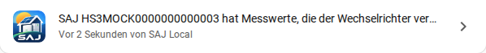

[en](../../en-gb/user/faults-and-repairs.md) | de | [nl](../../nl/user/faults-and-repairs.md) | [fr](../../fr/user/faults-and-repairs.md) | [zh](../../zh-hans/user/faults-and-repairs.md) | [es](../../es/user/faults-and-repairs.md) | [it](../../it/user/faults-and-repairs.md) | [pl](../../pl/user/faults-and-repairs.md) | [sv](../../sv/user/faults-and-repairs.md)

# Gerätefehler und Reparaturen

Die Seite Gerätefehler und Reparaturen erklärt, wie SAJ Local die Fehler zeigt, die der Wechselrichter, die Batterie und die Wallbox melden, und welche Reparaturmeldungen SAJ Local in Home Assistant auslöst. Die vollständige Liste des Fehlerverhaltens steht im Abschnitt [Gerätefehler und Reparaturen](../../../custom_components/saj_local/docs/features.md#device-faults-and-repairs) der Funktionsliste der Integration. Jede Fehler-Entität steht in den [Fehler-Entitäten](entities/faults.md) der Entitätsreferenz.

Gerätefehler und Reparaturmeldungen sind getrennt. Ein Gerätefehler ist eine Entität, die meldet, was die Ausstattung sagt. Eine Reparaturmeldung ist ein Problem mit der Verbindung von SAJ Local zur Ausstattung oder mit der Einrichtung von SAJ Local, und Home Assistant listet die Meldung unter Einstellungen und Reparaturen auf.

## Gerätefehler

Jeder benannte Fehler des Wechselrichters, der Batterie und der Wallbox ist ein Binärsensor mit der Geräteklasse Problem, standardmäßig aktiviert. Ein Fehler hat einen Verlauf und kann eine Automatisierung auslösen.

- **Sammelfehler:** Der Wechselrichter, die Batterie und die Wallbox haben je einen Sammelfehler, zum Beispiel Wechselrichterfehler, der an ist, wenn die Ausstattung irgendetwas meldet.
- **Nicht erkannt:** Jedes Ausstattungsteil hat außerdem einen Fehler Nicht erkannt, der an ist, wenn der Wechselrichter ein Bit ohne dokumentierte Bedeutung setzt. Der [Diagnosedownload](troubleshooting.md#diagnose-herunterladen) listet das Register und das Bit auf, sodass du das Bit melden kannst.
- **Eine Entitäts-ID auf jedem Modell:** Ein Fehler hat auf jedem Modell, das den Fehler meldet, dieselbe Entitäts-ID. Ein Fehler, den ein Modell nicht meldet, hat auf diesem Modell keine Entität.
- **Batteriepacks:** Jedes Batteriepack hat eine Fehler- und eine Warnungs-Entität. Ein HS3 hat ein Pack. Ein H2 hat bis zu vier.
- **Ausstattung, die nicht eingebaut ist:** Batteriefehler gibt es nur, wenn eine Batterie eingebaut ist, und Wallbox-Fehler nur, wenn eine Wallbox eingebaut ist. Siehe [optionale Ausstattung](optional-equipment.md).
- **Ein Fehlerregister, das nicht gelesen werden kann:** Die Fehler, die vom Register abhängen, sind nicht verfügbar. SAJ Local rät nicht.
- **Das Protokoll:** Ein Fehler, der angeht, schreibt eine Warnung ins Protokoll, die das System und den Fehler nennt. Wenn der Fehler verschwindet, schreibt SAJ Local eine Informationszeile.

Die [Fehler-Karte](cards/faults-card.md) listet die aktiven Fehler eines Systems in einem Dashboard auf, mit der Angabe, wie lange jeder zurückliegt. Die Schaltfläche Fehler quittieren der Karte sendet den Befehl Aktuellen Fehler quittieren, der [Steuerung zulassen](changing-settings.md#steuerung-zulassen) braucht.

## Reparaturmeldungen

SAJ Local löst eine Reparaturmeldung für einen Zustand aus, auf den du reagieren kannst.

| Reparaturmeldung | Ausgelöst, wenn | Was du tun kannst |
| --- | --- | --- |
| Das System ist auf das falsche Modell eingestellt | Der Wechselrichter an der Adresse meldet sich als ein anderes Modell als das gewählte. | Eine Behebung übernimmt das Modell, das SAJ Local gefunden hat. Siehe [Den Wechselrichter austauschen](replacing-the-inverter.md). |
| Das System erreicht jetzt einen anderen Wechselrichter | Der Wechselrichter an der Adresse hat eine andere Seriennummer. | Eine Behebung übernimmt den neuen Wechselrichter. Siehe [Den Wechselrichter austauschen](replacing-the-inverter.md). |
| Das System erreicht ein nicht erkanntes Gerät | Der Gerätetyp ist kein erkanntes Modell. | Wähle das Modell in Konfigurieren. SAJ Local verwendet das Modell dann ungeprüft. |
| Das System hat Messwerte, die der Wechselrichter verweigert | Der Wechselrichter hat die Messwerte dreimal hintereinander verweigert. | Eine Behebung deaktiviert die aufgelisteten Entitäten, sodass SAJ Local die Entitäten nicht mehr liest. Siehe [Den Wechselrichter schützen](protecting-the-inverter.md#wenn-der-wechselrichter-ein-lesen-verweigert). |
| Das System antwortet nicht mehr | Der Wechselrichter hat 15 Minuten lang nicht geantwortet. | Prüfe die Stromversorgung, das Netzwerk und andere Modbus-Clients. Die Meldung verschwindet beim ersten guten Messwert. |
| Ausstattung wird nicht mehr erkannt | Ausstattung, die SAJ Local früher erkannt hat, wird nicht mehr erkannt. | Prüfe die Ausstattung oder stelle die Ausstattung in Konfigurieren auf Nicht vorhanden. Siehe [optionale Ausstattung](optional-equipment.md#wenn-gemerkte-ausstattung-nicht-mehr-erkannt-wird). |

Die ersten drei Meldungen sind die Modellmeldungen. Von den Modellmeldungen ist für ein System immer nur eine offen, und die Meldung, dass das System nicht mehr antwortet, wird nicht ausgelöst, solange eine Modellmeldung offen ist.

Eine Reparaturmeldung verschwindet, wenn der Zustand der Meldung endet oder wenn du das System entfernst. Die Meldung über verweigerte Messwerte verschwindet auch, wenn du eine aufgelistete Entität deaktivierst.

## Noch nicht unterstützt

- Eine Reparaturmeldung für einen Gerätefehler. Gerätefehler sind Entitäten, und die Integration löst für einen Fehler keine Reparaturmeldung aus.
