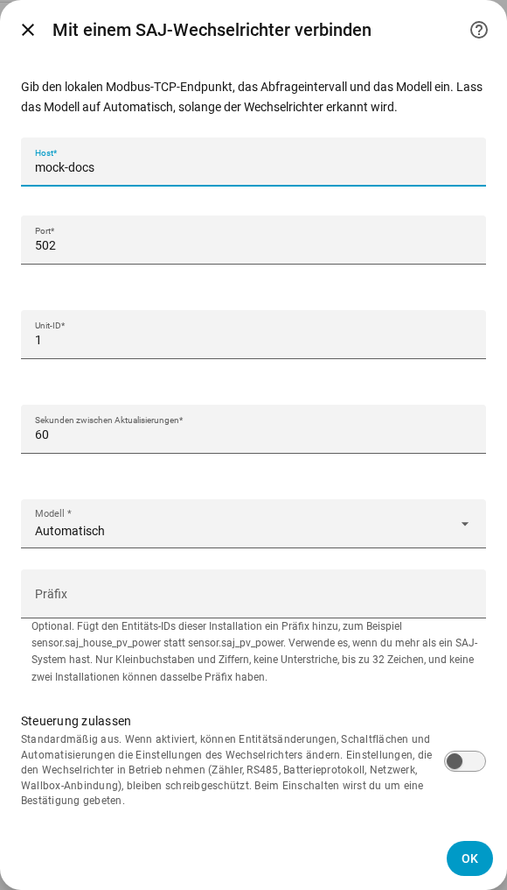
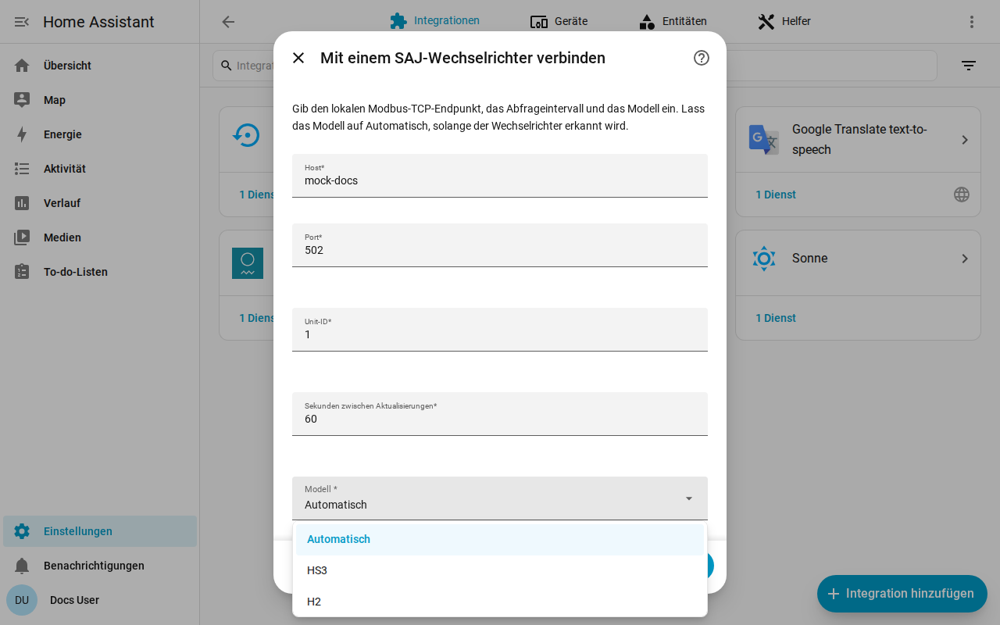

[en](../../en-gb/user/getting-started.md) | de | [nl](../../nl/user/getting-started.md) | [fr](../../fr/user/getting-started.md) | [zh](../../zh-hans/user/getting-started.md) | [es](../../es/user/getting-started.md) | [it](../../it/user/getting-started.md) | [pl](../../pl/user/getting-started.md) | [sv](../../sv/user/getting-started.md)

# Erste Schritte

Die Seite Erste Schritte fügt dein SAJ-System zu Home Assistant hinzu und sagt, was du danach bekommst. Die vollständige Liste dessen, was die Einrichtung leistet, steht im Abschnitt [Einrichtung und Erkennung](../../../custom_components/saj_local/docs/features.md#setup-and-detection) der Funktionsliste der Integration. [Installiere SAJ Local](installation.md) zuerst und prüfe, ob dein Wechselrichter zur [unterstützten Ausstattung](supported-equipment.md) gehört.

## Ein System hinzufügen

1. Öffne in Home Assistant Einstellungen, dann Geräte & Dienste.
2. Wähle Integration hinzufügen und suche nach SAJ Local.
3. Fülle das Formular aus und wähle Absenden.

| Feld | Was du einträgst |
| --- | --- |
| Host | Der Hostname oder die IP-Adresse des Wechselrichters. |
| Port | Der Modbus-TCP-Port. Der Standard ist 502. |
| Unit-ID | Die Modbus-Unit-ID, von 1 bis 247. Der Standard ist 1. |
| Sekunden zwischen Aktualisierungen | Wie oft jede aktivierte Entität gelesen wird. Der Standard ist 60 und der kleinste Wert 10. Siehe [Abfrage](polling.md). |
| Modell | Lass Automatisch stehen. SAJ Local erkennt den HS3 und den einphasigen H2 am Gerätetyp, den der Wechselrichter meldet. |
| Präfix | Optional. Lass das Feld für das erste System leer. Siehe [Entitäten und das Präfix](entities-and-prefix.md#das-präfix). |
| Steuerung zulassen | Standardmäßig aus, daher kann nichts eine Einstellung ändern. Siehe [Einstellungen ändern](changing-settings.md). |

SAJ Local verbindet sich mit dem Wechselrichter, liest die Identität des Wechselrichters und sechs Kernmesswerte (Betriebsmodus, Batterie-Ladezustand, Lastleistung, Solarleistung, Batterieleistung und Netzleistung) und erstellt das System. Ein Register, das ein Gerät nicht hat, stoppt die Einrichtung nicht. Das System heißt SAJ gefolgt von der Seriennummer des Wechselrichters.

Wenn die Einrichtung fehlschlägt, sagt das Formular, was schiefging: keine Verbindung, keine Antwort rechtzeitig, ein verweigertes Lesen, ungültige Daten, ein nicht erkanntes Gerät oder ein Modell, das nicht zum Wechselrichter passt. Nichts wird gespeichert, bis die Prüfung bestanden ist.

## Was du bekommst

- Ein Home-Assistant-Gerät namens SAJ. Das Modell des Geräts zeigt das Modell und die Nennleistung, zum Beispiel HS3 (12000 W).
- Die Entitäten, die zu deinem Modell und deiner Ausstattung passen. SAJ Local erkennt die Batterie, die Zähler und die übrige Ausstattung für dich, siehe [optionale Ausstattung](optional-equipment.md).
- Nur ein Kernsatz von Entitäten ist aktiviert. Alles andere wird deaktiviert erstellt, damit der Wechselrichter nicht für Werte gelesen wird, die du nicht angefordert hast. Aktiviere eine Entität in Home Assistant, und der nächste Lesevorgang schließt die Entität ein. Siehe [Entitäten und das Präfix](entities-and-prefix.md).
- Die [Dashboard-Karten](cards/README.md), ohne dass etwas zu installieren ist.

## Ein zweites System hinzufügen

Füge SAJ Local unter Geräte & Dienste erneut hinzu. SAJ Local lehnt einen Endpunkt oder eine Wechselrichter-Seriennummer ab, die schon eingerichtet ist. Gib jedem System ein eigenes [Präfix](entities-and-prefix.md#das-präfix), damit keiner Entitäts-ID eine Zahl angehängt werden muss.

## Wenn der Wechselrichter nicht erkannt wird

Wenn der Wechselrichter einen Gerätetyp meldet, den SAJ Local nicht erkennt, schlägt Automatisch mit einem Fehler fehl, der dich bittet, das Modell von Hand zu wählen. Wähle HS3 oder H2 im Feld Modell.

- Eine Wahl, die einem erkannten Wechselrichter widerspricht, wird abgelehnt. Wähle das Modell, das der Fehler nennt, oder Automatisch.
- Bei einem nicht erkannten Wechselrichter liest SAJ Local die benötigten Register und bittet dich, das Modell zu bestätigen. Die Register müssen zuerst antworten.
- Das Gerät zeigt das Modell danach als ungeprüft. Messwerte können falsch sein, weil SAJ Local die Messwerte nicht am Gerätetyp prüfen kann, und jeder Versuch, eine Einstellung zu ändern, wird abgelehnt.

## Ein System später ändern

Öffne Konfigurieren, das Zahnrad in der Zeile des Systems auf der Seite der SAJ-Local-Integration. Du kannst Host, Port, Unit-ID, Aktualisierungsintervall, Modell, Präfix und Steuerung zulassen ändern und jedes Ausstattungsteil einstellen. SAJ Local speichert die Änderung erst, nachdem der Wechselrichter am neuen Endpunkt geantwortet hat. [Den Wechselrichter austauschen](replacing-the-inverter.md) behandelt einen neuen Wechselrichter.

## Noch nicht unterstützt

- Produkte außer dem HS3 und dem einphasigen H2. Siehe [unterstützte Ausstattung](supported-equipment.md).
- Den Wechselrichter im Netzwerk finden. Du gibst die Adresse des Wechselrichters ein.
