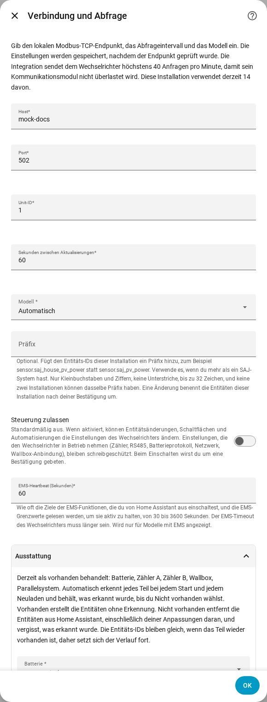

[en](../../en-gb/user/optional-equipment.md) | de | [nl](../../nl/user/optional-equipment.md) | [fr](../../fr/user/optional-equipment.md) | [zh](../../zh-hans/user/optional-equipment.md) | [es](../../es/user/optional-equipment.md) | [it](../../it/user/optional-equipment.md) | [pl](../../pl/user/optional-equipment.md) | [sv](../../sv/user/optional-equipment.md)

# Optionale Ausstattung

Die Seite Optionale Ausstattung erklärt, wie SAJ Local herausfindet, welche optionale Ausstattung dein Wechselrichter hat, und wie du das Ergebnis überschreibst. Die vollständige Liste steht im Abschnitt [Optionale Ausstattung](../../../custom_components/saj_local/docs/features.md#optional-equipment) der Funktionsliste der Integration. Die Seite [Unterstützte Ausstattung](supported-equipment.md) sagt, welches Modell was haben kann, und die [Entitätsreferenz](entities/README.md) sagt, welche Entitäten jedes Ausstattungsteil hinzufügt.

## Was SAJ Local erkennt

Die Einrichtung fragt nichts zur Ausstattung. Jedes Mal, wenn SAJ Local geladen wird, also bei jedem Start von Home Assistant und jedem Neuladen, fragt SAJ Local den Wechselrichter, was eingebaut ist, und erstellt nur für diese Ausstattung Entitäten.

| Ausstattung | Modelle |
| --- | --- |
| Batterie | HS3 und H2 |
| Zähler A, der Netzzähler | HS3 und H2 |
| Zähler B, der zweite Zähler | HS3 und H2 |
| Parallelsystem | HS3 und H2 |
| Wallbox | Nur HS3 |

- **Der Wechselrichter beantwortet die Prüfung nicht:** SAJ Local nimmt eine Batterie und Zähler A an und nimmt die übrige Ausstattung nicht an.
- **Ein Zähler ist während eines Neustarts offline:** Erkannte Ausstattung wird gemerkt, daher behält die Ausstattung ihre Entitäten.
- **Später eingebaute Ausstattung:** SAJ Local nimmt die Ausstattung beim nächsten Neustart oder Neuladen auf.

## Wenn gemerkte Ausstattung nicht mehr erkannt wird

SAJ Local behält die Entitäten der Ausstattung, sodass Verlauf und Dashboards unverändert bleiben, und löst in Home Assistant eine Reparaturmeldung aus. Die Meldung nennt die Ausstattung und das System. Prüfe die Ausstattung oder stelle die Ausstattung wie unten beschrieben auf Nicht vorhanden. Die Meldung verschwindet beim nächsten Laden, das die Ausstattung wieder erkennt, oder wenn du die Einstellung änderst.

## Die Erkennung überschreiben

1. Öffne Konfigurieren, das Zahnrad in der Zeile des Systems auf der Seite der SAJ-Local-Integration.
2. Klappe den Abschnitt Ausstattung auf.
3. Stelle jedes Ausstattungsteil auf Automatisch, Vorhanden oder Nicht vorhanden und wähle dann Absenden.

Der Abschnitt listet außerdem auf, was SAJ Local jetzt als vorhanden behandelt.

| Einstellung | Was die Einstellung tut |
| --- | --- |
| Automatisch | Erkennt die Ausstattung bei jedem Start und jedem Neuladen und behält, was erkannt wurde, bis du Nicht vorhanden wählst. Automatisch ist der Standard. |
| Vorhanden | Erstellt die Entitäten der Ausstattung, ohne die Ausstattung zu erkennen. |
| Nicht vorhanden | Entfernt die Entitäten der Ausstattung aus Home Assistant, einschließlich aller Änderungen, die du an den Entitäten vorgenommen hast, etwa eines neuen Namens. SAJ Local vergisst, was erkannt wurde. |

Entitäts-IDs bleiben unverändert, daher setzt sich der Verlauf fort, wenn du die Ausstattung wieder auf Vorhanden oder Automatisch stellst. Entitäten von Ausstattung, die nicht vorhanden ist, können nicht gelesen, abgefragt oder beschrieben werden.

Der Abschnitt listet nur die Ausstattung auf, die dein Modell haben kann. Nur HS3: die Wallbox.

## Batteriepacks

- **H2:** Ein H2 meldet, wie viele Batteriepacks der H2 hat, bis zu fünf. SAJ Local erstellt die Pack-Entitäten für so viele Packs. Eine Anzahl von 0 behält die Entitäten jedes Packs. SAJ Local merkt sich die höchste Anzahl, die SAJ Local gesehen hat. Jedes Pack hat Identitätsentitäten, die deaktiviert erstellt werden.
- **HS3:** Ein HS3 hat Entitäten für ein Batteriepack.

## Wallbox

Nur HS3: Ein HS3 mit einer Wallbox bekommt außerdem die Messwerte, Einstellungen, Ladezeitfenster und EMS-Ladesteuerungen der Wallbox. Die meisten werden deaktiviert erstellt. Das Einschalten von Steuerung zulassen aktiviert die Einstellungen und Zeitfenster, siehe [Einstellungen ändern](changing-settings.md#der-steuerungssatz).

## Noch nicht unterstützt

- Ausstattung, die SAJ Local nicht erkennt. Die Ausstattung in der Tabelle ist die vollständige Liste.
- Eine Wallbox an einem H2 erkennen.
