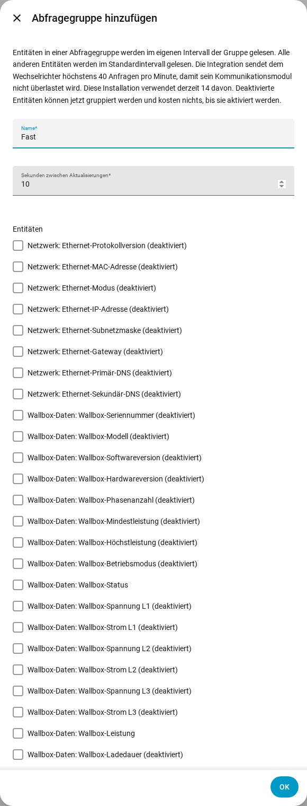

[en](../../en-gb/user/polling.md) | de | [nl](../../nl/user/polling.md) | [fr](../../fr/user/polling.md) | [zh](../../zh-hans/user/polling.md) | [es](../../es/user/polling.md) | [it](../../it/user/polling.md) | [pl](../../pl/user/polling.md) | [sv](../../sv/user/polling.md)

# Abfrage

Die Seite Abfrage erklärt, wie oft SAJ Local den Wechselrichter liest und wie du einige Entitäten schneller oder langsamer liest. Die vollständige Liste steht im Abschnitt [Abfrage](../../../custom_components/saj_local/docs/features.md#polling) der Funktionsliste der Integration. Die Grenzen, die für jede Anfrage gelten, stehen unter [Den Wechselrichter schützen](protecting-the-inverter.md).

SAJ Local liest den Wechselrichter über Modbus TCP in deinem lokalen Netzwerk, nach einem Zeitplan, den du steuerst. Nichts verlässt dein Netzwerk.

## Das Standardintervall

Jede aktivierte Entität wird standardmäßig alle 60 Sekunden gelesen. Ändere das Feld Sekunden zwischen Aktualisierungen in Konfigurieren, dem Zahnrad in der Zeile des Systems auf der Seite der SAJ-Local-Integration. Das Intervall ist nie kürzer als 10 Sekunden.

Nur aktivierte Entitäten werden gelesen. Deaktiviere eine Entität in Home Assistant, und das Register der Entität wird nicht mehr gelesen.

## Abfragegruppen

Eine Abfragegruppe liest gewählte Entitäten schneller oder langsamer als der Standard. Verwende eine Gruppe zum Beispiel, um die Last-, Solar-, Batterie- und Netzleistung alle 10 Sekunden zu lesen, während alles andere bei 60 bleibt.

1. Öffne das Menü in der Zeile des Systems auf der Seite der SAJ-Local-Integration und wähle Abfragegruppe hinzufügen. Die Schaltfläche Abfragegruppe hinzufügen oben auf der Seite öffnet das Formular Abfragegruppe hinzufügen ebenfalls.
2. Gib einen Namen, die Sekunden zwischen Aktualisierungen (mindestens 10) und die Entitäten der Gruppe ein.
3. Wähle Absenden, lies die Prüfung und wähle dann Gruppe speichern.

- **Jede Entität:** Eine Gruppe kann Entitäten jedes Typs enthalten. Auch eine deaktivierte Entität kann gewählt werden und kostet nichts, bis du die Entität aktivierst.
- **Höchstens eine Gruppe:** Eine Entität gehört zu höchstens einer Gruppe. Jede Entität in keiner Gruppe bleibt beim Standardintervall.
- **Registerreihenfolge:** Das Formular listet die Entitäten in Registerreihenfolge auf, jeweils mit dem Block von Registern beschriftet, aus dem die Entität gelesen wird, sodass Entitäten, die sich eine Anfrage teilen können, beieinander stehen.
- **Bearbeiten oder löschen:** Öffne die Abfragegruppe auf der Integrationsseite. Das Ändern oder Löschen einer Gruppe lässt die Entitäten, die Namen der Entitäten und den Verlauf der Entitäten bestehen.

Alle Intervalle eines Systems teilen sich einen Takt, daher werden Entitäten, die zusammen fällig sind, zusammen gelesen. Ein Lesevorgang, der überläuft, wird nicht nachgeholt. Die verpassten Takte werden verworfen, und die Abfrage läuft ab dem nächsten Takt weiter.

## Die Anfragelast

SAJ Local sendet einem Wechselrichter höchstens 40 Anfragen in beliebigen 60 Sekunden. Das Formular zeigt, was deine Wahl kostet, als Anfragen pro Minute gegenüber diesem Limit. Das Formular oben zeigt als Beispiel eine aktuelle Last von 14 Anfragen pro Minute.

- **Bevor du eine Gruppe speicherst:** Der Prüfschritt zeigt, wie viele Anfragen ein Lesen der Gruppe braucht, und die Last vor und nach dem Speichern.
- **Über dem Limit:** Du kannst die Gruppe trotzdem speichern. Die Prüfung warnt, dass das Lesen langsamer läuft, als du eingestellt hast, weil SAJ Local nie mehr als das Limit sendet.
- **Ein neues Standardintervall:** Konfigurieren bittet dich um Bestätigung, wenn das neue Intervall die Last über das Limit bringt.
- **Weniger Anfragen:** Entitäten, die zusammen in einem Block von Registern liegen, kosten eine Anfrage. Entitäten in verschiedenen Blöcken kosten je eine Anfrage.

Das Aktivieren einer Entität in Home Assistant kann von einem Formular nicht abgefangen werden. Der [Diagnosedownload](troubleshooting.md#diagnose-herunterladen) listet für diesen Fall die geplante Last gegenüber dem Limit auf.

## Noch nicht unterstützt

- Eine Abfragegruppe mit einem Intervall unter 10 Sekunden.
