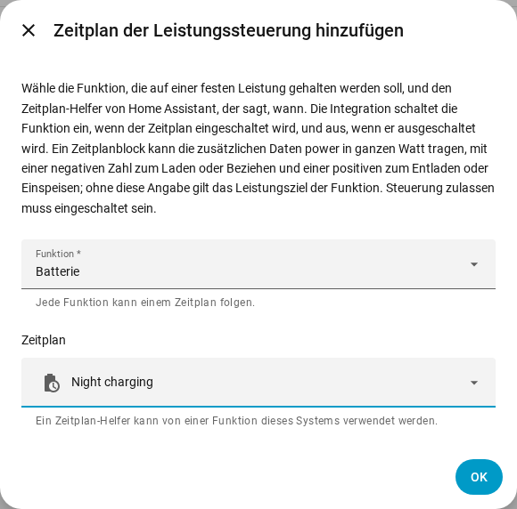

[en](../../en-gb/user/power-control.md) | de | [nl](../../nl/user/power-control.md) | [fr](../../fr/user/power-control.md) | [zh](../../zh-hans/user/power-control.md) | [es](../../es/user/power-control.md) | [it](../../it/user/power-control.md) | [pl](../../pl/user/power-control.md) | [sv](../../sv/user/power-control.md)

# Leistungssteuerung

Die Seite Leistungssteuerung erklärt, wie du die Batterie, den Netzanschlusspunkt oder den Wechselrichter auf einer festen Leistung hältst, von Hand oder mit einem Zeitplan von Home Assistant. Die vollständige Liste steht im Abschnitt [Leistungssteuerung](../../../custom_components/saj_local/docs/features.md#power-control) der Funktionsliste der Integration. Die Schalter und Ziele stehen in den [von der Integration hinzugefügten Entitäten](entities/added-by-the-integration.md) der Entitätsreferenz.

Die Leistungssteuerung funktioniert auf jedem Modell, das eine Funktion anbietet, auf dieselbe Weise. Die Leistungssteuerung tut nichts, solange [Steuerung zulassen](changing-settings.md#steuerung-zulassen) aus ist oder das Modell ungeprüft ist.

| Funktion | Was die Funktion auf der festen Leistung hält | HS3 | H2 |
| --- | --- | --- | --- |
| Batterie | Die Batterie lädt oder entlädt. | Ja | Ja |
| Netz | Der Netzanschlusspunkt bezieht oder speist ein. Braucht Zähler A. | Ja | Nein |
| Wechselrichter | Der Wechselrichter nimmt Leistung auf oder gibt Leistung ab. | Ja | Nein |

Eine positive Leistung entlädt, speist ein oder gibt ab. Eine negative Leistung lädt, bezieht oder nimmt auf. Die Vorzeichen folgen dem [Vorzeichen der Leistung](entities-and-prefix.md#vorzeichen-der-leistung) der Messwerte.

## Eine Funktion auf einer Leistung halten

Jede Funktion hat einen Schalter und ein Leistungsziel in ganzen Watt. Beide werden deaktiviert erstellt und stehen in der Kategorie Konfiguration. Das Einschalten von Steuerung zulassen aktiviert die Schalter und die Ziele, siehe [den Steuerungssatz](changing-settings.md#der-steuerungssatz).

1. Lege das Leistungsziel der Funktion fest. Das Ziel wird auf den nächsten Schritt gerundet, den der Wechselrichter unterstützt, und zeigt die Leistung, die der Wechselrichter hält.
2. Schalte die Funktion ein. Eine Funktion braucht ein Leistungsziel, bevor sie eingeschaltet werden kann.
3. Zum Beenden schaltest du die Funktion aus.

- Das Ziel bleibt über Neustarts erhalten und wird gesendet, wenn die Funktion startet. Das Ändern des Ziels, während die Funktion läuft, sendet die neue Leistung sofort.
- Es läuft immer nur eine Funktion. Das Einschalten einer Funktion, während eine andere läuft, wird abgelehnt, und die Meldung nennt die laufende Funktion.
- Der Schalter ist an, solange der Wechselrichter meldet, dass die Funktion läuft, auch wenn die Funktion außerhalb von Home Assistant gestartet wurde.
- Ein Start, der fehlschlägt, wird rückgängig gemacht. Ein Stopp, der fehlschlägt, wird in jedem Heartbeat-Intervall erneut gesendet, bis der Wechselrichter meldet, dass die Funktion gestoppt ist.
- Die [Steuerungs-Karte](cards/controls-card.md) im Dashboard zeigt jede Funktion mit einem Schalter, einem Ziel und einem Hinweis zum Vorzeichen.

### Wenn Home Assistant anhält

Eine Funktion, die du von Home Assistant aus eingeschaltet hast, wird ausgeschaltet, wenn SAJ Local entladen wird und wenn Home Assistant anhält. Eine Funktion, die schon lief, als SAJ Local geladen wurde, läuft weiter.

- Nur HS3: Der EMS-Heartbeat hält die Funktion am Leben. Nach einem abrupten Anhalten kann der EMS-Timeout des Wechselrichters die Funktion beenden, aber SAJ Local verlässt sich nicht auf den Timeout. Siehe [EMS](changing-settings.md#ems).
- Nur H2: Eine Funktion, die nach einem abrupten Anhalten weiterläuft, läuft weiter, bis du die Funktion ausschaltest.

## Einem Zeitplan folgen

Ein Zeitplan der Leistungssteuerung lässt eine Funktion einem Zeitplan-Helfer von Home Assistant folgen. Die Funktion ist an, solange der Zeitplan an ist, und aus, wenn der Zeitplan ausgeht.

1. Erstelle einen Zeitplan-Helfer in Home Assistant: Einstellungen, Geräte & Dienste, Helfer, Helfer erstellen, Zeitplan. Lege die Zeiten und die Wochentage des Zeitplans fest.
2. Öffne das Menü in der Zeile des Systems auf der Seite der SAJ-Local-Integration und wähle Zeitplan der Leistungssteuerung hinzufügen.
3. Wähle die Funktion und den Zeitplan-Helfer und wähle dann Absenden.

Ein Block des Zeitplan-Helfers kann die Zusatzdaten `power` tragen, in ganzen Watt mit dem Vorzeichen von oben, zum Beispiel `power: -600`, um die Batterie mit 600 W zu laden. Ohne `power` verwendet SAJ Local das Leistungsziel der Funktion.

- Jede Funktion folgt einem Zeitplan, und ein Zeitplan-Helfer steuert eine Funktion eines Systems.
- Der Zeitplan folgt einer Umbenennung des Helfers. Ein Helfer, der nicht in der Entitätsregistrierung steht, wird abgelehnt, wähle also einen Helfer, den du in der Oberfläche erstellt hast.
- SAJ Local lehnt einen Zeitplan ab, solange Steuerung zulassen aus ist.
- Ändere oder entferne einen Zeitplan auf der Integrationsseite. Das System wird dabei neu geladen.

### Was ein Zeitplan tut

| Situation | Was geschieht |
| --- | --- |
| Der Zeitplan geht an und keine Funktion läuft | SAJ Local setzt die Leistung aus dem Block oder verwendet das Leistungsziel und startet dann die Funktion. |
| Der Block hat kein `power` und die Funktion hat kein Leistungsziel | Nichts startet. Die Aktion bleibt offen, mit einer Warnung. |
| Die Funktion läuft schon | SAJ Local ändert die Leistung, wenn der Block eine hat, und übernimmt die Funktion. |
| Eine andere Funktion läuft | Nichts wird geschrieben. Die Aktion bleibt offen. |
| Der Start wird abgelehnt oder schlägt fehl | Die Aktion bleibt offen. SAJ Local versucht es in jedem Heartbeat-Intervall erneut. |
| Das `power` des Blocks ist keine ganze Zahl im Bereich des Ziels | Nichts startet. Die Aktion bleibt offen, mit einer Warnung. |
| Der Zeitplan wechselt zu einem Block mit einem anderen `power` | SAJ Local ändert die Leistung. |
| Du schaltest die Funktion von Hand aus, während der Zeitplan an ist | Die Funktion bleibt aus, bis der Zeitplan das nächste Mal angeht. |
| Der Zeitplan geht aus und SAJ Local hat die Funktion gestartet | SAJ Local stoppt die Funktion. |

Wenn nichts gewünscht ist und nichts offen ist, sendet SAJ Local nichts. Der [Diagnosedownload](troubleshooting.md#diagnose-herunterladen) listet jede Funktion, jeden Zeitplan und die Aktion auf, die offen ist.

## Noch nicht unterstützt

- Leistungssteuerung für Netz und Wechselrichter beim H2.
- Mehr als eine Funktion gleichzeitig.
- Mehr als ein Zeitplan für eine Funktion.
