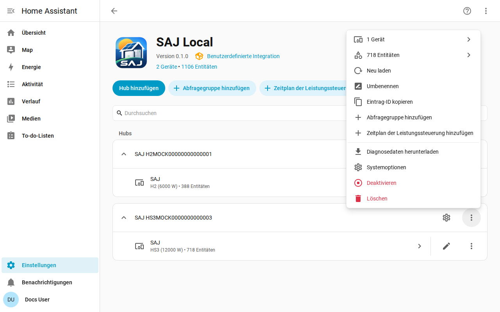

[en](../../en-gb/user/troubleshooting.md) | de | [nl](../../nl/user/troubleshooting.md) | [fr](../../fr/user/troubleshooting.md) | [zh](../../zh-hans/user/troubleshooting.md) | [es](../../es/user/troubleshooting.md) | [it](../../it/user/troubleshooting.md) | [pl](../../pl/user/troubleshooting.md) | [sv](../../sv/user/troubleshooting.md)

# Fehlerbehebung

Die Seite Fehlerbehebung zeigt, wie du die Diagnose herunterlädst, die Debug-Protokollierung einschaltest und die häufigen Probleme liest. Die vollständige Liste steht im Abschnitt [Diagnose und Debug-Protokollierung](../../../custom_components/saj_local/docs/features.md#diagnostics-and-debug-logging) der Funktionsliste der Integration.

Der Diagnosedownload und das Debug-Protokoll zeigen, was der Wechselrichter zurückgibt und was SAJ Local mit den Messwerten gemacht hat, ohne zu verraten, wer oder wo du bist. Beide nutzen die Werkzeuge von Home Assistant, daher muss nichts installiert werden und nichts wird irgendwohin gesendet.

## Mit den Entitäten und den Reparaturen beginnen

- Prüfe [Einstellungen und Reparaturen](faults-and-repairs.md#reparaturmeldungen) auf eine Reparaturmeldung des Systems. Jede Meldung sagt, was nicht stimmt und was zu tun ist.
- Prüfe die [Gerätefehler](faults-and-repairs.md#gerätefehler), wenn der Wechselrichter ein Problem meldet.
- Entitäten, die nach einer Verweigerung nicht verfügbar anzeigen, sind unter [Den Wechselrichter schützen](protecting-the-inverter.md#wenn-der-wechselrichter-ein-lesen-verweigert) beschrieben.

## Diagnose herunterladen

1. Öffne Einstellungen, dann Geräte & Dienste, dann SAJ Local.
2. Öffne das Menü in der Zeile des Systems und wähle Diagnose herunterladen.

Die Datei enthält:

- die aktivierten Entitäten, die Intervalle mit den Anfragen, die jedes braucht, und die geplante Last gegenüber dem Limit von 40 Anfragen pro Minute;
- verweigerte und ausgesetzte Entitäten;
- die aktiven Fehler mit den rohen Wörtern der Fehler und die nicht erkannten Fehlerbits als Register und Bit;
- die offenen Reparaturmeldungen und wie lange der Wechselrichter schon ausfällt;
- die Funktionen der Leistungssteuerung, welche läuft, welche SAJ Local besitzt und die Aktion, die für jeden Zeitplan offen ist;
- einen Schnappschuss der rohen Wörter jedes Registers, das SAJ Local seit dem Laden des Systems gelesen hat, mit dem Alter jedes Wortes, damit ein Maintainer einen Messwert am echten Gerät prüfen kann;
- jede Anfrage, die keine brauchbare Antwort bekam, mit dem Grund. Eine Anfrage mit Zeitüberschreitung sieht anders aus als eine Anfrage, die der Wechselrichter verweigert hat, und der Unterschied zählt, wenn ein anderer Client die Verbindung des Wechselrichters hält. Jede verweigerte Entität, jede fehlgeschlagene Anfrage und jede Zeile des Debug-Logs nennt die Modbus-Funktion der Anfrage.

Der Schnappschuss fügt keine Anfrage an den Wechselrichter hinzu. Der Schnappschuss beginnt jedes Mal leer, wenn das System geladen wird.

## Debug-Protokollierung einschalten

1. Öffne die Seite der SAJ-Local-Integration.
2. Öffne das Drei-Punkte-Menü der Integrationsseite und wähle Debug-Protokollierung aktivieren.
3. Wenn die Einrichtung des Systems fehlgeschlagen ist, lade das System im Menü des Systems neu, damit das Protokoll die Einrichtung abdeckt.
4. Stelle das Problem nach.
5. Wähle Debug-Protokollierung deaktivieren. Home Assistant lädt das Protokoll herunter.

Die Debug-Protokollierung zeichnet jede Verbindung, Abfrage, Anfrage, jeden Schreibvorgang, Heartbeat und jede Zeitplanänderung auf, eine Zeile pro Ereignis. Jede Protokollzeile beginnt mit dem Titel des Systems und der Seriennummer, maskiert auf die letzten drei Zeichen, damit sich Zeilen zweier Systeme unterscheiden lassen. Ein Titel, der die Seriennummer enthält, hat die Seriennummer an Ort und Stelle maskiert, zum Beispiel `SAJ xxxxx123`.

## Was die Datei und das Protokoll auslassen

Diagnose und Protokolle enthalten nie Host, Port, Unit-ID, vollständige Seriennummer, MAC-Adresse, Netzwerkadressen, Seriennummer der Wallbox, Präfix oder Namen von Abfragegruppen. Im Register-Schnappschuss werden die Wörter der Register, die die Netzwerkadressen und die Seriennummern enthalten, durch die Schwärzungsmarkierung von Home Assistant ersetzt, sodass du siehst, dass das Register geantwortet hat, ohne zu sehen, was das Register gesagt hat.

## Häufige Probleme

| Was du siehst | Was du prüfst |
| --- | --- |
| Die Einrichtung schlägt fehl, ohne Verbindung oder ohne Antwort | Host, Port und Unit-ID. Stelle sicher, dass kein anderer Modbus-Client die Verbindung des Wechselrichters hält. |
| Die Einrichtung sagt, das Gerät wird nicht erkannt | Wähle das Modell von Hand. Siehe [Erste Schritte](getting-started.md#wenn-der-wechselrichter-nicht-erkannt-wird). |
| Eine Einstellung lehnt eine Änderung ab | Steuerung zulassen ist aus, das Modell ist ungeprüft oder die Einstellung ist eine Inbetriebnahme-Einstellung. Die Meldung sagt, welcher Fall vorliegt. Siehe [Einstellungen ändern](changing-settings.md). |
| Das Lesen läuft langsamer als das eingestellte Intervall | Die Last liegt über dem Limit von 40 Anfragen pro Minute. Siehe [Abfrage](polling.md#die-anfragelast). |
| Eine Entität, die du aktiviert hast, hat noch keinen Wert | Home Assistant lädt das System etwa 30 Sekunden nach dem Aktivieren einer Entität neu, und die Entität wird ab dem nächsten Lesen gelesen. |
| Entitäts-IDs haben eine Zahl bekommen | Die ID, die die Entität wollte, war vergeben. Siehe [Entitäten und das Präfix](entities-and-prefix.md#das-präfix). |
| Entitäten fehlen | Die Ausstattung wird nicht erkannt oder ist auf Nicht vorhanden gestellt. Siehe [optionale Ausstattung](optional-equipment.md). |

## Hilfe und Feedback

Fragen, Fehlerberichte und Ideen sind im [Issue-Tracker](https://github.com/Counterphase-Labs/ha-saj-local/issues) willkommen. Öffne das Formular Bug report für ein Problem mit der Integration und das Formular Card bug report für ein Problem mit einer Dashboard-Karte. Das Formular Bug report verlangt den Diagnosedownload. Melde ein Sicherheitsproblem privat, siehe die [Sicherheitsrichtlinie](../../../SECURITY.md).
