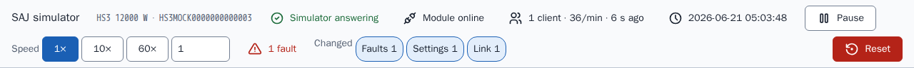
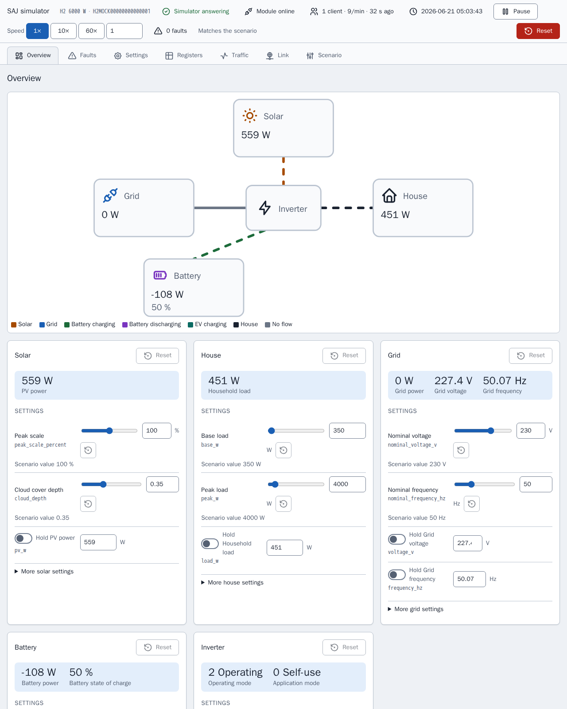
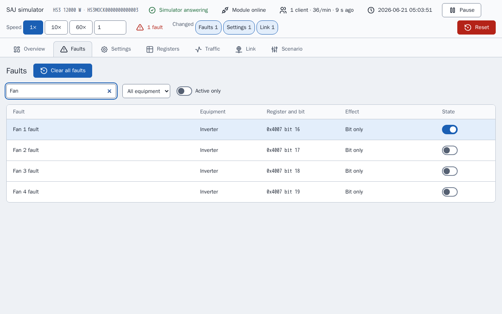
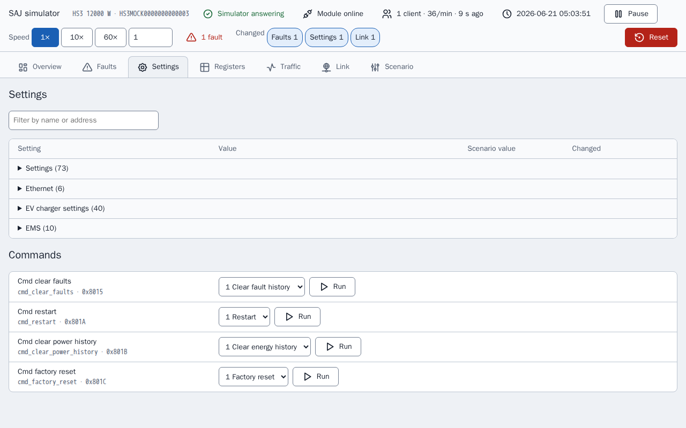
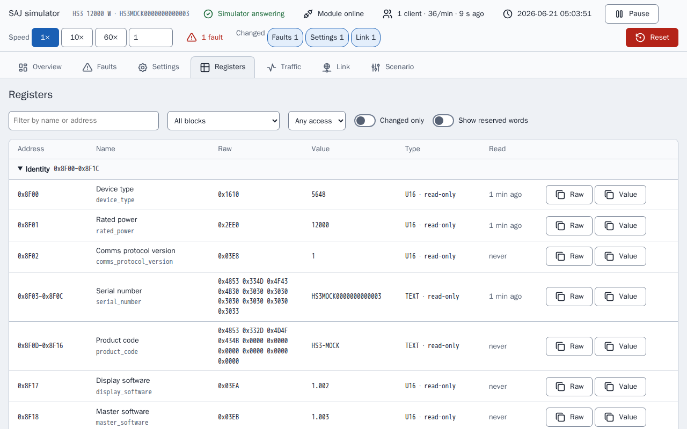
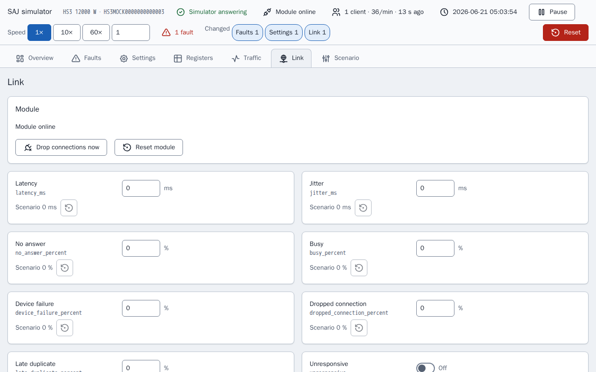
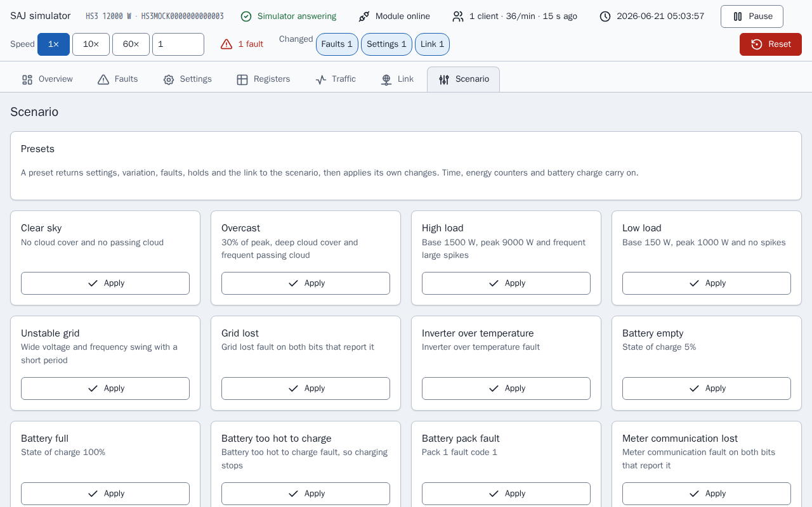
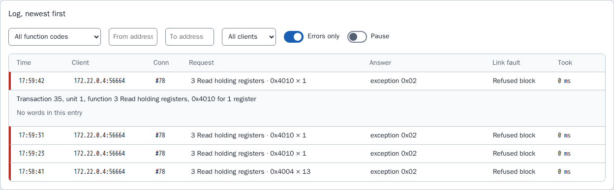

# Simulator page

The control page of a simulator: views, register inspector, traffic log, link faults, fault effects, presets and saved state.

The full list of what the page covers is in the feature list sections [Control page](../../../mock/docs/features.md#control-page), [State and presets](../../../mock/docs/features.md#state-and-presets), [Register inspector and traffic log](../../../mock/docs/features.md#register-inspector-and-traffic-log), [Link faults](../../../mock/docs/features.md#link-faults).

Each simulator serves a web page at `http://localhost:<panel port>/`: `5080` for the HS3 and `5081` for the H2 started by `make up` (`SAJ_MOCK_PANEL_HOST_PORT` and `SAJ_MOCK_H2_PANEL_HOST_PORT` change them). Inside the container it listens on `server.panel_port`, 8080 by default. There is no authentication: the simulator is a development tool.

The page exists so a developer can see what the simulated system is doing and put the system in a situation without editing a scenario and restarting. The page builds every control from the description of the device, so the page lists only the equipment that is fitted.
The page polls the state every 3 seconds, so a change made from Home Assistant shows up, and the Registers and Traffic views also refresh every second while the views are open. A control that has focus is not overwritten. Two clients can change things at once: the last write wins, as on a real device. Every change shows a short confirmation and every refusal its reason.

A status bar on every view answers whether the simulator is running as its scenario or has been changed: whether the module is online, the connected clients and their request rate, the simulated time, run and pause, the speed, the active faults and one chip for each kind of change from the scenario that is in force. The same summary (`changes` in the state) marks the changed rows and cards. Pause sets the speed to 0 and play restores the earlier speed, so pausing does not lose the speed.



The current view is in the URL fragment (`#registers`), so a reload keeps it. Nothing is stored in the browser. The screenshots of the views below are taken after one fault, "Fan 1 fault", has been set and after the simulator has refused one register, so each view shows a change from the scenario.

The page derives readable names from field names and rounds each scaled value to its scale's decimals, so a raw 65535 at scale 0.0001 reads 6.5535 instead of showing floating-point noise.

## Views

### Overview

A power-flow diagram of the fitted equipment, coloured and animated by direction, above one card per piece of equipment. A card holds the live reading, the controls that set the reading and the faults of the equipment, with a reset to the scenario for that card.


The H2 page has fewer cards than the HS3 page above, because the H2 scenario fits less equipment.



A card keeps what a control sets apart from the reading the control produces, because the two differ whenever a hold, a fault or the state of charge is in play: a peak scale of 100% does not mean 100% of the PV power. The reset of a card returns the variation, holds and fault bits of the card, and leaves the state of charge, the car, the clock and the energy counters alone, for the same reason presets do. A card with an active fault is marked, as in the card below.


### Faults

Every fault bit of the fitted equipment, searchable, with what the simulator does when the bit is set. Bits the document does not name are listed as reserved, so the integration's unrecognised-fault path can be tried.

The image shows the search "Fan", with the four fan faults and the switch of the set fault, "Fan 1 fault", on.



### Settings

The writable settings and commands, with names for the raw values and the scenario value of each.



### Registers

The register inspector, described below.



### Traffic

The traffic log, described below.


### Link

The link faults and the module state, described below.



### Scenario

Presets, the simulated time, the energy counters, reset and export.



## Register inspector

`GET /api/registers` lists every block of the device and, for each field of a block that answers, the raw words, the decoded value with its label, the access (read-only, writable or command) and when a client last read the field. The Registers view shows the list as a table with a filter, a "changed only" switch and a highlight on a value that has just changed, so the effect of a fault or a write on the registers is visible without a Modbus client.

The inspector only shows. The inspector reads the device without the observer of the device, so looking at a register is not a client read: the look does not count as a keep-alive, does not touch the field a read would touch and is not recorded in the traffic. A register is written only through the controls that go through the same validation as a Modbus write.

## Traffic log

The Modbus server reports every connection event and every request, with its answer, to a recorder (`traffic.py`). `GET /api/traffic?after=<sequence>` returns the entries after a sequence number, so the page asks only for what is new, together with the counters and a 30 minute history in 10 second buckets; `POST /api/traffic/reset` clears them. The Traffic view shows the live request rate, a graph of requests over time, the counters per client and the log, which can be filtered and opened for the words read or written. The image shows the log with only the errors listed and one refused request opened: a refused request has no words, so the entry says so and names the link fault that refused the request.



Counters count requests and registers, because that is how field reports describe module load, and both are shown because whether request size matters too is not known. The recorder keeps the last 2000 entries in memory and does not save them: the log describes what happened to the current run of the simulator, and a restart is a new run.

## Link faults

The Link view and the `link` section of a scenario set how the simulated module misbehaves. Each setting reproduces a failure that field reports describe of SAJ communication modules, and none is set unless a scenario or the page sets it.

| Key | Effect |
| --- | --- |
| `latency_ms`, `jitter_ms` | Each answer waits the latency plus or minus up to the jitter, 0 to 60000 ms |
| `no_answer_percent` | The request is read and never answered, and the connection stays open |
| `busy_percent`, `device_failure_percent` | The answer is exception `0x06` or `0x04` |
| `dropped_connection_percent` | The module closes the connection instead of answering |
| `late_duplicate_percent` | After an exception answer, the same frame is sent again just before the next answer on that connection |
| `refused_blocks` | A list of `start`, `end` and `code` (0 to 255). A request that touches the block is answered with that code, so devices that send non-standard codes, including 0, can be served |
| `unresponsive` | Connections are accepted and nothing is ever answered |
| `offline` | The module stops listening and closes every connection |
| `offline_seconds`, `offline_period_seconds` | Offline for the first `offline_seconds` of every period, which must be at least as long |
| `lockout_requests`, `lockout_window_seconds`, `lockout_whole_port` | A client that sends more than `lockout_requests` requests within the window has its connection closed and its address refused, or every client when `lockout_whole_port` is set, until the module is reset. A window is required when a threshold is set |

```yaml
link:
  latency_ms: 800
  jitter_ms: 400
  busy_percent: 10
  refused_blocks:
    - {start: 0x4000, end: 0x40FF, code: 0}
```

Percentages are 0 to 100. A wrong value, or a combination that cannot work, stops the simulator at start and names the key, such as `link.offline_seconds`.

The decisions are made in `link.py` and carried out by the transport, which asks the link before it accepts a connection and before it answers. The first check that applies decides, in this order: offline, unresponsive, lockout, dropped connection, no answer, refused block, device failure, busy. Latency applies to every answer that is sent. Whether a chance applies is drawn from the simulation seed and the request's sequence number, so the same seed and the same requests give the same failures, and a failure found while debugging can be reproduced. Latency, the offline period and the lockout window run on wall time, not simulated time, because the settings describe the link as the client sees the link and the clock speed must not change them.

Link settings and a lockout are kept across restarts and exported with the scenario. A lockout is cleared only by "Reset module", by Reset or by a preset, because field reports describe a lockout that lasted until the module was given a new address, and "Reset module" stands for the new address. "Drop connections now" closes every open connection once. The routes are `POST /api/link`, `/api/link/drop` and `/api/link/reset`.

The traffic recorder shows which fault was applied to each request, so the effect of a setting on the client can be read off the log.

## Fault effects

Some faults do more than set their bit, where a real system would. A fault that names a grid, PV, DC bus, battery port, temperature, relay, sensor or insulation condition stops the inverter, grid lost runs the inverter off-grid, meter communication lost silences Meter A, some battery faults stop charging or discharging, any pack fault code other than 0 stops both, and an EV charger fault stops the charger. Every other fault, and every reserved bit, only sets the bit. The tables are in `mock/saj_local_mock/profiles/fault_tables.py` and the effects are applied by `simulation/faults.py`.

## Presets, saved state and export

**Presets** return the settings, variation, seed, faults and holds to the scenario first, then apply their changes, so each gives the same conditions however the simulator was left. The simulated time, the clock speed, the energy counters and the battery state of charge carry on unless the preset sets the values, so Home Assistant does not see the clock jump back or the lifetime totals fall. **Reset** is the one that rewinds everything. Equipment that is not fitted has no presets, and neither does a model whose tables do not name the fault. A preset also returns the link to the scenario, then sets its own link changes, and a lockout is cleared. The link presets are offered on every model: Slow link, Flaky link, Busy module, Module offline and Module locked out. No field report gives the load at which a module locks out, so the threshold of Module locked out is a starting point to change on the page, and is not taken from any limit of the integration.

**Saved state.** Changes are kept across restarts in `/data/state.json`, in a bind-mounted folder per service in [compose.yaml](../../../compose.yaml): `mock/state/hs3/` and `mock/state/h2/`, reset by deleting the folder contents. Link settings and a lockout are saved with the state. A state saved for a different scenario is ignored, and logged once, because applying it to another system would be wrong. A state that cannot be read is ignored the same way and the file is kept. Only the settings a client can write are saved, so a change to a fixed register in the code is never masked by an old file, and the energy counters are saved with where each day, month and year started, so a restart is not a counter reset. Without a mounted folder the simulator logs one line that changes will not be kept and runs on. **Reset** deletes the file and returns to the scenario. The Playwright stack mounts no folder, so each run starts from the scenario.

**Export** downloads the running seed, variation, faults, link and clock as a scenario, so a tuned state can be committed and run again in a fresh simulator with the same variation.

## Icons

The icons of the page are vendored from the Tabler icon set under `mock/static/vendor/tabler/`, because the simulator must be standalone and load nothing from outside. Only the icons the page uses are kept, as the original SVG files, so the set can be checked against the source. The folder also holds the `LICENSE` of the set and a `README.md` naming the release of the icons. The page inlines the icons so the icons take the text colour; an icon font or an emoji is not used. Any set under the MIT or ISC licence may be vendored this way, with its licence beside it.
