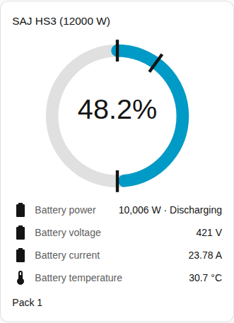
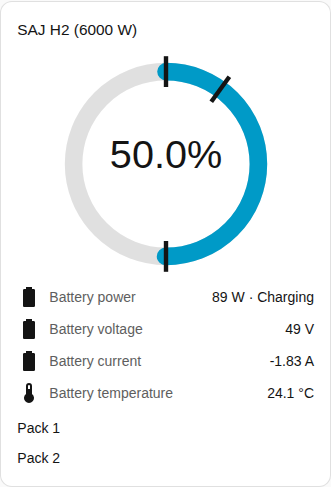

# Battery card

The Battery card page explains the battery card, which shows the charge, the power and the readings of the battery. The full list is in the [Battery card](../../../../frontend/docs/features.md#battery-card) section of the cards feature list. [Add an element](README.md#add-an-element) explains how to add the card and choose a system.

## What the card shows

- A ring shows the state of charge. Marks on the ring show the backup reserve, the charge limit and the on-grid discharge limit.
- The battery power shows with whether the battery is charging or discharging, and below the power the voltage, the current, the temperature and the usable capacity. The directions follow the [sign of power](../entities-and-prefix.md#sign-of-power).
- With Show battery packs on, which is the default, each pack gets a row group with the state of charge, health, voltage, current, temperature, cycles, fault and warning. A pack reading appears only when the entity of the reading is enabled. Most pack readings are created disabled, which is why the screenshot shows only the name of the pack. Enable the entities you want in Home Assistant. The [battery pack entities](../entities/battery-packs.md) are in the entity reference.
- A system with no battery says so.

## Differences between the models

- **HS3:** one pack.
- **H2:** one row group for each pack that the inverter reports, up to five. The screenshot shows an H2 with two packs. See [optional equipment](../optional-equipment.md#battery-packs).

The [faults card](faults-card.md) lists the active fault and warning of each pack. The fault and warning entities are enabled by default.

## Options

| Option in the editor | YAML key | Default |
| --- | --- | --- |
| System | `device` | The first system |
| Show battery packs | `show_packs` | On |

## Not supported yet

- Changing a battery setting from the card. The battery card shows readings only. Use the [controls card](controls-card.md) for the battery limits.
