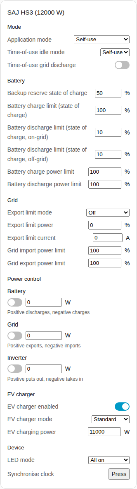
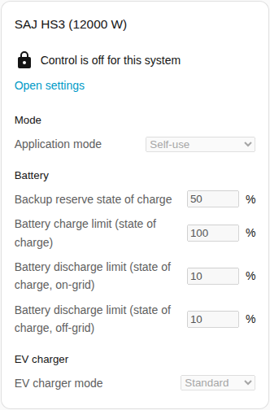
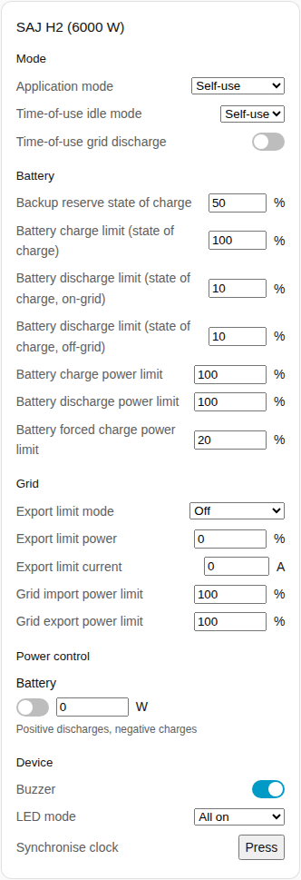

# Controls card

The Controls card page explains the controls card, which gathers the settings of a system into sections so you can change the settings from a dashboard. The full list is in the [Controls card](../../../../frontend/docs/features.md#controls-card) section of the cards feature list. [Add an element](README.md#add-an-element) explains how to add the card and choose a system. The settings behind the controls are described in [changing settings](../changing-settings.md).

## What the card shows

- The sections are Mode, Battery, Grid, Power control, EV charger and Device. A section with nothing to show is left out.
- **Mode:** the application mode and the time-of-use settings.
- **Battery:** the backup reserve and the charge and discharge limits.
- **Grid:** the export limit settings and the grid power limits.
- **Power control:** each [power control](../power-control.md) function that the system has, with a switch, a power target and a hint on what a positive and a negative power do.
- **EV charger:** the switch, the mode and the charge power of the charger.
- **Device:** the buzzer, the LED mode and the clock synchronisation.
- Each setting uses the control that fits the setting: a slider or a number field, a list, a switch, a time field or a button.
- A control changes the inverter once per decision, then shows the value that the inverter holds. A refused change appears under the control.
- The card has no Restart inverter button, so a tap on a dashboard cannot restart the inverter. Restart stays an entity.

## When control is not allowed

While [Allow control](../changing-settings.md#allow-control) is off for the system, every control is disabled. A lock above the controls links to the settings of the integration, where you switch Allow control on.

## Differences between the models

- **HS3 only:** the EV charger section, and the Grid and Inverter power control functions.
- **H2 only:** the buzzer and the battery forced charge power limit. The H2 has the Battery power control function only.

## Options

| Option in the editor | YAML key | Default |
| --- | --- | --- |
| System | `device` | The first system |
| Sections | `sections`, a list of `mode`, `battery`, `grid`, `power_control`, `ev_charger` and `device` | All sections |

## Not supported yet

- A Restart inverter button. Restart stays an entity.
- Power control schedules. Set the schedules up on the integration page, see [power control](../power-control.md#follow-a-schedule).
