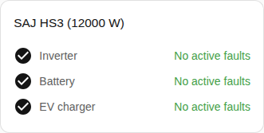

en | [de](../../../de/user/cards/faults-card.md) | [nl](../../../nl/user/cards/faults-card.md) | [fr](../../../fr/user/cards/faults-card.md) | [zh](../../../zh-hans/user/cards/faults-card.md) | [es](../../../es/user/cards/faults-card.md) | [it](../../../it/user/cards/faults-card.md) | [pl](../../../pl/user/cards/faults-card.md) | [sv](../../../sv/user/cards/faults-card.md)

# Faults card

The Faults card page explains the faults card, which lists the active faults of each piece of equipment. The full list is in the [Faults card](../../../../frontend/docs/features.md#faults-card) section of the cards feature list. [Add an element](README.md#add-an-element) explains how to add the card and choose a system. The faults come from the [device fault entities](../faults-and-repairs.md#device-faults).

## What the card shows

- Faults are grouped by inverter, battery and EV charger, and each active fault shows how long ago the fault began. The faults and warnings of the battery packs are in the battery group.
- An unrecognised fault says to look in the [diagnostics download](../troubleshooting.md#download-diagnostics) for the register and the bit.
- A Clear fault button sits under the active faults of the inverter. The button sends the Clear current fault command. While control is not allowed for the system, the button is disabled and a lock links to the settings of the integration. See [Allow control](../changing-settings.md#allow-control).
- With Show groups without faults on, which is the default, a group with no active fault shows as clear, as in the screenshot. With the option off, the card shows only the groups with an active fault.

A system without a battery or an EV charger has no faults to show for the missing equipment, so the card does not draw the group of the equipment.

## Options

| Option in the editor | YAML key | Default |
| --- | --- | --- |
| System | `device` | The first system |
| Show groups without faults | `show_groups_without_faults` | On |

## Not supported yet

- Clearing the faults of the battery or the EV charger from the card. The Clear fault button sits under the active faults of the inverter only.
