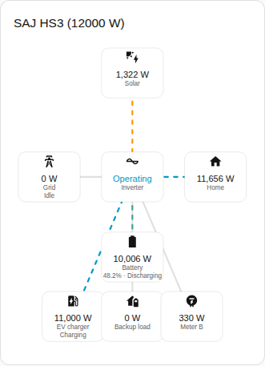
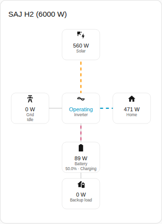

# Power flow card

The Power flow card page explains the power flow card, which draws live power between solar, battery, grid, home and the optional equipment. The full list is in the [Power flow card](../../../../frontend/docs/features.md#power-flow-card) section of the cards feature list. [Add an element](README.md#add-an-element) explains how to add the card and choose a system.



## What the card shows

- Solar, battery, grid and home are drawn around the inverter, which shows the operating state.
- Each line shows the direction of the flow and moves faster as the power grows. A power of 10 W or less is drawn as idle.
- The battery shows the state of charge and whether the battery is charging or discharging. The grid shows whether the system is importing or exporting. The directions follow the [sign of power](../entities-and-prefix.md#sign-of-power).
- With Show optional equipment on, which is the default, the card also draws the backup load, Meter B and the EV charger when the system has the equipment. Meter B is a reading with no direction.
- With Show solar strings on, the power of each solar string is listed. The option is off by default.
- Scope chooses between the readings of the system, which is the default, and the readings of the parallel system. A system without parallel readings shows the empty state with the parallel scope.

## Differences between the models

- **HS3 only:** the EV charger, as in the screenshot above.
- **H2:** the card draws the parts of the HS3 card, except the EV charger. The screenshot below shows an H2 that is charging the battery.



## Options

| Option in the editor | YAML key | Default |
| --- | --- | --- |
| System | `device` | The first system |
| Show solar strings | `show_strings` | Off |
| Show optional equipment | `show_optional_equipment` | On |
| Scope | `scope` (`system` or `parallel`) | `system` |

```yaml
type: custom:saj-local-power-flow-card
device: 0123456789abcdef0123456789abcdef
show_strings: false
show_optional_equipment: true
scope: system
```

The `device` value is the ID of the device in Home Assistant. The visual editor fills the value in for you. The names of the entities behind each part are in the [entity reference](../entities/README.md).

## Not supported yet

- A direction for Meter B. The card draws Meter B as a reading with no direction.
