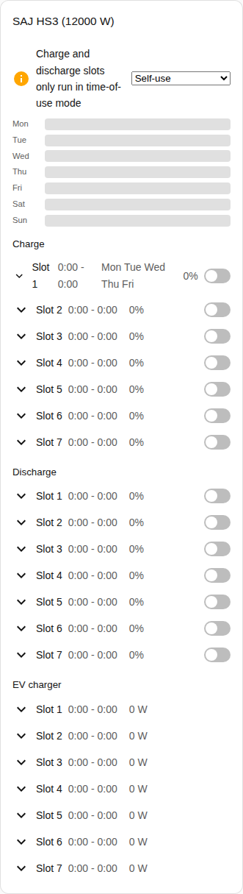
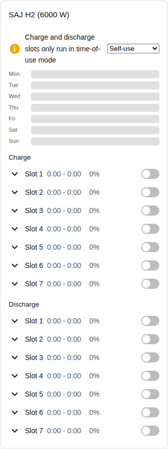

en | [de](../../../de/user/cards/schedule-card.md) | [nl](../../../nl/user/cards/schedule-card.md) | [fr](../../../fr/user/cards/schedule-card.md) | [zh](../../../zh-hans/user/cards/schedule-card.md) | [es](../../../es/user/cards/schedule-card.md) | [it](../../../it/user/cards/schedule-card.md) | [pl](../../../pl/user/cards/schedule-card.md) | [sv](../../../sv/user/cards/schedule-card.md)

# Schedule card

The Schedule card page explains the schedule card, which shows and edits the charge, discharge and EV charger slots. The full list is in the [Schedule card](../../../../frontend/docs/features.md#schedule-card) section of the cards feature list. [Add an element](README.md#add-an-element) explains how to add the card and choose a system.

## What the card shows

- The charge, discharge and EV charger slots, each with the times, the power, the days and whether the slot is on. The Slot kinds option chooses which kinds the card shows.
- With Show week timeline on, which is the default, a week timeline draws every slot as a bar. Tap a bar to open the slot.
- An open slot has an editor for the start, the end, power, days and the other settings of the slot.
- A slot appears only when every entity of the slot is enabled, and the card counts the slots that the card leaves out. Switching on [Allow control](../changing-settings.md#the-control-set) enables the entities of the slots.
- Charge and discharge slots run only in a time-of-use application mode. When the application mode is another mode, a notice says so and shows the mode list beside the notice. Time-of-use and Time-of-use (BMS) both count.
- While control is not allowed for the system, every control on the card is disabled and a lock links to the settings of the integration. See [Allow control](../changing-settings.md#allow-control).

## Differences between the models

- **HS3 only:** the EV charger slots.
- **H2:** charge and discharge slots only, as the screenshot below shows.

The day buttons of a slot are the buttons of the [weekdays tile card feature](weekdays-feature.md).

## Options

| Option in the editor | YAML key | Default |
| --- | --- | --- |
| System | `device` | The first system |
| Slot kinds | `slot_kinds`, a list of `charge`, `discharge` and `ev_charger` | All kinds |
| Show week timeline | `show_timeline` | On |

## Not supported yet

- Power control schedules. A power control schedule follows a Home Assistant schedule helper, see [power control](../power-control.md#follow-a-schedule).
