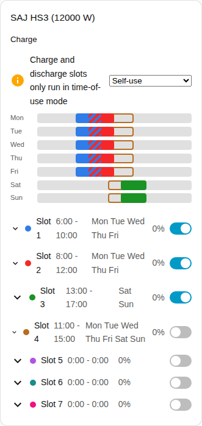
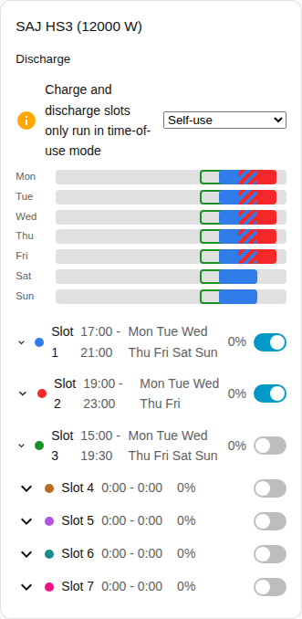
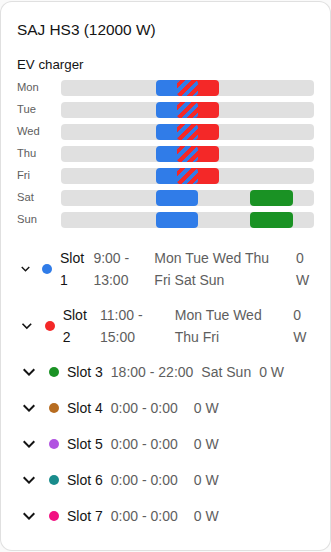

en | [de](../../../de/user/cards/schedule-cards.md) | [nl](../../../nl/user/cards/schedule-cards.md) | [fr](../../../fr/user/cards/schedule-cards.md) | [zh](../../../zh-hans/user/cards/schedule-cards.md) | [es](../../../es/user/cards/schedule-cards.md) | [it](../../../it/user/cards/schedule-cards.md) | [pl](../../../pl/user/cards/schedule-cards.md) | [sv](../../../sv/user/cards/schedule-cards.md)

# Schedule cards

The Schedule cards page explains the three schedule cards. Each card shows and edits the slots of one kind: charge, discharge or EV charger. The full list is in the [Schedule cards](../../../../frontend/docs/features.md#schedule-cards) section of the cards feature list. [Add an element](README.md#add-an-element) explains how to add a card and choose a system.

## What every schedule card shows

- The title of the card, and below the title a heading with the kind of the card.
- The slots of the kind, each with the times, the power, the days and whether the slot is on.
- A colour for each slot number. Slot 1 has the same colour on all three cards. Each slot row starts with a colour mark in the colour of the slot.
- With Show week timeline on, which is the default, a week timeline draws every slot as a bar in the colour of the slot. Tap a bar to open the slot.
- A slot that is switched off is an outline in the colour of the slot, with no fill. A bar of a slot that is switched on hides the part of an outline that it crosses. Where two or more slots that are switched on overlap on a day, the timeline draws the overlap as stripes in the colours of the overlapping slots. A slot that is switched off makes no overlap. Tap an overlap to open the overlapping slot with the lowest slot number.
- An open slot has an editor for the start, the end, power, days and the other settings of the slot.
- A slot appears only when every entity of the slot is enabled, and the card counts the slots that the card leaves out. Switching on [Allow control](../changing-settings.md#the-control-set) enables the entities of the slots.
- While control is not allowed for the system, every control on the card is disabled and a lock links to the settings of the integration. See [Allow control](../changing-settings.md#allow-control).

The day buttons of a slot are the buttons of the [weekdays tile card feature](weekdays-feature.md).

## Options

All three cards have the same options.

| Option in the editor | YAML key | Default |
| --- | --- | --- |
| System | `device` | The first system |
| Show week timeline | `show_timeline` | On |

## Charge schedule card

The Charge schedule card shows the charge slots.

Charge slots run only in a time-of-use application mode. When the application mode is another mode, a notice says so and shows the mode list beside the notice. Time-of-use and Time-of-use (BMS) both count.

## Discharge schedule card

The Discharge schedule card shows the discharge slots.

Discharge slots run only in a time-of-use application mode, so the card shows the same notice as the Charge schedule card.

## EV charger schedule card

The EV charger schedule card shows the EV charger slots. The card shows no notice about time-of-use mode.

## Differences between the models

- **HS3 only:** the EV charger slots. On an H2, the EV charger schedule card shows the empty state, which says which kind of entity to enable.
- **H2:** charge and discharge slots only.

## Not supported yet

- Power control schedules. A power control schedule follows a Home Assistant schedule helper, see [power control](../power-control.md#follow-a-schedule).
