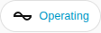

en | [de](../../../de/user/cards/status-badge.md) | [nl](../../../nl/user/cards/status-badge.md) | [fr](../../../fr/user/cards/status-badge.md) | [zh](../../../zh-hans/user/cards/status-badge.md) | [es](../../../es/user/cards/status-badge.md) | [it](../../../it/user/cards/status-badge.md) | [pl](../../../pl/user/cards/status-badge.md) | [sv](../../../sv/user/cards/status-badge.md)

# Status badge

The Status badge page explains the status badge, which shows the state of a system in the badge row of a dashboard. The full list is in the [Status badge](../../../../frontend/docs/features.md#status-badge) section of the cards feature list. [Add an element](README.md#add-an-element) explains how to add the badge and choose a system.



## What the badge shows

- The operating state, coloured by how healthy the state is, and the number of pieces of equipment with an active fault. The badge shows the number only when a fault is active, so the screenshot shows the state alone.
- The badge says Not answering when the system does not answer.
- Tapping the badge opens the details of the operating state.

## Options

| Option in the editor | YAML key | Default |
| --- | --- | --- |
| System | `device` | The first system |

```yaml
type: custom:saj-local-status-badge
device: 0123456789abcdef0123456789abcdef
```

The `device` value is the ID of the device in Home Assistant. The visual editor fills the value in for you.

## Not supported yet

- Options other than the system.
