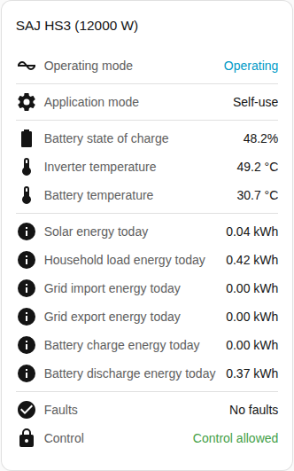

# Status card

The Status card page explains the status card, which sums up a system in one place. The full list is in the [Status card](../../../../frontend/docs/features.md#status-card) section of the cards feature list. [Add an element](README.md#add-an-element) explains how to add the card and choose a system.

## What the card shows

- The operating state, coloured by how healthy the state is, and the application mode.
- The battery state of charge, the inverter and battery temperatures and off-grid mode.
- With Show today's energy on, which is the default, the card shows today's solar, load, grid import, grid export, battery charge and battery discharge energy.
- The number of pieces of equipment with an active fault, or that there are no faults. See [device faults](../faults-and-repairs.md#device-faults).
- Whether control is allowed for the system. See [Allow control](../changing-settings.md#allow-control).

## Differences between the models

- **H2 only:** when the application mode that the inverter runs differs from the mode you chose, the card shows the mode that runs now as well. The row appears only when the Application mode (in effect) entity is enabled. That entity is created disabled. See the [entity reference](../entities/README.md).

## Options

| Option in the editor | YAML key | Default |
| --- | --- | --- |
| System | `device` | The first system |
| Show today's energy | `show_energy` | On |

## Not supported yet

- Changing a setting from the card. The status card only shows. Use the [controls card](controls-card.md) to change settings.
