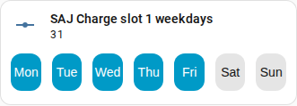

en | [de](../../../de/user/cards/weekdays-feature.md) | [nl](../../../nl/user/cards/weekdays-feature.md) | [fr](../../../fr/user/cards/weekdays-feature.md) | [zh](../../../zh-hans/user/cards/weekdays-feature.md) | [es](../../../es/user/cards/weekdays-feature.md) | [it](../../../it/user/cards/weekdays-feature.md) | [pl](../../../pl/user/cards/weekdays-feature.md) | [sv](../../../sv/user/cards/weekdays-feature.md)

# Weekdays tile card feature

The Weekdays tile card feature page explains the weekdays feature, which puts seven day buttons on a tile card to set the days of a slot. The full list is in the [Weekdays tile card feature](../../../../frontend/docs/features.md#weekdays-tile-card-feature) section of the cards feature list. The days of a slot are the Weekdays entities of the charge, discharge and EV charger slots, listed in the [Battery](../entities/battery.md) and [EV charger](../entities/ev-charger.md) areas of the entity reference.



## Add the feature

1. Add a tile card to a dashboard and choose the Weekdays entity of a slot as the entity of the tile card.
2. Open the features of the tile card, choose Add feature and pick SAJ Local weekdays.

The feature is offered only for a tile card whose entity is the weekdays entity of a slot. The feature has no options.

```yaml
type: tile
entity: number.saj_charge_slot_1_days
features:
  - type: custom:saj-local-weekdays-feature
```

The entity ID in the example has no prefix. If you set a [prefix](../entities-and-prefix.md#the-prefix), the ID of the entity has the prefix after `saj_`.

## How the buttons work

- Seven named day buttons start on your first day of the week, which comes from the Home Assistant settings or your language.
- SAJ Local sends the change 1.5 seconds after the last press, so you can pick several days in one change.
- The inverter stores the days as one number that does not move with your first day of the week. Monday is the lowest bit and Sunday the highest on every model, so Monday to Friday is 31, as in the screenshot, and Monday, Wednesday and Friday is 21.
- The buttons are disabled while [Allow control](../changing-settings.md#allow-control) is off for the system.

The [schedule card](schedule-card.md) uses the buttons in the slot editor.

## Not supported yet

- Any entity other than the weekdays entity of a slot. SAJ Local does not offer the feature for other tile cards.
