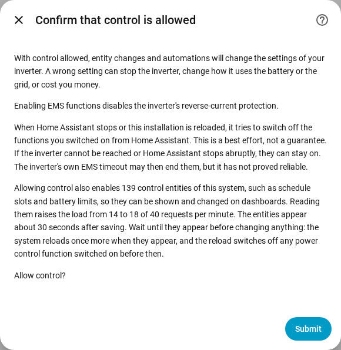

# Changing settings

The Changing settings page explains how to allow SAJ Local to change the settings of your inverter, what happens to a change and which changes are always refused. The full lists are in the [Changing settings](../../../custom_components/saj_local/docs/features.md#changing-settings) and [EMS](../../../custom_components/saj_local/docs/features.md#ems) sections of the integration feature list. The settings and commands are spread over the areas of the [entity reference](entities/README.md), mainly [Settings](entities/settings.md) and [Battery](entities/battery.md).

Writing to the inverter is off until you allow control for a system. While Allow control is off, settings show the current value but refuse every change, with a message that says where to switch control on. Nothing is sent to the inverter.

## Allow control

1. Open Configure, the gear on the system's row on the SAJ Local integration page. You can also switch Allow control on while you add the system.
2. Switch on Allow control and choose Submit.
3. Read the confirmation, then choose Submit again.

The confirmation warns that a wrong setting can stop the inverter, change how the inverter uses the battery or the grid, or cost you money. The confirmation also says:

- Enabling EMS functions disables the inverter's reverse-current protection.
- When Home Assistant stops, or the system reloads, SAJ Local tries to switch off the functions you switched on from Home Assistant. The switch-off is a best effort and not a guarantee.
- Allowing control enables control entities, and reading the entities raises the request load. The dialog shows the number of entities and the load before and after.

HS3 only: the confirmation at setup also asks for the EMS heartbeat. In Configure the heartbeat is a field on the main form. See [EMS](#ems).

Switching Allow control off needs no confirmation. Each system has a Control allowed binary sensor, in the diagnostic category, that is on while the system accepts changes. The [dashboard cards](cards/README.md) read the sensor and lock the controls while the sensor is off. The sensor is read only, because a switch on a dashboard would switch writing on without the warning.

## The control set

Most schedule slots and many settings are created disabled, so a dashboard card would have nothing to show or change. Switching Allow control on therefore also enables the control set of the system:

- the charge, discharge and EV charger slots (the EV charger slots are HS3 only);
- the application mode and the time-of-use settings;
- the battery limits and the grid limits;
- the EV charger settings (HS3 only);
- the power control switches and targets, see [power control](power-control.md);
- the LED mode, the buzzer (H2 only) and the Synchronise clock and Clear current fault buttons.

Battery pack readings and other read-only entities are not part of the set.

- **The entities appear after about 30 seconds.** Home Assistant reloads a system 30 seconds after an entity of the system is enabled. Wait until the entities appear before you change anything, because the reload switches off any power control function you switched on in between. Another reload follows when a new member of the set appears later, such as the EV charger slots after an EV charger is detected.
- **Switching Allow control off** disables the entities that SAJ Local enabled, and no reload follows.
- **Your choice wins.** An entity you disabled before you switched control on stays disabled, and an entity you enabled yourself stays enabled. A card counts a slot with a disabled entity as left out.

## What happens to a change

SAJ Local checks a change before SAJ Local sends anything. SAJ Local refuses the change, with a separate message for each case, when:

- Allow control is off;
- the model is unverified. A system on a model that could not be verified is never written to, see [get started](getting-started.md#when-the-inverter-is-not-recognised);
- the setting is a commissioning setting;
- the value is invalid;
- the inverter is not reachable;
- the write limit is reached. No more than 20 changes go to an inverter address in any 60 seconds, and a change over the limit is refused and not queued.

Each message says that the inverter was not changed. Otherwise SAJ Local writes the change once and reads the value back, and the entity shows the value that the inverter holds.

| What happened | What you see |
| --- | --- |
| The inverter refused the change | The message gives the exception code. |
| The inverter did not answer | The message says the change may or may not have been applied. SAJ Local sends nothing again and reads the inverter again after reconnecting. |
| The inverter holds a different value | The entity shows the value that the inverter holds, and the change fails. |

A change to one setting of a register that holds several settings leaves the other settings of the register unchanged.

## What you can change

- The application mode, seven charge slots and seven discharge slots (each with start, end, power, days and on or off), the time-of-use idle mode and grid discharge, and the backup reserve.
- The battery charge and discharge limits, battery auto wake, the export limit, the grid import and export power limits and the passive mode powers.
- HS3 only: the EV charger settings and seven EV charger slots.
- H2 only: the buzzer and the battery forced charge power limit. Both models have the LED mode.
- Commands, as buttons that are created disabled: Clear current fault, Restart inverter and Synchronise clock, which sends the local time of Home Assistant. HS3 only: Remove EMS solar power limit.

The [dashboard cards](cards/controls-card.md) offer the shared settings in one place. The controls card has no restart button, so a tap on a dashboard cannot restart the inverter.

## Commissioning settings

Commissioning settings are shown and cannot be changed from Home Assistant: the meter, RS485, the battery protocol, the network and the EV charger link, and on the H2 also the grid type, the parallel set-up, the input modes, the protection limits and other installer settings. A wrong value can cut the inverter off from the meter, the battery, the charger or Home Assistant. Commissioning settings are read-only sensors in the diagnostic category. Make such changes in the SAJ elekeeper app, see the [requirement](../../../custom_components/saj_local/docs/requirements.md#changing-settings).

## Not supported yet

- Factory reset and clearing the energy history. SAJ Local offers neither.
- Changing commissioning settings.
- Changing settings on a system whose model is unverified.

## EMS

HS3 only: EMS puts the inverter under external control. The H2 has no EMS entities. SAJ Local offers the EMS timeout and five limits as entities: the battery charge and discharge current, the inverter import and export power, and the solar power. The limits can be set, and SAJ Local does not poll the limits. Between heartbeats the limits show the last value that SAJ Local sent, and the limits are unknown before the first change. [Power control](power-control.md) switches the EMS functions on and off.

- **The heartbeat keeps a function alive.** SAJ Local reads the target of each EMS function you switched on from Home Assistant, and the limits, every heartbeat interval. Reading counts as EMS activity, so the heartbeat writes nothing.
- **The interval is 60 seconds by default.** You can set 30 to 3600 seconds, in the Allow control confirmation at setup and in Configure.
- **The timeout must be longer than the heartbeat.** A function cannot be switched on while the EMS timeout of the inverter is not longer than the heartbeat, and the timeout cannot be set that low.
- **Switch-off on stop.** When SAJ Local unloads or Home Assistant stops, SAJ Local switches off the EMS functions you switched on. A function that was already on when SAJ Local loaded is left alone.
- **The switch-off is a best effort.** When the inverter cannot be reached, or Home Assistant stops abruptly, the functions stay on. The EMS timeout of the inverter may end the functions, but SAJ Local does not rely on the timeout, see [tested on hardware](#tested-on-hardware).

## Tested on hardware

The notes below say which settings have been tried on a real inverter, and which rest on field reports or on the SAJ protocol documents alone.

HS3, written one register at a time on a real HS3 and read back:

- The Application mode, the Backup reserve state of charge, the Passive battery charge power, the EMS timeout, the four EMS enable bits that [power control](power-control.md) writes, and the three EMS targets and five EMS limits.
- On the HS3, the Passive battery charge power sets the power of Backup mode.
- Application mode EMS on its own leaves the inverter idle, with the house running from the grid, and the inverter does not leave EMS by itself.
- The EMS timeout ended EMS after 5 seconds, but did not end EMS at 20 or 60 seconds while another client polled the inverter. SAJ Local does not rely on the timeout.
- The solar power limit has an effect only while an EMS function is on.
- When an EMS function stops, the inverter goes back to the application mode it ran before.
- Time-of-use (BMS) is the mode the HS3 reports when the SAJ app selects the app's TOU (BMS) mode, which is not the app's time-of-use mode. SAJ Local has never written Time-of-use (BMS) to an inverter.

H2, built from field reports of H2 units and the H2 protocol document, and not tried by this project:

- Power control, which uses passive mode, the schedule slots, the application mode, the passive mode powers, the battery limits, the grid power limits and the export limit.
- Peak shaving: field reports show Peak shaving selected in the SAJ app, read back and written over Modbus. The H2 protocol document does not list Peak shaving.
- AI saving is the mode the H2 reports when the SAJ app selects AI saving. SAJ Local has never written AI saving to an inverter.

Never tried on a real inverter:

- the LED mode, the H2 buzzer and the H2 battery forced charge power limit;
- every other setting not named in this section;
- every change that writes more than one register;
- every command.
