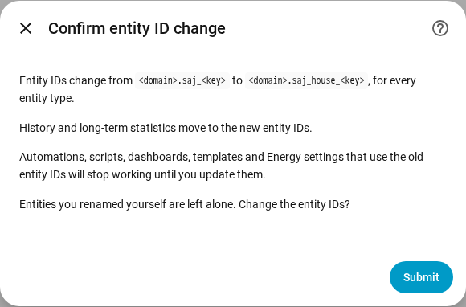

en | [de](../../de/user/entities-and-prefix.md) | [nl](../../nl/user/entities-and-prefix.md) | [fr](../../fr/user/entities-and-prefix.md) | [zh](../../zh-hans/user/entities-and-prefix.md) | [es](../../es/user/entities-and-prefix.md) | [it](../../it/user/entities-and-prefix.md) | [pl](../../pl/user/entities-and-prefix.md) | [sv](../../sv/user/entities-and-prefix.md)

# Entities and the prefix

The Entities and the prefix page explains what the entities of a system are, how the entity IDs are formed and how to add a prefix to the entity IDs. The full lists are in the [Devices and entities](../../../custom_components/saj_local/docs/features.md#devices-and-entities) and [Entity IDs and prefix](../../../custom_components/saj_local/docs/features.md#entity-ids-and-prefix) sections of the integration feature list. Every entity name, ID, model and default is in the [entity reference](entities/README.md).

## The entities of a system

Every reading, setting and command that SAJ Local knows for your model is an entity of the system's device. Each entity has the type Home Assistant users expect for the reading or the setting: a sensor, a binary sensor, a number, a select, a switch, a time or a button. A setting shows as the real control type of the setting, so a limit is a number and an on or off setting is a switch.

- **Only a core set is enabled.** Power, voltage, temperature and state of charge readings, the energy counters, the main battery limits and every fault are enabled. Everything else is created disabled.
- **A disabled entity is not read.** Enabling an entity adds the entity to the next read. Disabling an entity stops the register being read. [Polling](polling.md) shows what a choice costs the inverter.
- **A system gets only the entities that fit.** An H2 with one solar string has no second-string entities. Equipment that is not fitted creates no entities, see [optional equipment](optional-equipment.md).
- **Settings and diagnostics are grouped.** Settings are in the configuration category. Versions, commissioning settings and network settings are in the diagnostic category.
- **An unknown option shows as unknown.** The code of the option is in the [diagnostics download](troubleshooting.md#download-diagnostics), so the option can be reported.

When you set the model by hand for an inverter that is not recognised, the system gets every entity of the chosen model, with the entities beyond one phase and two solar strings disabled. See [get started](getting-started.md#when-the-inverter-is-not-recognised).

## Sign of power

Battery power and grid power use one sign on every model, so a reading has one meaning on an HS3 and on an H2.

- **Battery power** is positive while the battery discharges and negative while the battery charges.
- **Grid power** is positive while the system exports and negative while the system imports. Meter A follows the grid sign.
- **Meter B** is positive while the solar inverter that Meter B measures generates.

On the HS3, Grid power is the Meter A total, and the grid phase power, apparent power, current and power factor come from the matching Meter A phase, because the grid registers of the HS3 carry inverter values. An HS3 without Meter A has none of these entities. Household load power is the sum of the three on-grid output phase powers.

The [power control](power-control.md) targets follow the signs of the readings.

## The prefix

Every entity ID has the form `<type>.saj_<key>`, for example `sensor.saj_pv_power`. Renaming an entity's display name does not change the ID.

A prefix adds a word after `saj_` in every entity ID of one system, for example `sensor.saj_house_pv_power`. Use a prefix when you have more than one SAJ system, so no entity ID needs a number added.

- Use lowercase letters and digits only, up to 32 characters.
- Two systems cannot share a prefix, and only one system can have none.
- A prefix that would clash with an entity name, such as `battery`, is refused.
- Setup is refused when an entity ID the system would create is already taken.

### Add, change or remove a prefix

1. Open Configure, the gear on the system's row on the SAJ Local integration page.
2. Change the Prefix field and choose Submit.
3. Read the confirmation, then choose Submit again.

The confirmation shows the old and the new pattern. Automations, scripts, dashboards, templates and Energy settings that use the old entity IDs stop working until you update the references.

After you confirm:

- SAJ Local renames every entity of the system, enabled or disabled, and Home Assistant moves the history and the long-term statistics to the new IDs.
- An entity that you renamed yourself is left alone.
- The [dashboard cards](cards/README.md) keep working, because the cards find entities through the entity registry and not by ID.

SAJ Local refuses the change and renames nothing when a new ID is already taken, or when Home Assistant already holds long-term statistics under a new ID, for example from a system you deleted that had the prefix.

If a later version adds an entity and the ID of the entity is already taken, Home Assistant adds a number to the ID, and a warning in the log names the kind and the key of the entity.

## Not supported yet

- Choosing the key part of an entity ID. SAJ Local fixes the key, so dashboards and automations work identically on every model.
