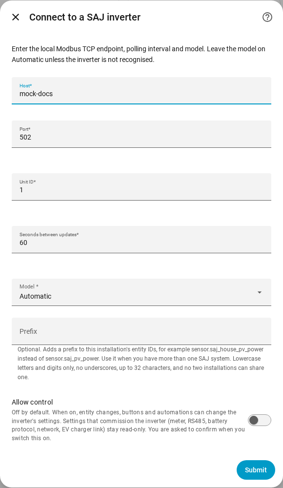
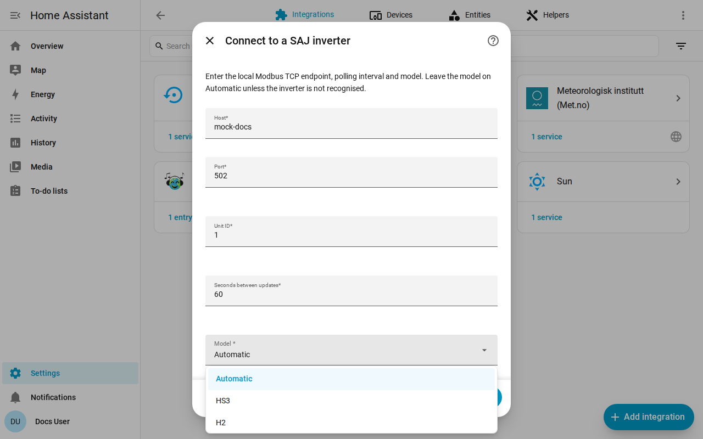

en | [de](../../de/user/getting-started.md) | [nl](../../nl/user/getting-started.md) | [fr](../../fr/user/getting-started.md) | [zh](../../zh-hans/user/getting-started.md) | [es](../../es/user/getting-started.md) | [it](../../it/user/getting-started.md) | [pl](../../pl/user/getting-started.md) | [sv](../../sv/user/getting-started.md)

# Get started

The Get started page adds your SAJ system to Home Assistant and says what you get afterwards. The full list of what setup does is in the [Setup and detection](../../../custom_components/saj_local/docs/features.md#setup-and-detection) section of the integration feature list. [Install SAJ Local](installation.md) first, and check that your inverter is in the [supported equipment](supported-equipment.md).

## Add a system

1. In Home Assistant, open Settings, then Devices & services.
2. Choose Add integration and search for SAJ Local.
3. Fill in the form and choose Submit.

| Field | What to enter |
| --- | --- |
| Host | The host name or IP address of the inverter. |
| Port | The Modbus TCP port. The default is 502. |
| Unit ID | The Modbus unit ID, from 1 to 247. The default is 1. |
| Seconds between updates | How often every enabled entity is read. The default is 60 and the lowest is 10. See [polling](polling.md). |
| Model | Leave on Automatic. SAJ Local recognises the HS3 and the single-phase H2 from the device type that the inverter reports. |
| Prefix | Optional. Leave empty for the first system. See [entities and the prefix](entities-and-prefix.md#the-prefix). |
| Allow control | Off by default, so nothing can change a setting. See [changing settings](changing-settings.md). |

SAJ Local connects to the inverter, reads the identity of the inverter and six core readings (operating mode, battery state of charge, load power, solar power, battery power and grid power) and creates the system. A register that one unit lacks does not stop setup. The system is titled SAJ followed by the serial number of the inverter.

When setup fails, the form says what went wrong: no connection, no answer in time, a refused reading, invalid data, a device that is not recognised or a model that does not match the inverter. Nothing is saved until the check passes.

## What you get

- One Home Assistant device named SAJ. The device's model shows the model and the rated power, for example HS3 (12000 W).
- The entities that fit your model and equipment. SAJ Local detects the battery, the meters and the other equipment for you, see [optional equipment](optional-equipment.md).
- Only a core set of entities is enabled. Everything else is created disabled, so the inverter is not read for values you did not ask for. Enable an entity in Home Assistant and the next read includes the entity. See [entities and the prefix](entities-and-prefix.md).
- The [dashboard cards](cards/README.md), with nothing to install.

## Add a second system

Add SAJ Local again from Devices & services. SAJ Local refuses an endpoint or an inverter serial that is already set up. Give each system a separate [prefix](entities-and-prefix.md#the-prefix), so no entity ID needs a number added.

## When the inverter is not recognised

When the inverter reports a device type that SAJ Local does not recognise, Automatic fails with an error that asks you to choose the model by hand. Choose HS3 or H2 in the Model field.

- A choice that contradicts a recognised inverter is refused. Choose the model the error names, or Automatic.
- For an unrecognised inverter, SAJ Local reads the required registers and asks you to confirm the model. The registers must answer first.
- The device then shows the model as unverified. Readings can be wrong, because SAJ Local cannot check the readings against the device type, and every attempt to change a setting is refused.

## Change a system later

Open Configure, the gear on the system's row on the SAJ Local integration page. You can change the host, port, unit ID, update interval, model, prefix and Allow control, and set each piece of equipment. SAJ Local saves the change only after the inverter answers at the new endpoint. [Replacing the inverter](replacing-the-inverter.md) covers a new inverter.

## Not supported yet

- Products other than the HS3 and the single-phase H2. See [supported equipment](supported-equipment.md).
- Finding the inverter on the network. You enter the address of the inverter.
