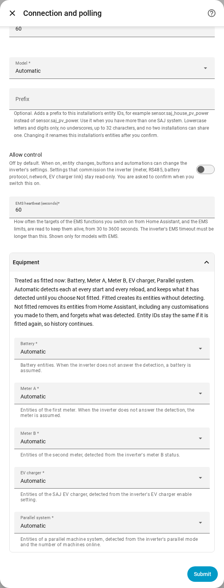

en | [de](../../de/user/optional-equipment.md) | [nl](../../nl/user/optional-equipment.md) | [fr](../../fr/user/optional-equipment.md) | [zh](../../zh-hans/user/optional-equipment.md) | [es](../../es/user/optional-equipment.md) | [it](../../it/user/optional-equipment.md) | [pl](../../pl/user/optional-equipment.md) | [sv](../../sv/user/optional-equipment.md)

# Optional equipment

The Optional equipment page explains how SAJ Local finds out which optional equipment your inverter has and how to override the result. The full list is in the [Optional equipment](../../../custom_components/saj_local/docs/features.md#optional-equipment) section of the integration feature list. The [supported equipment](supported-equipment.md) page says which model can have what, and the [entity reference](entities/README.md) says which entities each piece of equipment adds.

## What SAJ Local detects

Setup asks nothing about equipment. Every time SAJ Local loads, which includes every Home Assistant start and every reload, SAJ Local asks the inverter what is fitted and creates entities only for that equipment.

| Equipment | Models |
| --- | --- |
| Battery | HS3 and H2 |
| Meter A, the grid meter | HS3 and H2 |
| Meter B, the second meter | HS3 and H2 |
| Parallel system | HS3 and H2 |
| EV charger | HS3 only |

- **The inverter does not answer the check:** SAJ Local assumes a battery and Meter A, and does not assume the other equipment.
- **A meter is offline during a restart:** detected equipment is remembered, so the equipment keeps the entities of the equipment.
- **Equipment fitted later:** SAJ Local picks the equipment up at the next restart or reload.

## When remembered equipment is no longer detected

SAJ Local keeps the entities of the equipment, so history and dashboards stay unchanged, and raises a repair issue in Home Assistant. The issue names the equipment and the system. Check the equipment, or set the equipment to Not fitted as described below. The issue goes away at the next load that detects the equipment again, or when you change the setting.

## Override the detection

1. Open Configure, the gear on the system's row on the SAJ Local integration page.
2. Expand the Equipment section.
3. Set each piece of equipment to Automatic, Fitted or Not fitted, then choose Submit.

The section also lists what SAJ Local treats as fitted now.

| Setting | What the setting does |
| --- | --- |
| Automatic | Detects the equipment at every start and every reload, and keeps what was detected until you choose Not fitted. Automatic is the default. |
| Fitted | Creates the entities of the equipment without detecting the equipment. |
| Not fitted | Removes the entities of the equipment from Home Assistant, including any changes you made to the entities, such as a new name. SAJ Local forgets what was detected. |

Entity IDs stay unchanged, so history continues if you set the equipment back to Fitted or Automatic. Entities of equipment that is not fitted cannot be read, polled or written.

The section lists only the equipment your model can have. HS3 only: the EV charger.

## Battery packs

- **H2:** an H2 reports how many battery packs the H2 has, up to five. SAJ Local creates the pack entities for that many packs. A count of 0 keeps the entities of every pack. SAJ Local remembers the highest count SAJ Local has seen. Each pack has identity entities, created disabled.
- **HS3:** an HS3 has entities for one battery pack.

## EV charger

HS3 only: an HS3 with an EV charger also gets the readings, settings, charging slots and EMS charging controls of the charger. Most are created disabled. Switching on Allow control enables the settings and slots, see [changing settings](changing-settings.md#the-control-set).

## Not supported yet

- Equipment that SAJ Local does not detect. The equipment in the table is the full list.
- Detecting an EV charger on an H2.
