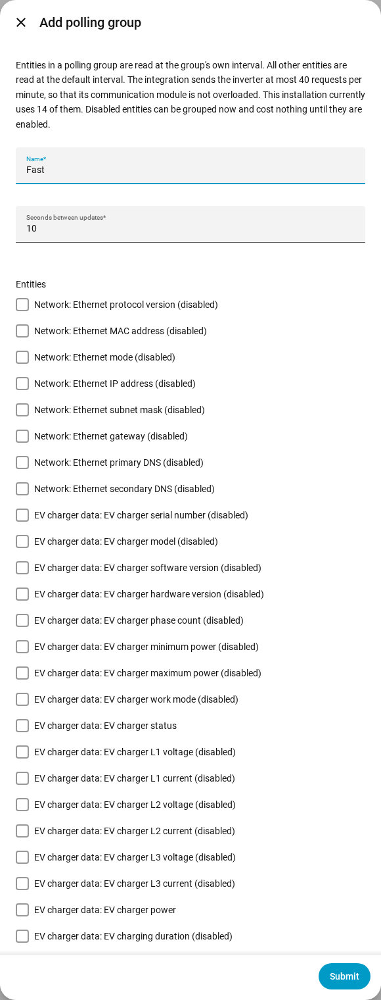

en | [de](../../de/user/polling.md) | [nl](../../nl/user/polling.md) | [fr](../../fr/user/polling.md) | [zh](../../zh-hans/user/polling.md) | [es](../../es/user/polling.md) | [it](../../it/user/polling.md) | [pl](../../pl/user/polling.md) | [sv](../../sv/user/polling.md)

# Polling

The Polling page explains how often SAJ Local reads the inverter and how to read some entities faster or slower. The full list is in the [Polling](../../../custom_components/saj_local/docs/features.md#polling) section of the integration feature list. The limits that apply to every request are on [protecting the inverter](protecting-the-inverter.md).

SAJ Local reads the inverter over Modbus TCP on your local network, on a schedule you control. Nothing leaves your network.

## The default interval

Every enabled entity is read every 60 seconds by default. Change the Seconds between updates field in Configure, the gear on the system's row on the SAJ Local integration page. The interval is never shorter than 10 seconds.

Only enabled entities are read. Disable an entity in Home Assistant and the register of the entity is no longer read.

## Polling groups

A polling group reads chosen entities faster or slower than the default. Use a group, for example, to read the load, solar, battery and grid power every 10 seconds while everything else stays at 60.

1. Open the menu on the system's row on the SAJ Local integration page and choose Add polling group. The Add polling group button at the top of the page opens the Add polling group form too.
2. Enter a name, the seconds between updates (at least 10) and the entities of the group.
3. Choose Submit, read the review, then choose Save the group.

- **Any entity:** a group can hold entities of any type. A disabled entity can be chosen too, and costs nothing until you enable the entity.
- **One group at most:** an entity belongs to one group at most. Every entity in no group stays on the default interval.
- **Register order:** the form lists entities in register order, each labelled with the block of registers the entity is read from, so entities that can share a request sit together.
- **Edit or delete:** open the polling group from the integration page. Changing or deleting a group keeps the entities, the names of the entities and the history of the entities.

All intervals of a system share one clock, so entities that are due together are read together. A read that overruns is not caught up. The missed ticks are dropped and polling carries on from the next tick.

## The request load

SAJ Local sends an inverter at most 40 requests in any 60 seconds. The form shows what your choice costs, as requests per minute against that limit. The form above shows a current load of 14 requests per minute as an example.

- **Before you save a group:** the review step shows how many requests one read of the group takes, and the load before and after you save.
- **Over the limit:** you can still save the group. The review warns that reads run slower than you configured, because SAJ Local never sends more than the limit.
- **A new default interval:** Configure asks you to confirm when the new interval puts the load over the limit.
- **Fewer requests:** entities that sit together in one block of registers cost one request. Entities in different blocks cost one request each.

Enabling an entity in Home Assistant cannot be intercepted by a form. The [diagnostics download](troubleshooting.md#download-diagnostics) lists the planned load against the limit for that case.

## Not supported yet

- A polling group with an interval below 10 seconds.
