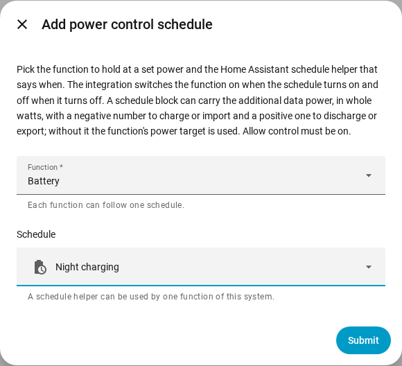

en | [de](../../de/user/power-control.md) | [nl](../../nl/user/power-control.md) | [fr](../../fr/user/power-control.md) | [zh](../../zh-hans/user/power-control.md) | [es](../../es/user/power-control.md) | [it](../../it/user/power-control.md) | [pl](../../pl/user/power-control.md) | [sv](../../sv/user/power-control.md)

# Power control

The Power control page explains how to hold the battery, the grid connection point or the inverter at a set power, by hand or with a Home Assistant schedule. The full list is in the [Power control](../../../custom_components/saj_local/docs/features.md#power-control) section of the integration feature list. The switches and targets are in the [entities the integration adds](entities/added-by-the-integration.md) in the entity reference.

Power control works in one way on every model that offers a function. Power control does nothing while [Allow control](changing-settings.md#allow-control) is off or the model is unverified.

| Function | What the function holds at the set power | HS3 | H2 |
| --- | --- | --- | --- |
| Battery | The battery charges or discharges. | Yes | Yes |
| Grid | The grid connection point imports or exports. Needs Meter A. | Yes | No |
| Inverter | The inverter takes in or puts out power. | Yes | No |

A positive power discharges, exports or puts out. A negative power charges, imports or takes in. The signs follow the [sign of power](entities-and-prefix.md#sign-of-power) of the readings.

## Hold a function at a power

Each function has a switch and a power target in whole watts. Both are created disabled and are in the configuration category. Switching on Allow control enables the switches and the targets, see [the control set](changing-settings.md#the-control-set).

1. Set the power target of the function. The target is rounded to the nearest step the inverter supports, and shows the power that the inverter holds.
2. Switch on the function. A function needs a power target before the function can be switched on.
3. To stop, switch the function off.

- The target is kept across restarts and is sent when the function starts. Changing the target while the function runs sends the new power at once.
- Only one function runs at a time. Switching on a function while another runs is refused, and the message names the running function.
- The switch is on while the inverter reports the function running, even when the function was started outside Home Assistant.
- A start that fails is undone. A stop that fails is sent again every heartbeat interval, until the inverter reports the function stopped.
- The [dashboard controls card](cards/controls-card.md) shows each function with a switch, a target and a hint on the sign.

### When Home Assistant stops

A function you switched on from Home Assistant is switched off when SAJ Local unloads and when Home Assistant stops. A function that was already running when SAJ Local loaded is left running.

- HS3 only: the EMS heartbeat keeps the function alive. After an abrupt stop, the EMS timeout of the inverter may end the function, but SAJ Local does not rely on the timeout. See [EMS](changing-settings.md#ems).
- H2 only: a function left running by an abrupt stop keeps running until you switch the function off.

## Follow a schedule

A power control schedule makes a function follow a Home Assistant schedule helper. The function is on while the schedule is on and off when the schedule turns off.

1. Create a schedule helper in Home Assistant: Settings, Devices & services, Helpers, Create helper, Schedule. Set the times and the weekdays of the schedule.
2. Open the menu on the system's row on the SAJ Local integration page and choose Add power control schedule.
3. Choose the function and the schedule helper, then choose Submit.

A block of the schedule helper can carry the additional data `power`, in whole watts with the sign above, for example `power: -600` to charge the battery at 600 W. Without `power`, SAJ Local uses the power target of the function.

- Each function follows one schedule, and a schedule helper drives one function of a system.
- The schedule follows a rename of the helper. A helper that is not in the entity registry is refused, so choose a helper that you created in the interface.
- SAJ Local refuses a schedule while Allow control is off.
- Change or remove a schedule from the integration page. The system reloads when you do.

### What a schedule does

| Situation | What happens |
| --- | --- |
| The schedule turns on and no function is running | SAJ Local sets the power from the block, or uses the power target, then starts the function. |
| The block has no `power` and the function has no power target | Nothing starts. The action stays outstanding, with a warning. |
| The function is already running | SAJ Local changes the power when the block has one, and takes the function over. |
| A different function is running | Nothing is written. The action stays outstanding. |
| The start is refused or fails | The action stays outstanding. SAJ Local tries again every heartbeat interval. |
| The block's `power` is not a whole number in the range of the target | Nothing starts. The action stays outstanding, with a warning. |
| The schedule moves to a block with another `power` | SAJ Local changes the power. |
| You switch the function off by hand while the schedule is on | The function stays off until the schedule next turns on. |
| The schedule turns off and SAJ Local started the function | SAJ Local stops the function. |

With nothing wanted and nothing outstanding, SAJ Local sends nothing. The [diagnostics download](troubleshooting.md#download-diagnostics) lists each function, each schedule and the action that is outstanding.

## Not supported yet

- Grid and Inverter power control on the H2.
- More than one function at a time.
- More than one schedule for one function.
