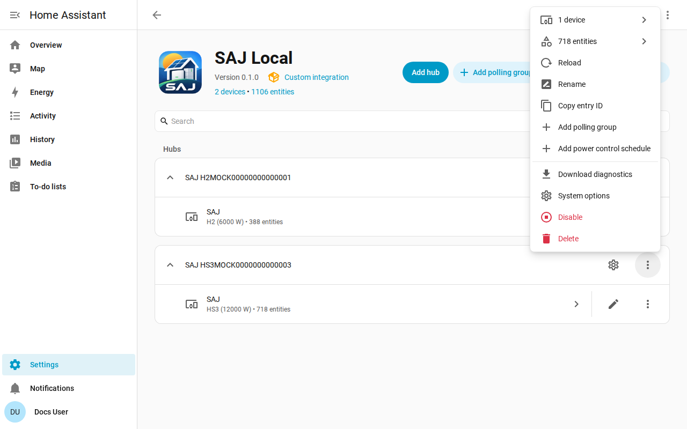

# Troubleshooting

The Troubleshooting page shows how to download diagnostics, turn on debug logging and read the common problems. The full list is in the [Diagnostics and debug logging](../../../custom_components/saj_local/docs/features.md#diagnostics-and-debug-logging) section of the integration feature list.

The diagnostics download and the debug log show what the inverter returns and what SAJ Local did about the readings, without giving away who or where you are. Both use the tools of Home Assistant, so nothing needs installing and nothing is sent anywhere.

## Start with the entities and the repairs

- Check [Settings and Repairs](faults-and-repairs.md#repair-issues) for a repair issue of the system. Each issue says what is wrong and what to do.
- Check the [device faults](faults-and-repairs.md#device-faults) when the inverter reports a problem.
- Entities that read unavailable after a refusal are described in [protecting the inverter](protecting-the-inverter.md#when-the-inverter-refuses-a-reading).

## Download diagnostics

1. Open Settings, then Devices & services, then SAJ Local.
2. Open the menu on the system's row and choose Download diagnostics.

The file holds:

- the enabled entities, the intervals with the requests each takes, and the planned load against the limit of 40 requests per minute;
- refused and suspended entities;
- the active faults with the raw words of the faults, and the unrecognised fault bits as register and bit;
- the open repair issues, and how long the inverter has been failing;
- the power control functions, which one is running, which one SAJ Local owns and the action that is outstanding for each schedule;
- a snapshot of the raw words of every register that SAJ Local has read since the system loaded, with the age of each, so a maintainer can check a reading against the real device;
- every request that got no usable answer, with the reason. A request that timed out looks different from a request the inverter refused, and the difference matters when another client holds the connection of the inverter.

The snapshot adds no request to the inverter. The snapshot starts empty each time the system loads.

## Turn on debug logging

1. Open the SAJ Local integration page.
2. Open the three-dot menu of the integration page and choose Enable debug logging.
3. Reproduce the problem.
4. Choose Disable debug logging. Home Assistant downloads the log.

Debug logging records each connection, poll, request, write, heartbeat and schedule change, one line per event. Every log line starts with the title of the system and the serial number masked to the last three characters, so lines from two systems can be told apart. A title that holds the serial number has the serial masked in place, for example `SAJ xxxxx123`.

## What the file and the log leave out

Diagnostics and logs never contain the host, port, unit ID, full serial number, MAC address, network addresses, EV charger serial number, prefix or polling group names. In the register snapshot, the words of the registers that hold the network addresses and the serial numbers are replaced by the redaction marker of Home Assistant, so you can see that the register answered without seeing what the register said.

## Common problems

| What you see | What to check |
| --- | --- |
| Setup fails with no connection or no answer | The host, the port and the unit ID. Make sure no other Modbus client holds the connection of the inverter. |
| Setup says the device is not recognised | Choose the model by hand. See [get started](getting-started.md#when-the-inverter-is-not-recognised). |
| A setting refuses a change | Allow control is off, the model is unverified or the setting is a commissioning setting. The message says which. See [changing settings](changing-settings.md). |
| Reads run slower than the interval you set | The load is over the limit of 40 requests per minute. See [polling](polling.md#the-request-load). |
| An entity you enabled has no value yet | Home Assistant reloads the system about 30 seconds after you enable an entity, and the entity is read from the next read. |
| Entity IDs gained a number | The ID the entity wanted was taken. See [entities and the prefix](entities-and-prefix.md#the-prefix). |
| Entities are missing | The equipment is not detected or is set to Not fitted. See [optional equipment](optional-equipment.md). |

## Help and feedback

Questions, bug reports and ideas are welcome on the [issue tracker](https://github.com/Counterphase-Labs/ha-saj-local/issues). Attach the diagnostics download to a bug report.
