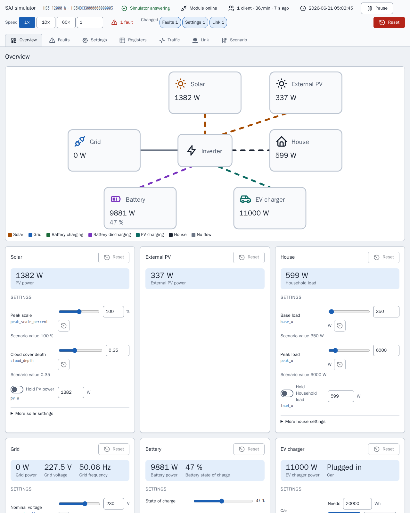

[en](../../en-gb/developer/README.md) | [de](../../de/developer/README.md) | [nl](../../nl/developer/README.md) | [fr](../../fr/developer/README.md) | [zh](../../zh-hans/developer/README.md) | es | [it](../../it/developer/README.md) | [pl](../../pl/developer/README.md) | [sv](../../sv/developer/README.md)

# Documentación para desarrolladores de SAJ Local

Cómo se construye, se comprueba y se publica SAJ Local, y dónde está la verdad sobre cada parte. La documentación explica por qué el proyecto está construido como está y enlaza con el archivo que contiene cada dato. Las versiones, las listas de comandos y los mapas de registros viven en el código y en la configuración, no aquí.

Para tener una copia de trabajo y enviar un cambio, empieza por [CONTRIBUTING.md](../../../CONTRIBUTING.md). SAJ Local es una integración de Home Assistant solo local: SAJ Local habla con el inversor por la red local y no añade ningún servicio en la nube ni SDK complementario.

## Desarrollar sin un inversor

El simulador es un dispositivo SAJ de sustitución, así que la mayor parte del trabajo no necesita hardware. Cada simulador ofrece una página que muestra lo que hace el sistema simulado y permite a un desarrollador cambiar el sistema mientras Home Assistant sondea, sin editar un escenario ni reiniciar.

El [simulador Modbus](simulator.md) explica para qué sirve el simulador y cómo ejecutar un escenario. La [página del simulador](simulator-page.md) muestra cada vista de la página.

## Páginas

- [Simulador Modbus](simulator.md): para qué sirve el simulador, los escenarios y cómo ejecutar otro sistema.
- [Página del simulador](simulator-page.md): cada vista de la página, el inspector de registros, el registro de tráfico, los fallos de enlace, los ajustes preestablecidos y el estado guardado.
- [Entorno](environment.md): preparar una copia de trabajo y ejecutar el Home Assistant de desarrollo con los simuladores.
- [Comprobaciones](checks.md): los objetivos de make, la barrera de cobertura y cómo acotar una ejecución.
- [Arquitectura](architecture.md): la biblioteca SAJ y la integración, los perfiles, el catálogo, el sondeo y los nombres estables.
- [Frontend](frontend.md): el código fuente de las tarjetas, la compilación y los paneles de muestra.
- [Documentación](documentation.md): cómo se hacen y se comprueban estas páginas, la referencia de entidades generada y las capturas de pantalla.
- [Publicación de versiones](releasing.md): la subida de versión de Home Assistant y los pasos previos a una versión.

La documentación de usuario está en la [documentación de usuario](../user/README.md).

## Dónde está la verdad

| Pregunta | Autoridad |
| --- | --- |
| ¿Qué debe hacer el proyecto? | [Requisitos globales](../../../.github/work/requirements.md), [requisitos de la integración](../../../custom_components/saj_local/docs/requirements.md), [requisitos de las tarjetas](../../../frontend/docs/requirements.md), [requisitos del simulador](../../../mock/docs/requirements.md) |
| ¿Qué hace hoy cada parte? | [Funciones de la integración](../../../custom_components/saj_local/docs/features.md), [funciones de las tarjetas](../../../frontend/docs/features.md), [funciones del simulador](../../../mock/docs/features.md) |
| ¿Cómo se escriben el código, las pruebas y la documentación? | [code-style.md](../../../.github/work/code-style.md) |
| ¿Qué reglas obligan a todos los que trabajan aquí? | [AGENTS.md](../../../AGENTS.md) |
| ¿Qué se construyó y por qué? | [done/index.md](../../../.github/work/done/index.md) |
| ¿Qué está previsto? | [.github/work/future/](../../../.github/work/future/) |
| ¿Qué comandos existen? | [Makefile](../../../Makefile) |
| ¿Qué ejecuta CI? | [ci.yml](../../../.github/workflows/ci.yml) |
| Dependencias de Python y ajustes de las herramientas | [pyproject.toml](../../../pyproject.toml) |
| Dependencias y scripts del frontend | [frontend/package.json](../../../frontend/package.json) |
| Servicios de desarrollo | [compose.yaml](../../../compose.yaml) |

El código existente no tiene autoridad sobre los requisitos. Cuando discrepan, el código está mal o el responsable cambia el requisito.

## Estilo de código

[code-style.md](../../../.github/work/code-style.md) es la autoridad. La regla de documentación de code-style.md da forma a estas páginas: explicar por qué y no cómo, y dejar que los nombres y los tipos describan el resto.
