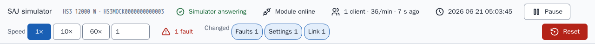
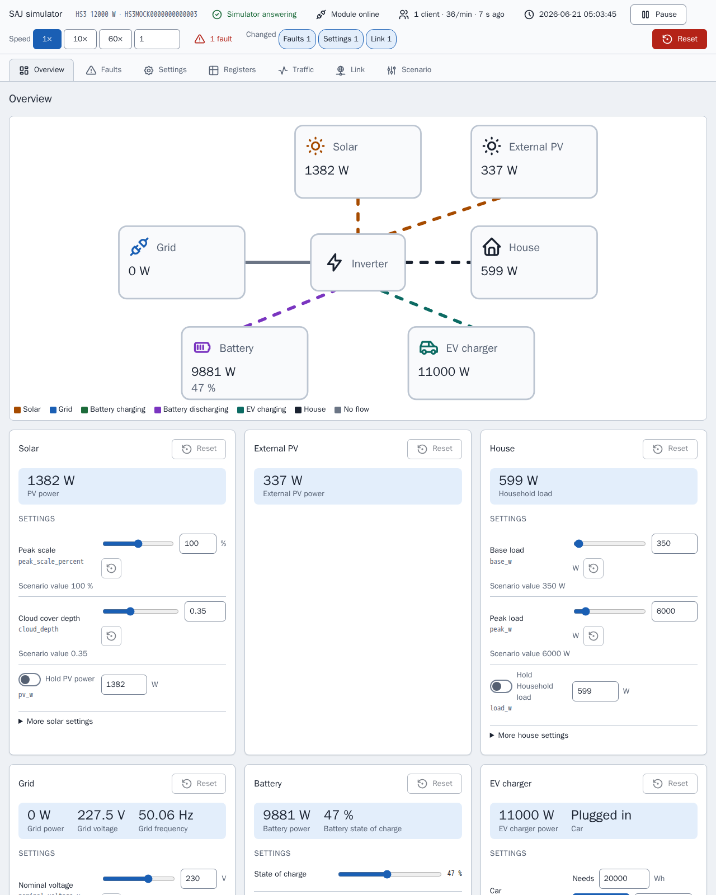
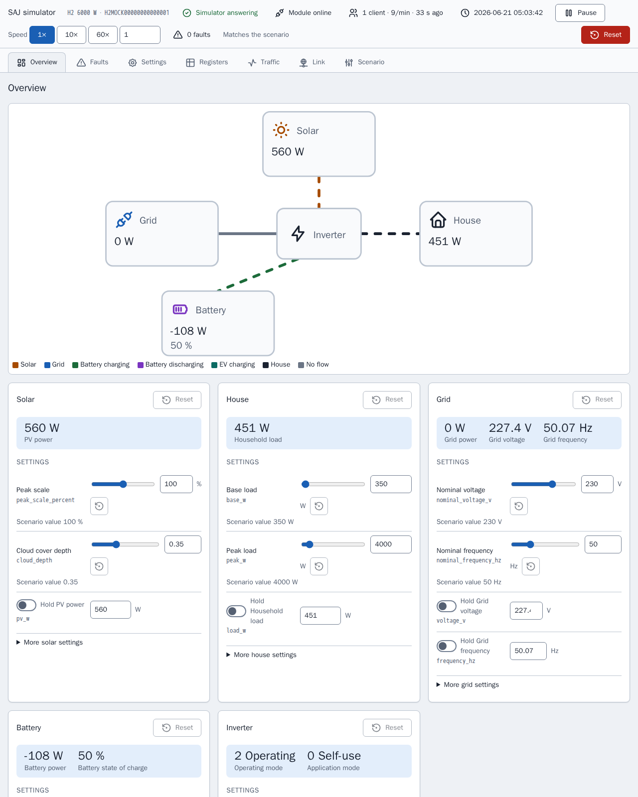
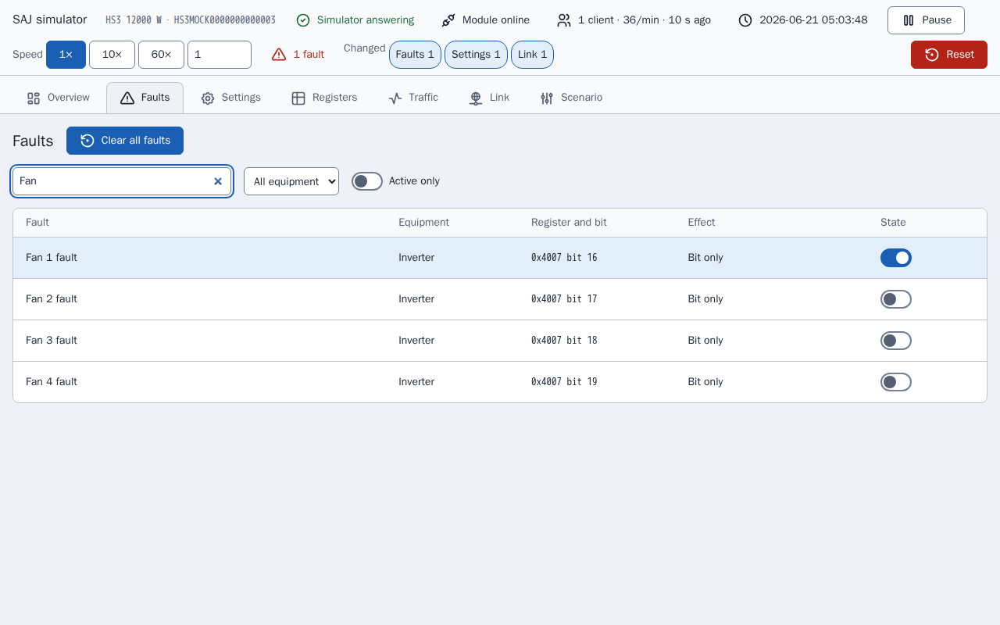
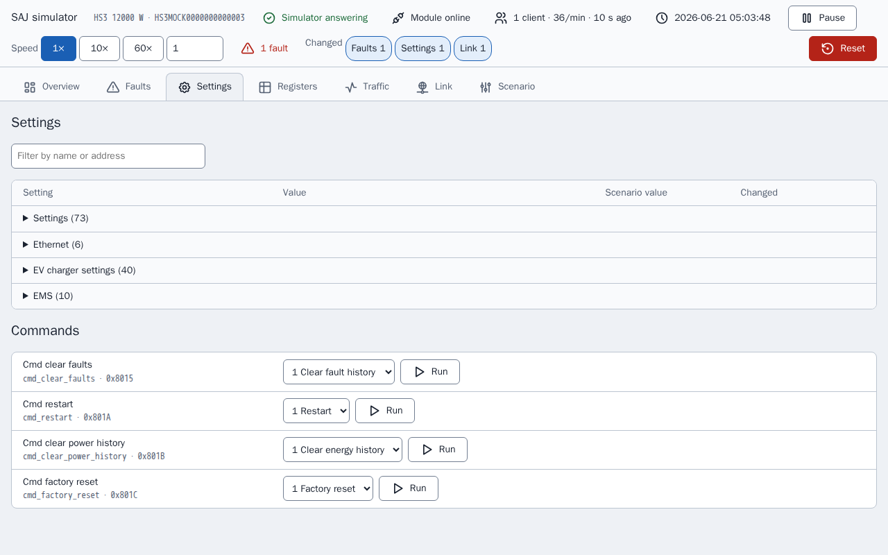
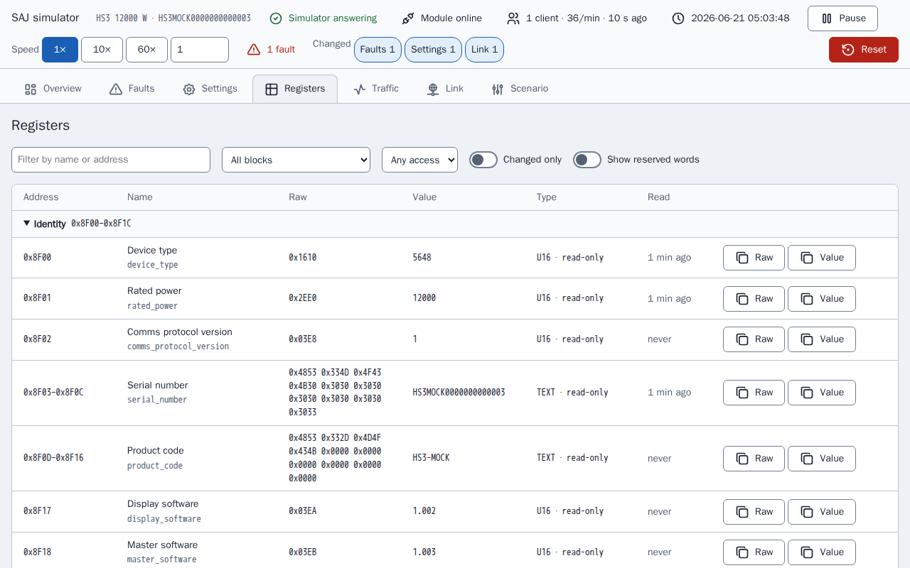
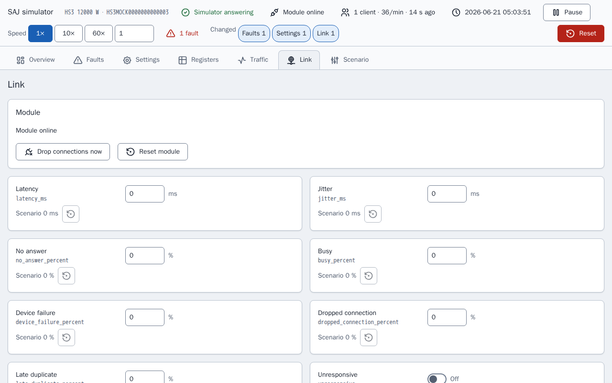
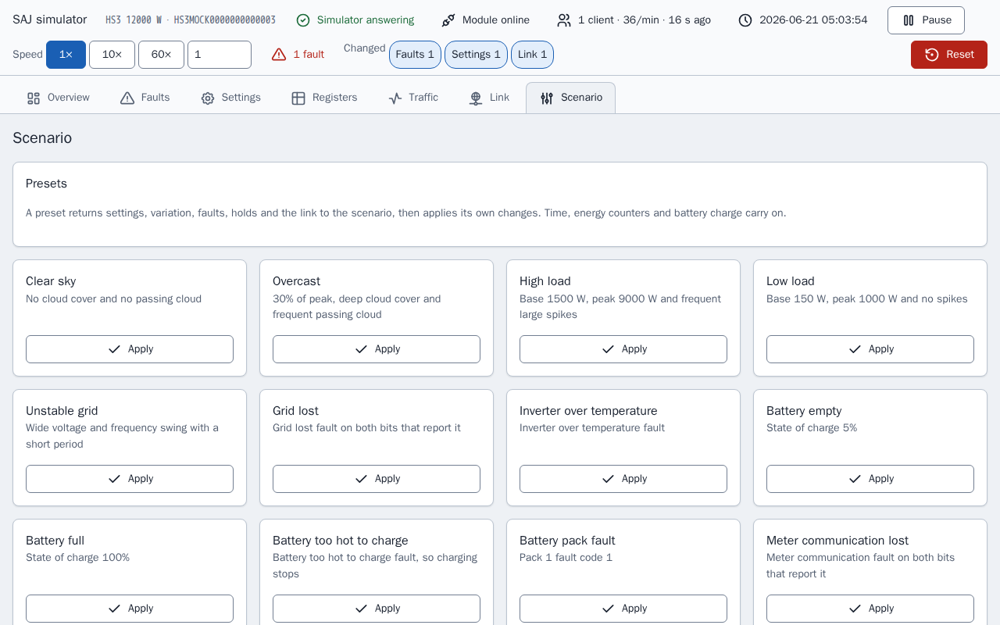
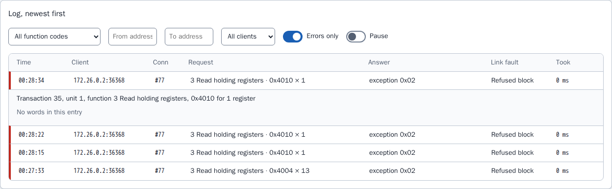

[en](../../en-gb/developer/simulator-page.md) | [de](../../de/developer/simulator-page.md) | [nl](../../nl/developer/simulator-page.md) | [fr](../../fr/developer/simulator-page.md) | [zh](../../zh-hans/developer/simulator-page.md) | es | [it](../../it/developer/simulator-page.md) | [pl](../../pl/developer/simulator-page.md) | [sv](../../sv/developer/simulator-page.md)

# Página del simulador

La página de control de un simulador: vistas, inspector de registros, registro de tráfico, fallos de enlace, efectos de los fallos, ajustes preestablecidos y estado guardado.

La lista completa de lo que cubre la página está en las secciones [Página de control](../../../mock/docs/features.md#control-page), [Estado y preajustes](../../../mock/docs/features.md#state-and-presets), [Inspector de registros y registro de tráfico](../../../mock/docs/features.md#register-inspector-and-traffic-log) y [Fallos de enlace](../../../mock/docs/features.md#link-faults) de la lista de funciones. La página del simulador solo existe en inglés, así que los nombres de las vistas, los botones y los ajustes preestablecidos aparecen abajo tal como los muestra la página.

Cada simulador ofrece una página web en `http://localhost:<panel port>/`: `5080` para el HS3 y `5081` para el H2 que inicia `make up` (`SAJ_MOCK_PANEL_HOST_PORT` y `SAJ_MOCK_H2_PANEL_HOST_PORT` los cambian). Dentro del contenedor escucha en `server.panel_port`, 8080 por defecto. No hay autenticación: el simulador es una herramienta de desarrollo.

La página existe para que un desarrollador pueda ver qué hace el sistema simulado y poner el sistema en una situación sin editar un escenario ni reiniciar. La página construye cada control a partir de la descripción del dispositivo, así que la página lista solo el equipo que está instalado.
La página sondea el estado cada 3 segundos, de modo que un cambio hecho desde Home Assistant aparece, y las vistas Registers y Traffic además se actualizan cada segundo mientras las vistas están abiertas. Un control que tiene el foco no se sobrescribe. Dos clientes pueden cambiar cosas a la vez: gana la última escritura, como en un dispositivo real. Cada cambio muestra una confirmación breve y cada rechazo su motivo.

Una barra de estado en cada vista responde si el simulador funciona como su escenario o ha sido cambiado: si el módulo está en línea, los clientes conectados y su tasa de solicitudes, la hora simulada, ejecutar y pausar, la velocidad, los fallos activos y un chip por cada tipo de cambio respecto al escenario que está en vigor. El mismo resumen (`changes` en el estado) marca las filas y las tarjetas cambiadas. Pausar fija la velocidad en 0 y reanudar restablece la velocidad anterior, así que pausar no pierde la velocidad.



La vista actual está en el fragmento de la URL (`#registers`), así que una recarga conserva la vista. No se guarda nada en el navegador. Las capturas de las vistas siguientes se toman después de activar un fallo, "Fan 1 fault", y después de que el simulador haya rechazado un registro, de modo que cada vista muestra un cambio respecto al escenario.

La página deriva nombres legibles de los nombres de campo y redondea cada valor escalado a los decimales de su escala, así que un 65535 sin procesar con escala 0.0001 se lee 6.5535 en lugar de mostrar ruido de coma flotante.

## Vistas

### Resumen (Overview)

Un diagrama de flujo de potencia del equipo instalado, coloreado y animado según la dirección, sobre una tarjeta por cada equipo. Una tarjeta contiene la lectura en vivo, los controles que fijan la lectura y los fallos del equipo, con un restablecimiento al escenario para esa tarjeta.



La página del H2 tiene menos tarjetas que la página del HS3 de arriba, porque el escenario del H2 instala menos equipo.



Una tarjeta mantiene separado lo que fija un control de la lectura que produce el control, porque las dos difieren siempre que interviene una retención, un fallo o el estado de carga: una escala de pico del 100 % no significa el 100 % de la potencia PV. El restablecimiento de una tarjeta devuelve la variación, las retenciones y los bits de fallo de la tarjeta, y deja en paz el estado de carga, el coche, el reloj y los contadores de energía, por la misma razón que los ajustes preestablecidos. Una tarjeta con un fallo activo está marcada, como en la tarjeta de abajo.


### Fallos (Faults)

Cada bit de fallo del equipo instalado, con búsqueda, con lo que hace el simulador cuando el bit está activado. Los bits que el documento no nombra aparecen como reservados, para poder probar la ruta de fallos no reconocidos de la integración.

La imagen muestra la búsqueda "Fan", con los cuatro fallos del ventilador y el interruptor del fallo activado, "Fan 1 fault", encendido.



### Ajustes (Settings)

Los ajustes y comandos escribibles, con nombres para los valores sin procesar y el valor del escenario de cada uno.



### Registros (Registers)

El inspector de registros, descrito abajo.



### Tráfico (Traffic)

El registro de tráfico, descrito abajo.


### Enlace (Link)

Los fallos de enlace y el estado del módulo, descritos abajo.



### Escenario (Scenario)

Ajustes preestablecidos, la hora simulada, los contadores de energía, restablecer y exportar.



## Inspector de registros

`GET /api/registers` lista cada bloque del dispositivo y, para cada campo de un bloque que responde, las palabras sin procesar, el valor decodificado con su etiqueta, el acceso (solo lectura, escribible o comando) y cuándo leyó el campo un cliente por última vez. La vista Registers muestra la lista como una tabla con un filtro, un interruptor "changed only" y un resaltado en un valor que acaba de cambiar, de modo que el efecto de un fallo o de una escritura en los registros es visible sin un cliente Modbus.

El inspector solo muestra. El inspector lee el dispositivo sin el observador del dispositivo, así que mirar un registro no es una lectura de un cliente: la mirada no cuenta como keep-alive, no toca el campo que tocaría una lectura y no se registra en el tráfico. Un registro solo se escribe mediante los controles que pasan por la misma validación que una escritura Modbus.

## Registro de tráfico

El servidor Modbus informa de cada evento de conexión y de cada solicitud, con su respuesta, a un registrador (`traffic.py`). `GET /api/traffic?after=<sequence>` devuelve las entradas posteriores a un número de secuencia, de modo que la página solo pide lo que es nuevo, junto con los contadores y un historial de 30 minutos en cubos de 10 segundos; `POST /api/traffic/reset` los borra. La vista Traffic muestra la tasa de solicitudes en vivo, un gráfico de solicitudes a lo largo del tiempo, los contadores por cliente y el registro, que se puede filtrar y abrir para ver las palabras leídas o escritas. La imagen muestra el registro con solo los errores listados y una solicitud rechazada abierta: una solicitud rechazada no tiene palabras, así que la entrada lo dice y nombra el fallo de enlace que rechazó la solicitud.



Los contadores cuentan solicitudes y registros, porque así describen los informes de campo la carga de un módulo, y se muestran ambos porque no se sabe si el tamaño de la solicitud también importa. El registrador conserva las últimas 2000 entradas en memoria y no las guarda: el registro describe lo que ocurrió en la ejecución actual del simulador, y un reinicio es una ejecución nueva.

## Fallos de enlace

La vista Link y la sección `link` de un escenario fijan cómo se comporta mal el módulo simulado. Cada ajuste reproduce un fallo que los informes de campo describen en los módulos de comunicación de SAJ, y ninguno está activado salvo que un escenario o la página lo active.

| Clave | Efecto |
| --- | --- |
| `latency_ms`, `jitter_ms` | Cada respuesta espera la latencia más o menos hasta el jitter, de 0 a 60000 ms |
| `no_answer_percent` | La solicitud se lee y nunca se responde, y la conexión sigue abierta |
| `busy_percent`, `device_failure_percent` | La respuesta es la excepción `0x06` o `0x04` |
| `dropped_connection_percent` | El módulo cierra la conexión en lugar de responder |
| `late_duplicate_percent` | Tras una respuesta de excepción, se vuelve a enviar la misma trama justo antes de la siguiente respuesta en esa conexión |
| `refused_blocks` | Una lista de `start`, `end` y `code` (de 0 a 255). Una solicitud que toca el bloque se responde con ese código, de modo que se pueden imitar dispositivos que envían códigos no estándar, incluido el 0 |
| `unresponsive` | Las conexiones se aceptan y nunca se responde nada |
| `offline` | El módulo deja de escuchar y cierra todas las conexiones |
| `offline_seconds`, `offline_period_seconds` | Sin conexión durante los primeros `offline_seconds` de cada periodo, que debe ser al menos igual de largo |
| `lockout_requests`, `lockout_window_seconds`, `lockout_whole_port` | A un cliente que envía más de `lockout_requests` solicitudes dentro de la ventana se le cierra la conexión y se rechaza su dirección, o a todos los clientes cuando `lockout_whole_port` está activado, hasta que se restablece el módulo. Se exige una ventana cuando se fija un umbral |

<!-- jscpd:ignore-start -->
```yaml
link:
  latency_ms: 800
  jitter_ms: 400
  busy_percent: 10
  refused_blocks:
    - {start: 0x4000, end: 0x40FF, code: 0}
```
<!-- jscpd:ignore-end -->

Los porcentajes van de 0 a 100. Un valor erróneo, o una combinación que no puede funcionar, detiene el simulador al iniciar y nombra la clave, como `link.offline_seconds`.

Las decisiones se toman en `link.py` y las ejecuta el transporte, que consulta el enlace antes de aceptar una conexión y antes de responder. La primera comprobación que se aplica decide, en este orden: offline, unresponsive, lockout, dropped connection, no answer, refused block, device failure, busy. La latencia se aplica a cada respuesta que se envía. Que se aplique una probabilidad se sortea a partir de la semilla de simulación y del número de secuencia de la solicitud, así que la misma semilla y las mismas solicitudes dan los mismos fallos, y un fallo encontrado al depurar se puede reproducir. La latencia, el periodo sin conexión y la ventana de bloqueo se miden con el tiempo del reloj de pared, no con el tiempo simulado, porque los ajustes describen el enlace tal como lo ve el cliente y la velocidad del reloj no debe cambiarlos.

Los ajustes del enlace y un bloqueo se conservan entre reinicios y se exportan con el escenario. Un bloqueo solo se borra con "Reset module", con Reset o con un ajuste preestablecido, porque los informes de campo describen un bloqueo que duró hasta que se dio al módulo una dirección nueva, y "Reset module" representa la dirección nueva. "Drop connections now" cierra una vez todas las conexiones abiertas. Las rutas son `POST /api/link`, `/api/link/drop` y `/api/link/reset`.

El registrador de tráfico muestra qué fallo se aplicó a cada solicitud, de modo que el efecto de un ajuste en el cliente se puede leer en el registro.

## Efectos de los fallos

Algunos fallos hacen más que activar su bit, donde lo haría un sistema real. Un fallo que nombra una condición de red, PV, bus de CC, puerto de batería, temperatura, relé, sensor o aislamiento detiene el inversor, la pérdida de red hace funcionar el inversor aislado de la red, la pérdida de comunicación del contador silencia el Contador A, algunos fallos de batería detienen la carga o la descarga, cualquier código de fallo de módulo distinto de 0 detiene ambas y un fallo del cargador de VE detiene el cargador. Cualquier otro fallo, y cada bit reservado, solo activa el bit. Las tablas están en `mock/saj_local_mock/profiles/fault_tables.py` y los efectos los aplica `simulation/faults.py`.

## Ajustes preestablecidos, estado guardado y exportación

Los **ajustes preestablecidos** devuelven primero al escenario los ajustes, la variación, la semilla, los fallos y las retenciones, y después aplican sus cambios, de modo que cada uno da las mismas condiciones, se haya dejado el simulador como se haya dejado. La hora simulada, la velocidad del reloj, los contadores de energía y el estado de carga de la batería continúan salvo que el ajuste preestablecido fije los valores, para que Home Assistant no vea saltar el reloj hacia atrás ni caer los totales acumulados. **Reset** es el que lo rebobina todo. El equipo que no está instalado no tiene ajustes preestablecidos, ni tampoco un modelo cuyas tablas no nombran el fallo. Un ajuste preestablecido también devuelve el enlace al escenario, después aplica sus propios cambios del enlace, y un bloqueo se borra. Los ajustes preestablecidos del enlace se ofrecen en todos los modelos: Slow link, Flaky link, Busy module, Module offline y Module locked out. Ningún informe de campo da la carga a la que un módulo se bloquea, así que el umbral de Module locked out es un punto de partida para cambiar en la página y no se toma de ningún límite de la integración.

**Estado guardado.** Los cambios se conservan entre reinicios en `/data/state.json`, en una carpeta montada por servicio en [compose.yaml](../../../compose.yaml): `mock/state/hs3/` y `mock/state/h2/`, que se restablecen borrando el contenido de la carpeta. Los ajustes del enlace y un bloqueo se guardan con el estado. Un estado guardado para un escenario distinto se ignora y se registra una vez, porque aplicarlo a otro sistema sería incorrecto. Un estado que no se puede leer se ignora de la misma manera y se conserva el archivo. Solo se guardan los ajustes que un cliente puede escribir, así que un cambio en un registro fijo del código nunca queda enmascarado por un archivo antiguo, y los contadores de energía se guardan con el momento en que empezó cada día, mes y año, de modo que un reinicio no es un restablecimiento de contadores. Sin una carpeta montada el simulador registra una línea indicando que los cambios no se conservarán y sigue funcionando. **Reset** borra el archivo y vuelve al escenario. La pila de Playwright no monta ninguna carpeta, así que cada ejecución parte del escenario.

**Exportar** descarga la semilla, la variación, los fallos, el enlace y el reloj en marcha como un escenario, de modo que un estado afinado se puede confirmar y ejecutar de nuevo en un simulador nuevo con la misma variación.

## Iconos

Los iconos de la página proceden del conjunto de iconos Tabler, incluido en `mock/static/vendor/tabler/`, porque el simulador debe ser independiente y no cargar nada del exterior. Solo se conservan los iconos que usa la página, como los archivos SVG originales, de modo que el conjunto se puede comprobar con la fuente. La carpeta también contiene el `LICENSE` del conjunto y un `README.md` que nombra la versión de los iconos. La página incrusta los iconos para que los iconos tomen el color del texto; no se usa una fuente de iconos ni un emoji. Cualquier conjunto con licencia MIT o ISC se puede incluir de esta manera, con su licencia al lado.
