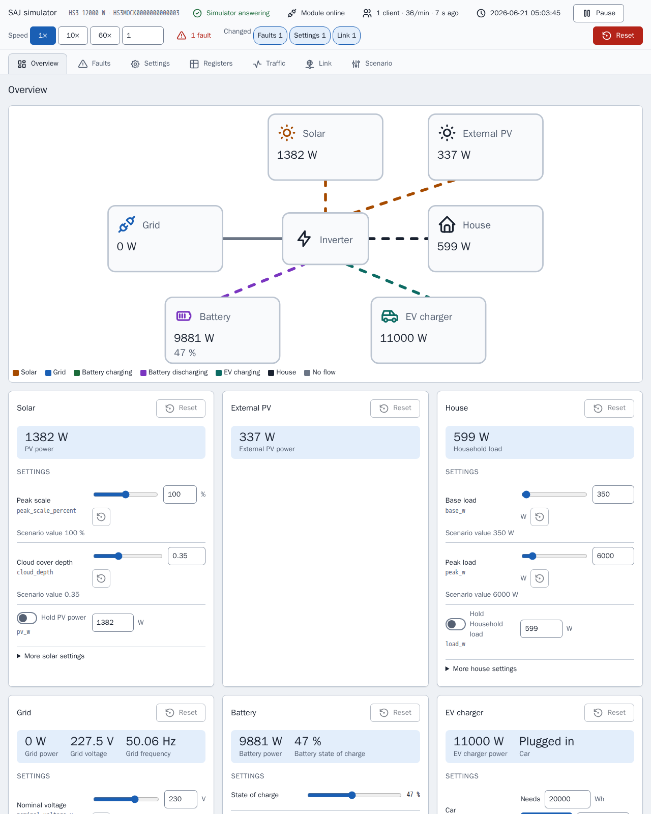

[en](../../en-gb/developer/simulator.md) | [de](../../de/developer/simulator.md) | [nl](../../nl/developer/simulator.md) | [fr](../../fr/developer/simulator.md) | [zh](../../zh-hans/developer/simulator.md) | es | [it](../../it/developer/simulator.md) | [pl](../../pl/developer/simulator.md) | [sv](../../sv/developer/simulator.md)

# Simulador Modbus



Para qué sirve el simulador, cómo ejecutar y configurar un escenario, y cómo ampliar el simulador.

La lista completa de lo que cubre el simulador está en las secciones [Modelos simulados](../../../mock/docs/features.md#simulated-models), [Escenarios](../../../mock/docs/features.md#scenarios) y [Variación](../../../mock/docs/features.md#variation) de la lista de funciones.

El simulador es un dispositivo SAJ de sustitución al que pueden conectarse Home Assistant o cualquier cliente Modbus, de modo que la integración se pueda desarrollar sin tener el hardware ni arriesgar el hardware. El simulador busca pruebas de humo verosímiles, no una emulación exacta, y no es un servidor Modbus general. El paquete es `mock/saj_local_mock/`, y cada simulador se ejecuta en su propio contenedor.

## Decisiones de diseño

- **Independiente.** El simulador no comparte código con la integración, y un contrato de import-linter prohíbe que el simulador importe Home Assistant o `custom_components`. Si ambos lados usaran las mismas definiciones de registros, un error en las definiciones sería invisible.
- **Su propia capa Modbus.** Los dispositivos SAJ reales incumplen el estándar: códigos de excepción extraños, bloques que rechazan lecturas que cruzan su final, un límite bajo de cliente. La integración tiene que sobrellevar esos fallos, así que los fallos están integrados.
- **Un contenedor, un dispositivo.** Cada instancia guarda su propio estado, en su propia carpeta bajo `mock/state/`, de modo que las instancias nunca se afectan entre sí.
- **Se puede cambiar en marcha.** El escenario es el punto de partida, no la única entrada. La página del simulador y las solicitudes entrantes cambian el sistema en marcha, y el escenario sigue siendo el estado conocido al que volver.
- **Determinista.** El clima y la carga dependen solo de la semilla y de la hora simulada. El mismo escenario, instante y escrituras dan los mismos valores, por muchas veces que sondee un cliente.
- **Un balance de energía.** Solo se generan la irradiancia y la carga; todo lo demás se deriva, de modo que los registros nunca se contradicen.
- **Las escrituras surten efecto.** Los ajustes se guardan, se vuelven a leer y se aplican. Una escritura desde la página pasa por la misma validación y el mismo tratamiento que una escritura Modbus, de modo que la integración no puede distinguir las dos y la página no puede dejar el dispositivo en un estado que un cliente no podría alcanzar.
- **La página no sabe nada de modelos.** La página se construye a partir de la descripción que da el dispositivo, así que un modelo nuevo no necesita cambios en la página. La página es una herramienta de desarrollo, así que la página son archivos HTML, CSS y JavaScript sencillos en `mock/static/` servidos tal cual, sin bibliotecas, sin paso de compilación y sin pruebas propias de la página, mientras que el Python que hay detrás de la página se prueba como el resto. Consulta la [página del simulador](simulator-page.md).
- **El módulo es parte de la simulación.** El servidor Modbus representa el módulo de comunicación al que se conecta un cliente, así que los fallos que los informes de campo describen de esos módulos (respuestas lentas o ausentes, códigos de excepción extraños, conexiones caídas, un bloqueo) son ajustes del simulador y no casos especiales repartidos por el dispositivo.
- **El comportamiento de escritura procede de los documentos de SAJ.** Las escrituras las especifican los documentos del protocolo de SAJ y las lecturas reales, no el simulador. Si el simulador se aparta del comportamiento documentado de `0x06` y `0x10`, la desviación es un defecto del simulador que hay que comunicar, no algo alrededor de lo cual ajustar la integración.

## Cómo orientarte

| Para | Mira en |
| --- | --- |
| Por qué el simulador está construido como está | El trabajo terminado [Construir el simulador Modbus de SAJ](../../../.github/work/done/build-saj-modbus-mock-simulator.md), [Añadir el panel de control del simulador](../../../.github/work/done/add-simulator-control-panel.md) y [Rediseñar el panel del simulador con inspector y fallos de enlace](../../../.github/work/done/redesign-simulator-panel-with-inspector-and-link-faults.md) |
| Sistemas ya preparados | [mock/scenarios/](../../../mock/scenarios/) |
| Claves de escenario válidas y valores por defecto | `mock/saj_local_mock/scenario.py` |
| Qué admite cada modelo | `mock/saj_local_mock/models.py` |
| Registros | `mock/saj_local_mock/profiles/` |
| Cómo evolucionan los valores | `mock/saj_local_mock/simulation/` |
| Servicios y puertos | [compose.yaml](../../../compose.yaml) |
| Página del simulador | `panel.py` (rutas), `description.py`, `presets.py` y la página en [mock/static/](../../../mock/static/) |
| Fallos de enlace | `mock/saj_local_mock/link.py` (ajustes, límites, decisiones) y `transport.py` (ejecución de las decisiones) |
| Registro de tráfico | `mock/saj_local_mock/traffic.py` |
| Bits de fallo por modelo | `mock/saj_local_mock/profiles/fault_tables.py` |
| Estado guardado | `mock/saj_local_mock/persistence.py` |

El transporte no sabe nada de SAJ, el dispositivo es responsable de las direcciones y de las reglas de acceso, un perfil enlaza registros con magnitudes simuladas, y la simulación no sabe cómo se transportan los valores. Mantener separadas las capas es lo que permite probar cada capa por sí sola con pruebas unitarias.

## Hablar con el simulador desde un terminal

`make up` inicia los simuladores. Home Assistant llega a cada uno por el nombre de su servicio de Compose en el puerto propio del simulador; desde tu máquina usa `localhost` y el puerto publicado de `compose.yaml`.

Los ejemplos usan [mbpoll](https://github.com/epsilonrt/mbpoll) contra el puerto publicado del simulador HS3. `-0` hace que las direcciones coincidan con los mapas de registros, `-1` lee una vez, `-t 4` selecciona registros de retención y `-a` es el ID de unidad.

Lee el tipo de dispositivo y la potencia nominal (registros `0x8F00` y `0x8F01`):

<!-- jscpd:ignore-start -->
```bash
mbpoll -m tcp -p 5020 -a 1 -0 -1 -t 4:hex -r 0x8F00 -c 2 localhost
```
<!-- jscpd:ignore-end -->

Un HS3 y un H2 responden con tipos de dispositivo distintos, que es la forma más rápida de confirmar qué sistema simula un puerto.

Escribe un ajuste y vuelve a leerlo (aquí el modo de aplicación en `0x3647`):

<!-- jscpd:ignore-start -->
```bash
mbpoll -m tcp -p 5020 -a 1 -0 -t 4 -r 0x3647 localhost 1
mbpoll -m tcp -p 5020 -a 1 -0 -1 -t 4 -r 0x3647 localhost
```
<!-- jscpd:ignore-end -->

Mira cómo rechaza el simulador una solicitud, por ejemplo una dirección fuera de todos los bloques:

<!-- jscpd:ignore-start -->
```bash
mbpoll -m tcp -p 5020 -a 1 -0 -1 -t 4 -r 0x0001 localhost
```
<!-- jscpd:ignore-end -->

Observa cómo cambia un valor quitando `-1`; mbpoll sondea entonces una vez por segundo hasta que lo detengas.

Ejecuta la comprobación de salud propia del simulador, que no necesita ningún cliente instalado:

<!-- jscpd:ignore-start -->
```bash
docker compose exec mock python -m saj_local_mock healthcheck; echo $?
```
<!-- jscpd:ignore-end -->

Las escrituras se conservan entre reinicios en `mock/state/`, que Git ignora, y se restablecen desde la página del simulador o borrando el contenido de la carpeta, consulta [Estado guardado](simulator-page.md#ajustes-preestablecidos-estado-guardado-y-exportación). Las direcciones proceden de los perfiles; las tres de arriba son solo puntos de partida.

## Configurar un escenario

Un escenario es un archivo YAML montado en `/config/config.yaml`. Solo `device.model` es obligatorio, así que un archivo indica solo lo que difiere de los valores por defecto:

<!-- jscpd:ignore-start -->
```yaml
device:
  model: hs3
simulation:
  start: "2026-06-21T12:00:00"
  speed: 600
battery:
  modules: 4
```
<!-- jscpd:ignore-end -->

En el ejemplo, `simulation.speed` son segundos simulados por segundo real, así que esto ejecuta diez minutos simulados cada segundo desde el mediodía de pleno verano: útil para ver un día completo de carga y descarga en unos minutos. `simulation.seed` elige el clima y la carga.

Dos secciones dan forma al comportamiento aleatorio y a los fallos al iniciar; una tercera, `link`, se describe en [Fallos de enlace](simulator-page.md#fallos-de-enlace). `variation` fija los límites, la profundidad y el periodo de los generadores solar, de carga y de red (el nivel de carga permanece en `site.load`), y `faults` lista los bits de fallo activos por equipo con registro y bit, más los códigos de fallo de los módulos de batería:

<!-- jscpd:ignore-start -->
```yaml
variation:
  cloud_depth: 0.9
faults:
  inverter:
    - {register: 0x4005, bit: 23}
  packs:
    - {pack: 1, fault: 1}
```
<!-- jscpd:ignore-end -->

Una clave errónea o una combinación imposible detiene el simulador al iniciar y nombra la clave. El simulador escribe la línea en la salida de error y termina:

```text
invalid scenario: ev_charger.installed: not available on h2
```

## Ejecutar un sistema distinto o adicional

**Prueba un escenario una vez**, sin tocar ningún archivo. El simulador se ejecuta en primer plano en su propio puerto hasta que detengas el simulador:

<!-- jscpd:ignore-start -->
```bash
docker compose run --rm --no-deps -p 5030:502 \
  -v ./mock/scenarios/hs3-off-grid.yaml:/config/config.yaml:ro \
  -v ./mock/state/off-grid:/data \
  mock
```
<!-- jscpd:ignore-end -->

El `-v` adicional es necesario porque el servicio `mock` trae de otro modo el montaje `/data` de `mock/state/hs3/`, y el primer cambio de la ejecución aislada de la red sustituiría el `state.json` del HS3 de desarrollo por el estado aislado de la red. La ejecución aislada de la red conserva su propio estado en `mock/state/off-grid/` entre ejecuciones.

Apunta el primer `-v` a tu propio archivo para ejecutar un escenario que hayas escrito.

**Cambia lo que inicia `make up`** en `compose.override.yaml`. Montar otro archivo sobre la misma ruta sustituye el escenario; un servicio nuevo añade un sistema:

<!-- jscpd:ignore-start -->
```yaml
services:
  mock:
    volumes:
      - ./mock/scenarios/hs3-ev.yaml:/config/config.yaml:ro

  mock-off-grid:
    build:
      context: ./mock
    volumes:
      - ./mock/scenarios/hs3-off-grid.yaml:/config/config.yaml:ro
    ports:
      - "5022:502"
```
<!-- jscpd:ignore-end -->

Cada servicio es un dispositivo independiente con su propio estado. Home Assistant llega al servicio nuevo como `mock-off-grid`, así que se pueden añadir varios sistemas a un mismo Home Assistant uno junto a otro.

## Ampliar el simulador

- **Escenario nuevo:** un archivo en `mock/scenarios/`. `make mock-smoke` recoge cada archivo de la carpeta.
- **Modelo nuevo:** una entrada en `models.py`, un perfil en `profiles/` y la aceptación por la validación de escenarios en `scenario.py`.
- **Peculiaridad nueva:** en la capa que es responsable de ella. El encuadre y las conexiones en el transporte, las direcciones y el acceso en el dispositivo, el comportamiento del modelo en el perfil.

El simulador supera las mismas barreras que la integración, consulta la [página de comprobaciones](checks.md).
