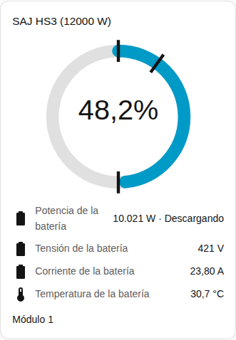
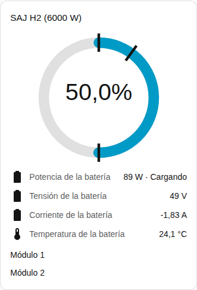

[en](../../../en-gb/user/cards/battery-card.md) | [de](../../../de/user/cards/battery-card.md) | [nl](../../../nl/user/cards/battery-card.md) | [fr](../../../fr/user/cards/battery-card.md) | [zh](../../../zh-hans/user/cards/battery-card.md) | es | [it](../../../it/user/cards/battery-card.md) | [pl](../../../pl/user/cards/battery-card.md) | [sv](../../../sv/user/cards/battery-card.md)

# Tarjeta de batería

La página Tarjeta de batería explica la tarjeta de batería, que muestra la carga, la potencia y las lecturas de la batería. La lista completa está en la sección [Tarjeta de batería](../../../../frontend/docs/features.md#battery-card) de la lista de funciones de las tarjetas. [Añadir un elemento](README.md#añadir-un-elemento) explica cómo añadir la tarjeta y elegir un sistema.

## Qué muestra la tarjeta

- Un anillo muestra el estado de carga. Unas marcas en el anillo muestran la reserva de respaldo, el límite de carga y el límite de descarga conectada a la red.
- La potencia de la batería se muestra con si la batería se está cargando o descargando, y debajo de la potencia la tensión, la corriente, la temperatura y la capacidad utilizable. Las direcciones siguen el [signo de la potencia](../entities-and-prefix.md#signo-de-la-potencia).
- Con Mostrar módulos de batería activado, que es el valor por defecto, cada módulo recibe un grupo de filas con el estado de carga, el estado de salud, la tensión, la corriente, la temperatura, los ciclos, el fallo y la advertencia. Una lectura de módulo aparece solo cuando la entidad de la lectura está habilitada. La mayoría de las lecturas de módulo se crean deshabilitadas, por eso la captura de pantalla muestra solo el nombre del módulo. Habilita en Home Assistant las entidades que quieras. Las [entidades de los módulos de batería](../entities/battery-packs.md) están en la referencia de entidades.
- Un sistema sin batería lo indica.

## Diferencias entre los modelos

- **HS3:** un módulo.
- **H2:** un grupo de filas por cada módulo que informa el inversor, hasta cinco. La captura de pantalla muestra un H2 con dos módulos. Consulta el [equipo opcional](../optional-equipment.md#módulos-de-batería).

La [tarjeta de fallos](faults-card.md) lista el fallo y la advertencia activos de cada módulo. Las entidades de fallo y de advertencia están habilitadas por defecto.

## Opciones

| Opción en el editor | Clave YAML | Valor por defecto |
| --- | --- | --- |
| Sistema | `device` | El primer sistema |
| Mostrar módulos de batería | `show_packs` | Activado |

## Aún no compatible

- Cambiar un ajuste de la batería desde la tarjeta. La tarjeta de batería muestra solo lecturas. Usa la [tarjeta de controles](controls-card.md) para los límites de la batería.
