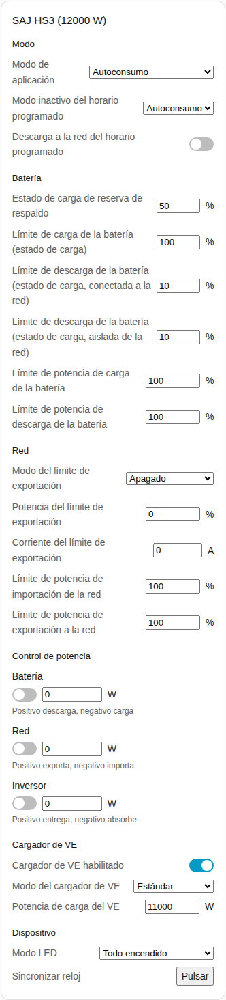
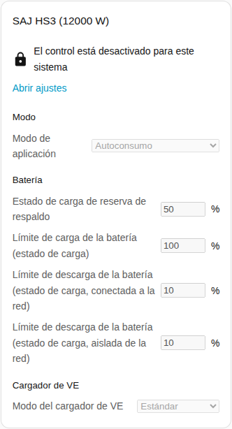
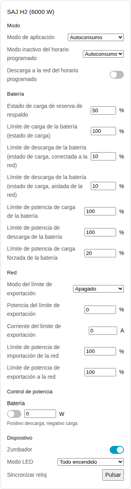

[en](../../../en-gb/user/cards/controls-card.md) | [de](../../../de/user/cards/controls-card.md) | [nl](../../../nl/user/cards/controls-card.md) | [fr](../../../fr/user/cards/controls-card.md) | [zh](../../../zh-hans/user/cards/controls-card.md) | es | [it](../../../it/user/cards/controls-card.md) | [pl](../../../pl/user/cards/controls-card.md) | [sv](../../../sv/user/cards/controls-card.md)

# Tarjeta de controles

La página Tarjeta de controles explica la tarjeta de controles, que reúne los ajustes de un sistema en secciones para que puedas cambiarlos desde un panel. La lista completa está en la sección [Tarjeta de controles](../../../../frontend/docs/features.md#controls-card) de la lista de funciones de las tarjetas. [Añadir un elemento](README.md#añadir-un-elemento) explica cómo añadir la tarjeta y elegir un sistema. Los ajustes que hay detrás de los controles se describen en [cambiar ajustes](../changing-settings.md).

## Qué muestra la tarjeta

- Las secciones son Modo, Batería, Red, Control de potencia, Cargador de VE y Dispositivo. Una sección sin nada que mostrar se omite.
- **Modo:** el modo de aplicación y los ajustes del horario programado.
- **Batería:** la reserva de respaldo y los límites de carga y descarga.
- **Red:** los ajustes del límite de exportación y los límites de potencia de la red.
- **Control de potencia:** cada función de [control de potencia](../power-control.md) que tiene el sistema, con un interruptor, un objetivo de potencia y una indicación de lo que hacen una potencia positiva y una negativa.
- **Cargador de VE:** el interruptor, el modo y la potencia de carga del cargador.
- **Dispositivo:** el zumbador, el modo LED y la sincronización del reloj.
- Cada ajuste usa el control que le corresponde: un control deslizante o un campo numérico, una lista, un interruptor, un campo de hora o un botón.
- Un control cambia el inversor una vez por decisión y luego muestra el valor que tiene el inversor. Un cambio rechazado aparece bajo el control.
- La tarjeta no tiene botón Reiniciar inversor, así que una pulsación en un panel no puede reiniciar el inversor. Reiniciar sigue siendo una entidad.

## Cuando no se permite el control

Mientras [Permitir control](../changing-settings.md#permitir-control) está desactivado para el sistema, todos los controles están deshabilitados. Un candado sobre los controles enlaza con los ajustes de la integración, donde activas Permitir control.

## Diferencias entre los modelos

- **Solo HS3:** la sección Cargador de VE, y las funciones de control de potencia Red e Inversor.
- **Solo H2:** el zumbador y el límite de potencia de carga forzada de la batería. El H2 tiene solo la función de control de potencia Batería.

## Opciones

| Opción en el editor | Clave YAML | Valor por defecto |
| --- | --- | --- |
| Sistema | `device` | El primer sistema |
| Secciones | `sections`, una lista de `mode`, `battery`, `grid`, `power_control`, `ev_charger` y `device` | Todas las secciones |

## Aún no compatible

- Un botón Reiniciar inversor. Reiniciar sigue siendo una entidad.
- Programaciones de control de potencia. Configura las programaciones en la página de la integración, consulta el [control de potencia](../power-control.md#seguir-una-programación).
