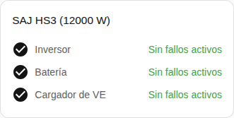

[en](../../../en-gb/user/cards/faults-card.md) | [de](../../../de/user/cards/faults-card.md) | [nl](../../../nl/user/cards/faults-card.md) | [fr](../../../fr/user/cards/faults-card.md) | [zh](../../../zh-hans/user/cards/faults-card.md) | es | [it](../../../it/user/cards/faults-card.md) | [pl](../../../pl/user/cards/faults-card.md) | [sv](../../../sv/user/cards/faults-card.md)

# Tarjeta de fallos

La página Tarjeta de fallos explica la tarjeta de fallos, que lista los fallos activos de cada equipo. La lista completa está en la sección [Tarjeta de fallos](../../../../frontend/docs/features.md#faults-card) de la lista de funciones de las tarjetas. [Añadir un elemento](README.md#añadir-un-elemento) explica cómo añadir la tarjeta y elegir un sistema. Los fallos proceden de las [entidades de fallo del dispositivo](../faults-and-repairs.md#fallos-del-dispositivo).

## Qué muestra la tarjeta

- Los fallos se agrupan por inversor, batería y cargador de VE, y cada fallo activo muestra cuánto hace que empezó. Los fallos y las advertencias de los módulos de batería están en el grupo de la batería.
- Un fallo no reconocido indica que se consulte la [descarga de diagnósticos](../troubleshooting.md#descargar-los-diagnósticos) para ver el registro y el bit.
- Un botón Borrar fallo está bajo los fallos activos del inversor. El botón envía la orden Borrar fallo actual. Mientras el control no está permitido para el sistema, el botón está deshabilitado y un candado enlaza con los ajustes de la integración. Consulta [Permitir control](../changing-settings.md#permitir-control).
- Con Mostrar grupos sin fallos activado, que es el valor por defecto, un grupo sin ningún fallo activo se muestra como despejado, como en la captura de pantalla. Con la opción desactivada, la tarjeta muestra solo los grupos con un fallo activo.

Un sistema sin batería o sin cargador de VE no tiene fallos que mostrar para el equipo que falta, así que la tarjeta no dibuja el grupo de ese equipo.

## Opciones

| Opción en el editor | Clave YAML | Valor por defecto |
| --- | --- | --- |
| Sistema | `device` | El primer sistema |
| Mostrar grupos sin fallos | `show_groups_without_faults` | Activado |

## Aún no compatible

- Borrar desde la tarjeta los fallos de la batería o del cargador de VE. El botón Borrar fallo está solo bajo los fallos activos del inversor.
