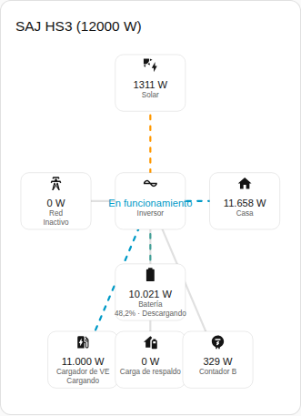
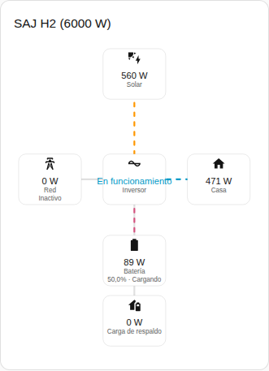

[en](../../../en-gb/user/cards/power-flow-card.md) | [de](../../../de/user/cards/power-flow-card.md) | [nl](../../../nl/user/cards/power-flow-card.md) | [fr](../../../fr/user/cards/power-flow-card.md) | [zh](../../../zh-hans/user/cards/power-flow-card.md) | es | [it](../../../it/user/cards/power-flow-card.md) | [pl](../../../pl/user/cards/power-flow-card.md) | [sv](../../../sv/user/cards/power-flow-card.md)

# Tarjeta de flujo de potencia

La página Tarjeta de flujo de potencia explica la tarjeta de flujo de potencia, que dibuja la potencia en vivo entre solar, batería, red, casa y el equipo opcional. La lista completa está en la sección [Tarjeta de flujo de potencia](../../../../frontend/docs/features.md#power-flow-card) de la lista de funciones de las tarjetas. [Añadir un elemento](README.md#añadir-un-elemento) explica cómo añadir la tarjeta y elegir un sistema.



## Qué muestra la tarjeta

- Solar, batería, red y casa se dibujan alrededor del inversor, que muestra el estado de funcionamiento.
- Cada línea muestra la dirección del flujo y se mueve más rápido a medida que crece la potencia. Una potencia de 10 W o menos se dibuja como inactiva.
- La batería muestra el estado de carga y si la batería se está cargando o descargando. La red muestra si el sistema está importando o exportando. Las direcciones siguen el [signo de la potencia](../entities-and-prefix.md#signo-de-la-potencia).
- Con Mostrar equipo opcional activado, que es el valor por defecto, la tarjeta también dibuja la carga de respaldo, el Contador B y el cargador de VE cuando el sistema tiene el equipo. El Contador B es una lectura sin dirección.
- Con Mostrar strings solares activado, se lista la potencia de cada string solar. La opción está desactivada por defecto.
- Ámbito elige entre las lecturas del sistema, que es el valor por defecto, y las lecturas del sistema en paralelo. Un sistema sin lecturas en paralelo muestra el estado vacío con el ámbito en paralelo.

## Diferencias entre los modelos

- **Solo HS3:** el cargador de VE, como en la captura de pantalla de arriba.
- **H2:** la tarjeta dibuja las partes de la tarjeta del HS3, salvo el cargador de VE. La captura de pantalla de abajo muestra un H2 que está cargando la batería.



## Opciones

| Opción en el editor | Clave YAML | Valor por defecto |
| --- | --- | --- |
| Sistema | `device` | El primer sistema |
| Mostrar strings solares | `show_strings` | Desactivado |
| Mostrar equipo opcional | `show_optional_equipment` | Activado |
| Ámbito | `scope` (`system` o `parallel`) | `system` |

<!-- jscpd:ignore-start -->
```yaml
type: custom:saj-local-power-flow-card
device: 0123456789abcdef0123456789abcdef
show_strings: false
show_optional_equipment: true
scope: system
```
<!-- jscpd:ignore-end -->

El valor `device` es el ID del dispositivo en Home Assistant. El editor visual rellena el valor por ti. Los nombres de las entidades que hay detrás de cada parte están en la [referencia de entidades](../entities/README.md).

## Aún no compatible

- Una dirección para el Contador B. La tarjeta dibuja el Contador B como una lectura sin dirección.
