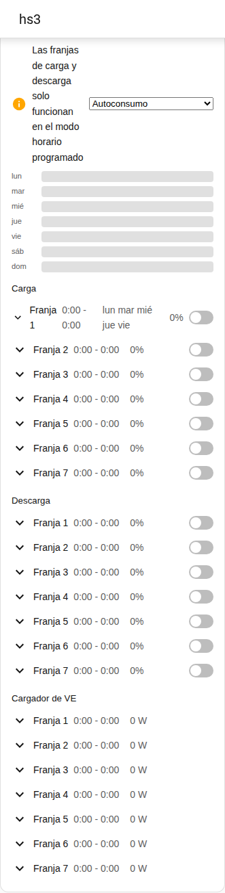
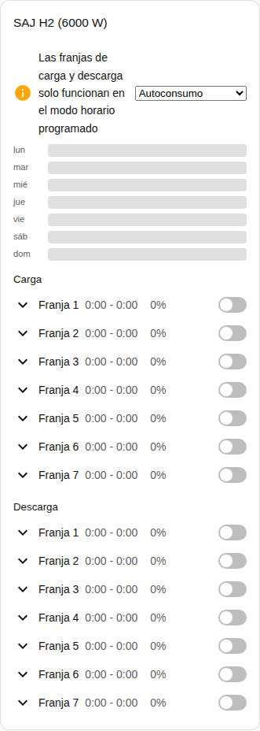

[en](../../../en-gb/user/cards/schedule-card.md) | [de](../../../de/user/cards/schedule-card.md) | [nl](../../../nl/user/cards/schedule-card.md) | [fr](../../../fr/user/cards/schedule-card.md) | [zh](../../../zh-hans/user/cards/schedule-card.md) | es | [it](../../../it/user/cards/schedule-card.md) | [pl](../../../pl/user/cards/schedule-card.md) | [sv](../../../sv/user/cards/schedule-card.md)

# Tarjeta de programación

La página Tarjeta de programación explica la tarjeta de programación, que muestra y edita las franjas de carga, de descarga y del cargador de VE. La lista completa está en la sección [Tarjeta de programación](../../../../frontend/docs/features.md#schedule-card) de la lista de funciones de las tarjetas. [Añadir un elemento](README.md#añadir-un-elemento) explica cómo añadir la tarjeta y elegir un sistema.

## Qué muestra la tarjeta

- Las franjas de carga, de descarga y del cargador de VE, cada una con las horas, la potencia, los días y si la franja está activada. La opción Tipos de franja elige qué tipos muestra la tarjeta.
- Con Mostrar línea de tiempo semanal activado, que es el valor por defecto, una línea de tiempo semanal dibuja cada franja como una barra. Pulsa una barra para abrir la franja.
- Una franja abierta tiene un editor para el inicio, el fin, la potencia, los días y los demás ajustes de la franja.
- Una franja aparece solo cuando todas las entidades de la franja están habilitadas, y la tarjeta cuenta las franjas que omite. Activar [Permitir control](../changing-settings.md#el-conjunto-de-control) habilita las entidades de las franjas.
- Las franjas de carga y de descarga funcionan solo en un modo de aplicación de horario programado. Cuando el modo de aplicación es otro modo, un aviso lo indica y muestra junto al aviso la lista de modos. Cuentan tanto Horario programado como Horario programado (BMS).
- Mientras el control no está permitido para el sistema, todos los controles de la tarjeta están deshabilitados y un candado enlaza con los ajustes de la integración. Consulta [Permitir control](../changing-settings.md#permitir-control).

## Diferencias entre los modelos

- **Solo HS3:** las franjas del cargador de VE.
- **H2:** solo franjas de carga y de descarga, como muestra la captura de pantalla de abajo.

Los botones de días de una franja son los botones de la [función de tarjeta mosaico de días de la semana](weekdays-feature.md).

## Opciones

| Opción en el editor | Clave YAML | Valor por defecto |
| --- | --- | --- |
| Sistema | `device` | El primer sistema |
| Tipos de franja | `slot_kinds`, una lista de `charge`, `discharge` y `ev_charger` | Todos los tipos |
| Mostrar línea de tiempo semanal | `show_timeline` | Activado |

## Aún no compatible

- Programaciones de control de potencia. Una programación de control de potencia sigue un ayudante de programación de Home Assistant, consulta el [control de potencia](../power-control.md#seguir-una-programación).
