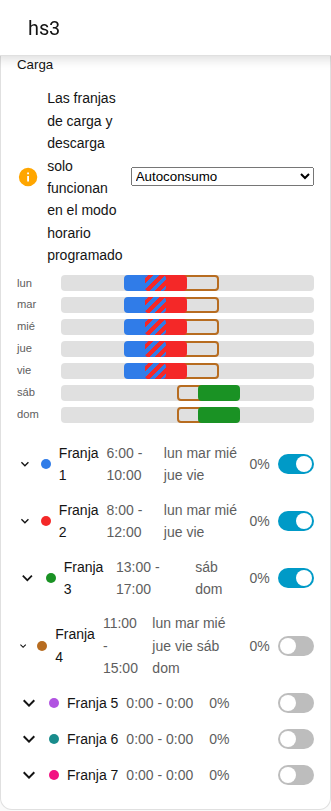
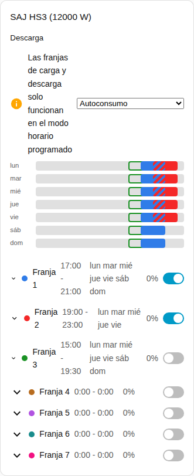
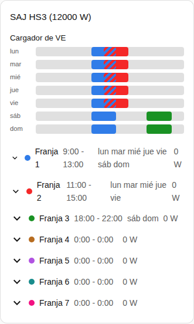

[en](../../../en-gb/user/cards/schedule-cards.md) | [de](../../../de/user/cards/schedule-cards.md) | [nl](../../../nl/user/cards/schedule-cards.md) | [fr](../../../fr/user/cards/schedule-cards.md) | [zh](../../../zh-hans/user/cards/schedule-cards.md) | es | [it](../../../it/user/cards/schedule-cards.md) | [pl](../../../pl/user/cards/schedule-cards.md) | [sv](../../../sv/user/cards/schedule-cards.md)

# Tarjetas de programación

La página Tarjetas de programación explica las tres tarjetas de programación. Cada tarjeta muestra y edita las franjas de un solo tipo: carga, descarga o cargador de VE. La lista completa está en la sección [Schedule cards](../../../../frontend/docs/features.md#schedule-cards) de la lista de funciones de las tarjetas. [Añadir un elemento](README.md#añadir-un-elemento) explica cómo añadir una tarjeta y elegir un sistema.

## Qué muestra cada tarjeta de programación

- El título de la tarjeta y, bajo el título, un encabezado con el tipo de la tarjeta.
- Las franjas del tipo, cada una con las horas, la potencia, los días y si la franja está activada.
- Un color para cada número de franja. La franja 1 tiene el mismo color en las tres tarjetas. Cada fila de franja empieza con una marca de color en el color de la franja.
- Con Mostrar línea de tiempo semanal activado, que es el valor por defecto, una línea de tiempo semanal dibuja cada franja como una barra en el color de la franja. Pulsa una barra para abrir la franja.
- Una franja desactivada es un contorno en el color de la franja, sin relleno. La barra de una franja activada oculta la parte de un contorno que cruza. Donde dos o más franjas activadas se solapan en un día, la línea de tiempo dibuja el solape como rayas en los colores de las franjas que se solapan. Una franja desactivada no forma ningún solape. Pulsa un solape para abrir la franja solapada con el número más bajo.
- Una franja abierta tiene un editor para el inicio, el fin, la potencia, los días y los demás ajustes de la franja.
- Una franja aparece solo cuando todas las entidades de la franja están habilitadas, y la tarjeta cuenta las franjas que omite. Activar [Permitir control](../changing-settings.md#el-conjunto-de-control) habilita las entidades de las franjas.
- Mientras el control no está permitido para el sistema, todos los controles de la tarjeta están deshabilitados y un candado enlaza con los ajustes de la integración. Consulta [Permitir control](../changing-settings.md#permitir-control).

Los botones de días de una franja son los botones de la [función de tarjeta mosaico de días de la semana](weekdays-feature.md).

## Opciones

Las tres tarjetas tienen las mismas opciones.

| Opción en el editor | Clave YAML | Valor por defecto |
| --- | --- | --- |
| Sistema | `device` | El primer sistema |
| Mostrar línea de tiempo semanal | `show_timeline` | Activado |

## Tarjeta de programación de carga

La Tarjeta de programación de carga muestra las franjas de carga.

Las franjas de carga funcionan solo en un modo de aplicación de horario programado. Cuando el modo de aplicación es otro modo, un aviso lo indica y muestra junto al aviso la lista de modos. Cuentan tanto Horario programado como Horario programado (BMS).

## Tarjeta de programación de descarga

La Tarjeta de programación de descarga muestra las franjas de descarga.

Las franjas de descarga funcionan solo en un modo de aplicación de horario programado, así que la tarjeta muestra el mismo aviso que la Tarjeta de programación de carga.

## Tarjeta de programación del cargador de VE

La Tarjeta de programación del cargador de VE muestra las franjas del cargador de VE. La tarjeta no muestra ningún aviso sobre el modo de horario programado.

## Diferencias entre los modelos

- **Solo HS3:** las franjas del cargador de VE. En un H2, la Tarjeta de programación del cargador de VE muestra el estado vacío, que indica qué tipo de entidad habilitar.
- **H2:** solo franjas de carga y de descarga.

## Aún no compatible

- Programaciones de control de potencia. Una programación de control de potencia sigue un ayudante de programación de Home Assistant, consulta el [control de potencia](../power-control.md#seguir-una-programación).
