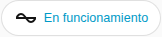

[en](../../../en-gb/user/cards/status-badge.md) | [de](../../../de/user/cards/status-badge.md) | [nl](../../../nl/user/cards/status-badge.md) | [fr](../../../fr/user/cards/status-badge.md) | [zh](../../../zh-hans/user/cards/status-badge.md) | es | [it](../../../it/user/cards/status-badge.md) | [pl](../../../pl/user/cards/status-badge.md) | [sv](../../../sv/user/cards/status-badge.md)

# Insignia de estado

La página Insignia de estado explica la insignia de estado, que muestra el estado de un sistema en la fila de insignias de un panel. La lista completa está en la sección [Insignia de estado](../../../../frontend/docs/features.md#status-badge) de la lista de funciones de las tarjetas. [Añadir un elemento](README.md#añadir-un-elemento) explica cómo añadir la insignia y elegir un sistema.



## Qué muestra la insignia

- El estado de funcionamiento, coloreado según lo saludable que sea el estado, y el número de equipos con un fallo activo. La insignia muestra el número solo cuando hay un fallo activo, así que la captura de pantalla muestra solo el estado.
- La insignia dice Sin respuesta cuando el sistema no responde.
- Al pulsar la insignia se abren los detalles del estado de funcionamiento.

## Opciones

| Opción en el editor | Clave YAML | Valor por defecto |
| --- | --- | --- |
| Sistema | `device` | El primer sistema |

```yaml
type: custom:saj-local-status-badge
device: 0123456789abcdef0123456789abcdef
```

El valor `device` es el ID del dispositivo en Home Assistant. El editor visual rellena el valor por ti.

## Aún no compatible

- Opciones distintas del sistema.
