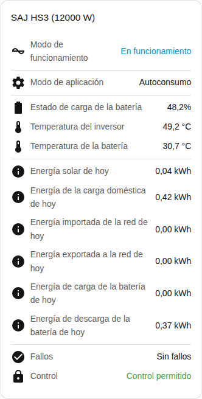

[en](../../../en-gb/user/cards/status-card.md) | [de](../../../de/user/cards/status-card.md) | [nl](../../../nl/user/cards/status-card.md) | [fr](../../../fr/user/cards/status-card.md) | [zh](../../../zh-hans/user/cards/status-card.md) | es | [it](../../../it/user/cards/status-card.md) | [pl](../../../pl/user/cards/status-card.md) | [sv](../../../sv/user/cards/status-card.md)

# Tarjeta de estado

La página Tarjeta de estado explica la tarjeta de estado, que resume un sistema en un solo lugar. La lista completa está en la sección [Tarjeta de estado](../../../../frontend/docs/features.md#status-card) de la lista de funciones de las tarjetas. [Añadir un elemento](README.md#añadir-un-elemento) explica cómo añadir la tarjeta y elegir un sistema.

## Qué muestra la tarjeta

- El estado de funcionamiento, coloreado según lo saludable que sea el estado, y el modo de aplicación.
- El estado de carga de la batería, las temperaturas del inversor y de la batería y el modo aislado de la red.
- Con Mostrar la energía de hoy activado, que es el valor por defecto, la tarjeta muestra la energía solar, de la carga, importada de la red, exportada a la red, de carga de la batería y de descarga de la batería de hoy.
- El número de equipos con un fallo activo, o que no hay fallos. Consulta los [fallos del dispositivo](../faults-and-repairs.md#fallos-del-dispositivo).
- Si se permite el control para el sistema. Consulta [Permitir control](../changing-settings.md#permitir-control).

## Diferencias entre los modelos

- **Solo H2:** cuando el modo de aplicación que ejecuta el inversor difiere del modo que elegiste, la tarjeta muestra además el modo que se ejecuta ahora. La fila aparece solo cuando la entidad Modo de aplicación (en vigor) está habilitada. Esa entidad se crea deshabilitada. Consulta la [referencia de entidades](../entities/README.md).

## Opciones

| Opción en el editor | Clave YAML | Valor por defecto |
| --- | --- | --- |
| Sistema | `device` | El primer sistema |
| Mostrar la energía de hoy | `show_energy` | Activado |

## Aún no compatible

- Cambiar un ajuste desde la tarjeta. La tarjeta de estado solo muestra. Usa la [tarjeta de controles](controls-card.md) para cambiar ajustes.
