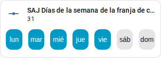

[en](../../../en-gb/user/cards/weekdays-feature.md) | [de](../../../de/user/cards/weekdays-feature.md) | [nl](../../../nl/user/cards/weekdays-feature.md) | [fr](../../../fr/user/cards/weekdays-feature.md) | [zh](../../../zh-hans/user/cards/weekdays-feature.md) | es | [it](../../../it/user/cards/weekdays-feature.md) | [pl](../../../pl/user/cards/weekdays-feature.md) | [sv](../../../sv/user/cards/weekdays-feature.md)

# Función de tarjeta mosaico de días de la semana

La página Función de tarjeta mosaico de días de la semana explica la función de días de la semana, que pone siete botones de días en una tarjeta mosaico para fijar los días de una franja. La lista completa está en la sección [Función de tarjeta mosaico de días de la semana](../../../../frontend/docs/features.md#weekdays-tile-card-feature) de la lista de funciones de las tarjetas. Los días de una franja son las entidades Días de la semana de las franjas de carga, de descarga y del cargador de VE, listadas en las áreas [Batería](../entities/battery.md) y [Cargador de VE](../entities/ev-charger.md) de la referencia de entidades.



## Añadir la función

1. Añade una tarjeta mosaico a un panel y elige la entidad Días de la semana de una franja como entidad de la tarjeta mosaico.
2. Abre las funciones de la tarjeta mosaico, elige Añadir función y elige Días de la semana de SAJ Local.

La función se ofrece solo para una tarjeta mosaico cuya entidad es la entidad de días de la semana de una franja. La función no tiene opciones.

```yaml
type: tile
entity: number.saj_charge_slot_1_days
features:
  - type: custom:saj-local-weekdays-feature
```

El ID de entidad del ejemplo no tiene prefijo. Si fijas un [prefijo](../entities-and-prefix.md#el-prefijo), el ID de la entidad lleva el prefijo después de `saj_`.

## Cómo funcionan los botones

- Siete botones de días con nombre empiezan en tu primer día de la semana, que procede de los ajustes de Home Assistant o de tu idioma.
- SAJ Local envía el cambio 1,5 segundos después de la última pulsación, para que puedas elegir varios días en un solo cambio.
- El inversor guarda los días como un solo número que no se mueve con tu primer día de la semana. El lunes es el bit más bajo y el domingo el más alto en todos los modelos, así que de lunes a viernes es 31, como en la captura de pantalla, y lunes, miércoles y viernes es 21.
- Los botones están deshabilitados mientras [Permitir control](../changing-settings.md#permitir-control) está desactivado para el sistema.

La [tarjeta de programación](schedule-card.md) usa los botones en el editor de franjas.

## Aún no compatible

- Cualquier entidad distinta de la entidad de días de la semana de una franja. SAJ Local no ofrece la función para otras tarjetas mosaico.
