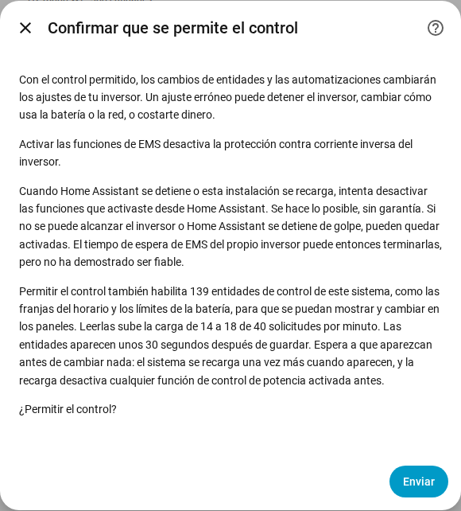

[en](../../en-gb/user/changing-settings.md) | [de](../../de/user/changing-settings.md) | [nl](../../nl/user/changing-settings.md) | [fr](../../fr/user/changing-settings.md) | [zh](../../zh-hans/user/changing-settings.md) | es | [it](../../it/user/changing-settings.md) | [pl](../../pl/user/changing-settings.md) | [sv](../../sv/user/changing-settings.md)

# Cambiar ajustes

La página Cambiar ajustes explica cómo permitir que SAJ Local cambie los ajustes de tu inversor, qué ocurre con un cambio y qué cambios se rechazan siempre. Las listas completas están en las secciones [Cambiar ajustes](../../../custom_components/saj_local/docs/features.md#changing-settings) y [EMS](../../../custom_components/saj_local/docs/features.md#ems) de la lista de funciones de la integración. Los ajustes y las órdenes se reparten entre las áreas de la [referencia de entidades](entities/README.md), principalmente [Ajustes](entities/settings.md) y [Batería](entities/battery.md).

Escribir en el inversor está desactivado hasta que permites el control de un sistema. Mientras Permitir control está desactivado, los ajustes muestran el valor actual pero rechazan cualquier cambio, con un mensaje que indica dónde activar el control. No se envía nada al inversor.

## Permitir control

1. Abre Configurar, el engranaje de la fila del sistema en la página de la integración SAJ Local. También puedes activar Permitir control mientras añades el sistema.
2. Activa Permitir control y elige Enviar.
3. Lee la confirmación y elige Enviar otra vez.

La confirmación advierte de que un ajuste erróneo puede detener el inversor, cambiar cómo usa el inversor la batería o la red, o costarte dinero. La confirmación también indica:

- Activar las funciones de EMS desactiva la protección contra corriente inversa del inversor.
- Cuando Home Assistant se detiene, o el sistema se recarga, SAJ Local intenta desactivar las funciones que activaste desde Home Assistant. La desactivación se hace lo posible, sin garantía.
- Permitir el control habilita entidades de control, y leer las entidades sube la carga de solicitudes. El diálogo muestra el número de entidades y la carga antes y después.

Solo HS3: la confirmación en la configuración también pide el latido de EMS. En Configurar el latido es un campo del formulario principal. Consulta [EMS](#ems).

Desactivar Permitir control no necesita confirmación. Cada sistema tiene un sensor binario Control permitido, en la categoría de diagnóstico, que está activo mientras el sistema acepta cambios. Las [tarjetas del panel](cards/README.md) leen el sensor y bloquean los controles mientras el sensor está apagado. El sensor es de solo lectura, porque un interruptor en un panel activaría la escritura sin la advertencia.

## El conjunto de control

La mayoría de las franjas del horario y muchos ajustes se crean deshabilitados, así que una tarjeta del panel no tendría nada que mostrar ni cambiar. Por eso, activar Permitir control también habilita el conjunto de control del sistema:

- las franjas de carga, de descarga y del cargador de VE (las franjas del cargador de VE son solo HS3);
- el modo de aplicación y los ajustes del horario programado;
- los límites de la batería y los límites de la red;
- los ajustes del cargador de VE (solo HS3);
- los interruptores y objetivos del control de potencia, consulta el [control de potencia](power-control.md);
- el modo LED, el zumbador (solo H2) y los botones Sincronizar reloj y Borrar fallo actual.

Las lecturas de los módulos de batería y las demás entidades de solo lectura no forman parte del conjunto.

- **Las entidades aparecen después de unos 30 segundos.** Home Assistant recarga un sistema 30 segundos después de habilitar una entidad del sistema. Espera a que aparezcan las entidades antes de cambiar nada, porque la recarga desactiva cualquier función de control de potencia que hayas activado entretanto. Sigue otra recarga cuando aparece más tarde un nuevo miembro del conjunto, como las franjas del cargador de VE después de detectar un cargador de VE.
- **Desactivar Permitir control** deshabilita las entidades que SAJ Local habilitó, y no sigue ninguna recarga.
- **Tu elección prevalece.** Una entidad que deshabilitaste antes de activar el control sigue deshabilitada, y una entidad que habilitaste tú mismo sigue habilitada. Una tarjeta cuenta una franja con una entidad deshabilitada como omitida.

## Qué ocurre con un cambio

SAJ Local comprueba un cambio antes de enviar nada. SAJ Local rechaza el cambio, con un mensaje distinto para cada caso, cuando:

- Permitir control está desactivado;
- el modelo está sin verificar. Un sistema con un modelo que no se pudo verificar nunca recibe escrituras, consulta los [primeros pasos](getting-started.md#cuando-no-se-reconoce-el-inversor);
- el ajuste es un ajuste de puesta en servicio;
- el valor no es válido;
- el inversor no es accesible;
- se alcanza el límite de escrituras. No van más de 20 cambios a una dirección de inversor en cualquier periodo de 60 segundos, y un cambio por encima del límite se rechaza y no se pone en cola.

Cada mensaje indica que no se cambió el inversor. En los demás casos, SAJ Local escribe el cambio una vez y vuelve a leer el valor, y la entidad muestra el valor que tiene el inversor.

| Qué ocurrió | Qué ves |
| --- | --- |
| El inversor rechazó el cambio | El mensaje da el código de excepción. |
| El inversor no respondió | El mensaje dice que el cambio puede haberse aplicado o no. SAJ Local no vuelve a enviar nada y vuelve a leer el inversor tras reconectar. |
| El inversor tiene un valor distinto | La entidad muestra el valor que tiene el inversor, y el cambio falla. |

Un cambio en un ajuste de un registro que contiene varios ajustes deja sin cambiar los demás ajustes del registro.

## Qué puedes cambiar

- El modo de aplicación, siete franjas de carga y siete franjas de descarga (cada una con inicio, fin, potencia, días y encendido o apagado), el modo inactivo del horario programado y la descarga a la red, y la reserva de respaldo.
- Los límites de carga y descarga de la batería, el despertar automático de la batería, el límite de exportación, los límites de potencia de importación y exportación de la red y las potencias del modo pasivo.
- Solo HS3: los ajustes del cargador de VE y siete franjas del cargador de VE.
- Solo H2: el zumbador y el límite de potencia de carga forzada de la batería. Ambos modelos tienen el modo LED.
- Órdenes, como botones que se crean deshabilitados: Borrar fallo actual, Reiniciar inversor y Sincronizar reloj, que envía la hora local de Home Assistant. Solo HS3: Quitar límite de potencia solar por EMS.

Las [tarjetas del panel](cards/controls-card.md) ofrecen los ajustes compartidos en un solo lugar. La tarjeta de controles no tiene botón de reinicio, así que una pulsación en un panel no puede reiniciar el inversor.

## Ajustes de puesta en servicio

Los ajustes de puesta en servicio se muestran y no se pueden cambiar desde Home Assistant: el contador, el RS485, el protocolo de la batería, la red y el enlace del cargador de VE, y en el H2 también el tipo de red, la configuración en paralelo, los modos de entrada, los límites de protección y otros ajustes del instalador. Un valor erróneo puede dejar al inversor sin comunicación con el contador, la batería, el cargador o Home Assistant. Los ajustes de puesta en servicio son sensores de solo lectura en la categoría de diagnóstico. Haz esos cambios en la aplicación SAJ elekeeper, consulta el [requisito](../../../custom_components/saj_local/docs/requirements.md#changing-settings).

## Aún no compatible

- Restablecer de fábrica y borrar el historial de energía. SAJ Local no ofrece ninguna de las dos cosas.
- Cambiar ajustes de puesta en servicio.
- Cambiar ajustes en un sistema cuyo modelo está sin verificar.

## EMS

Solo HS3: EMS pone el inversor bajo control externo. El H2 no tiene entidades de EMS. SAJ Local ofrece como entidades el tiempo de espera de EMS y cinco límites: la corriente de carga y descarga de la batería, la potencia de importación y exportación del inversor, y la potencia solar. Los límites se pueden ajustar, y SAJ Local no sondea los límites. Entre latidos, los límites muestran el último valor que envió SAJ Local, y los límites son desconocidos antes del primer cambio. El [control de potencia](power-control.md) activa y desactiva las funciones de EMS.

- **El latido mantiene activa una función.** SAJ Local lee el objetivo de cada función de EMS que activaste desde Home Assistant, y los límites, en cada intervalo de latido. Leer cuenta como actividad de EMS, así que el latido no escribe nada.
- **El intervalo es de 60 segundos por defecto.** Puedes ajustar de 30 a 3600 segundos, en la confirmación de Permitir control durante la configuración y en Configurar.
- **El tiempo de espera debe ser mayor que el latido.** No se puede activar una función mientras el tiempo de espera de EMS del inversor no sea mayor que el latido, y el tiempo de espera no se puede ajustar tan bajo.
- **Desactivación al detenerse.** Cuando SAJ Local se descarga o Home Assistant se detiene, SAJ Local desactiva las funciones de EMS que activaste. Una función que ya estaba activada cuando se cargó SAJ Local no se toca.
- **La desactivación se hace lo posible, sin garantía.** Cuando no se puede alcanzar el inversor, o Home Assistant se detiene de golpe, las funciones siguen activadas. El tiempo de espera de EMS del inversor puede terminar las funciones, pero SAJ Local no cuenta con el tiempo de espera, consulta [probado en hardware](#probado-en-hardware).

## Probado en hardware

Las notas siguientes indican qué ajustes se han probado en un inversor real, y cuáles se basan solo en informes de campo o en los documentos del protocolo de SAJ.

HS3, escritos de registro en registro en un HS3 real y vueltos a leer:

- El Modo de aplicación, el Estado de carga de reserva de respaldo, la Potencia de carga de la batería en modo pasivo, el Tiempo de espera de EMS, los cuatro bits de habilitación de EMS que escribe el [control de potencia](power-control.md), y los tres objetivos de EMS y los cinco límites de EMS.
- En el HS3, la Potencia de carga de la batería en modo pasivo fija la potencia del modo Respaldo.
- El modo de aplicación EMS por sí solo deja el inversor inactivo, con la casa funcionando desde la red, y el inversor no sale de EMS por sí mismo.
- El tiempo de espera de EMS terminó EMS a los 5 segundos, pero no terminó EMS a los 20 ni a los 60 segundos mientras otro cliente sondeaba el inversor. SAJ Local no cuenta con el tiempo de espera.
- El límite de potencia solar solo tiene efecto mientras una función de EMS está activada.
- Cuando una función de EMS se detiene, el inversor vuelve al modo de aplicación que tenía antes.
- Horario programado (BMS) es el modo que informa el HS3 cuando la aplicación de SAJ selecciona el modo TOU (BMS) de la aplicación, que no es el modo de horario programado de la aplicación. SAJ Local nunca ha escrito Horario programado (BMS) en un inversor.

H2, construido a partir de informes de campo de unidades H2 y del documento del protocolo del H2, y no probado por este proyecto:

- El control de potencia, que usa el modo pasivo, las franjas del horario, el modo de aplicación, las potencias del modo pasivo, los límites de la batería, los límites de potencia de la red y el límite de exportación.
- Recorte de picos: los informes de campo muestran Recorte de picos seleccionado en la aplicación de SAJ, leído y escrito por Modbus. El documento del protocolo del H2 no lista Recorte de picos.
- Ahorro con IA es el modo que informa el H2 cuando la aplicación de SAJ selecciona Ahorro con IA. SAJ Local nunca ha escrito Ahorro con IA en un inversor.

Nunca probado en un inversor real:

- el modo LED, el zumbador del H2 y el límite de potencia de carga forzada de la batería del H2;
- todos los demás ajustes que no se nombran en esta sección;
- todos los cambios que escriben más de un registro;
- todas las órdenes.
