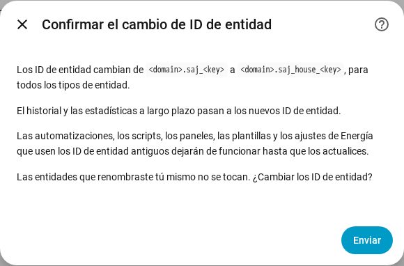

[en](../../en-gb/user/entities-and-prefix.md) | [de](../../de/user/entities-and-prefix.md) | [nl](../../nl/user/entities-and-prefix.md) | [fr](../../fr/user/entities-and-prefix.md) | [zh](../../zh-hans/user/entities-and-prefix.md) | es | [it](../../it/user/entities-and-prefix.md) | [pl](../../pl/user/entities-and-prefix.md) | [sv](../../sv/user/entities-and-prefix.md)

# Entidades y el prefijo

La página Entidades y el prefijo explica qué son las entidades de un sistema, cómo se forman los ID de entidad y cómo añadir un prefijo a los ID de entidad. Las listas completas están en las secciones [Dispositivos y entidades](../../../custom_components/saj_local/docs/features.md#devices-and-entities) y [IDs de entidad y prefijo](../../../custom_components/saj_local/docs/features.md#entity-ids-and-prefix) de la lista de funciones de la integración. Cada nombre de entidad, ID, modelo y valor por defecto está en la [referencia de entidades](entities/README.md).

## Las entidades de un sistema

Cada lectura, ajuste y orden que SAJ Local conoce para tu modelo es una entidad del dispositivo del sistema. Cada entidad tiene el tipo que los usuarios de Home Assistant esperan para la lectura o el ajuste: un sensor, un sensor binario, un número, un seleccionar, un interruptor, una hora o un botón. Un ajuste se muestra como el tipo de control real del ajuste, así que un límite es un número y un ajuste de encendido o apagado es un interruptor.

- **Solo se habilita un conjunto básico.** Se habilitan las lecturas de potencia, tensión, temperatura y estado de carga, los contadores de energía, los límites principales de la batería y todos los fallos. Todo lo demás se crea deshabilitado.
- **Una entidad deshabilitada no se lee.** Habilitar una entidad añade la entidad a la siguiente lectura. Deshabilitar una entidad detiene la lectura del registro. El [sondeo](polling.md) muestra lo que cuesta cada elección al inversor.
- **Un sistema recibe solo las entidades que le corresponden.** Un H2 con un string solar no tiene entidades del segundo string. El equipo que no está instalado no crea entidades, consulta el [equipo opcional](optional-equipment.md).
- **Los ajustes y los diagnósticos están agrupados.** Los ajustes están en la categoría de configuración. Las versiones, los ajustes de puesta en servicio y los ajustes de red están en la categoría de diagnóstico.
- **Una opción desconocida se muestra como desconocida.** El código de la opción está en la [descarga de diagnósticos](troubleshooting.md#descargar-los-diagnósticos), para poder informar de la opción.

Cuando eliges el modelo a mano para un inversor que no se reconoce, el sistema recibe todas las entidades del modelo elegido, con las entidades que superan una fase y dos strings solares deshabilitadas. Consulta los [primeros pasos](getting-started.md#cuando-no-se-reconoce-el-inversor).

## Signo de la potencia

La potencia de la batería y la potencia de la red usan un único signo en todos los modelos, así que una lectura tiene el mismo significado en un HS3 y en un H2.

- **La potencia de la batería** es positiva mientras la batería se descarga y negativa mientras la batería se carga.
- **La potencia de la red** es positiva mientras el sistema exporta y negativa mientras el sistema importa. El Contador A sigue el signo de la red.
- **El Contador B** es positivo mientras genera el inversor solar que mide el Contador B.

Los objetivos del [control de potencia](power-control.md) siguen los signos de las lecturas.

## El prefijo

Cada ID de entidad tiene la forma `<type>.saj_<key>`, por ejemplo `sensor.saj_pv_power`. Cambiar el nombre visible de una entidad no cambia el ID.

Un prefijo añade una palabra después de `saj_` en cada ID de entidad de un sistema, por ejemplo `sensor.saj_house_pv_power`. Usa un prefijo cuando tengas más de un sistema SAJ, para que ningún ID de entidad necesite que se le añada un número.

- Usa solo letras minúsculas y dígitos, hasta 32 caracteres.
- Dos sistemas no pueden compartir un prefijo, y solo un sistema puede no tener ninguno.
- Se rechaza un prefijo que chocaría con un nombre de entidad, como `battery`.
- Se rechaza la configuración cuando un ID de entidad que crearía el sistema ya está en uso.

### Añadir, cambiar o quitar un prefijo

1. Abre Configurar, el engranaje de la fila del sistema en la página de la integración SAJ Local.
2. Cambia el campo Prefijo y elige Enviar.
3. Lee la confirmación y elige Enviar otra vez.

La confirmación muestra el patrón antiguo y el nuevo. Las automatizaciones, los scripts, los paneles, las plantillas y los ajustes de Energía que usen los ID de entidad antiguos dejan de funcionar hasta que actualices las referencias.

Después de confirmar:

- SAJ Local cambia el nombre de cada entidad del sistema, habilitada o deshabilitada, y Home Assistant mueve el historial y las estadísticas a largo plazo a los nuevos ID.
- Una entidad a la que cambiaste el nombre tú mismo no se toca.
- Las [tarjetas del panel](cards/README.md) siguen funcionando, porque las tarjetas encuentran las entidades mediante el registro de entidades y no por el ID.

SAJ Local rechaza el cambio y no renombra nada cuando un ID nuevo ya está en uso, o cuando Home Assistant ya tiene estadísticas a largo plazo con un ID nuevo, por ejemplo de un sistema que eliminaste y que tenía el prefijo.

Si una versión posterior añade una entidad y el ID de la entidad ya está en uso, Home Assistant añade un número al ID, y una advertencia en el registro nombra el tipo y la clave de la entidad.

## Aún no compatible

- Elegir la parte de clave de un ID de entidad. SAJ Local fija la clave, para que los paneles y las automatizaciones funcionen igual en todos los modelos.
