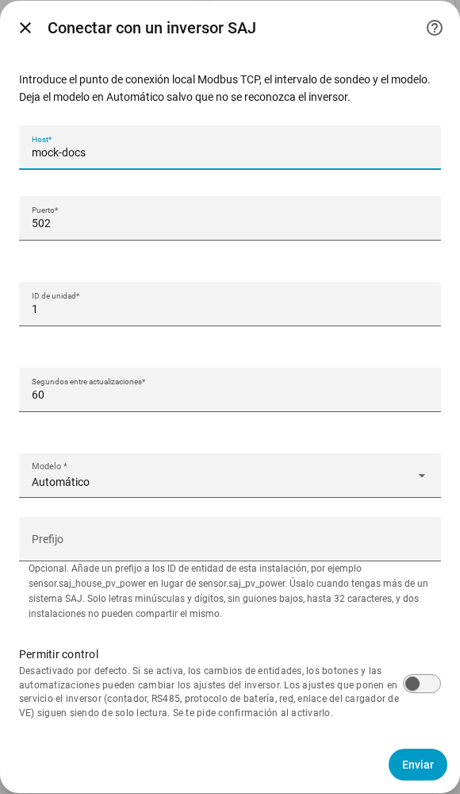
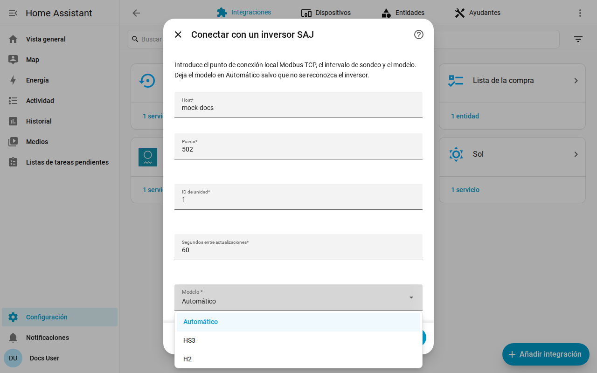

[en](../../en-gb/user/getting-started.md) | [de](../../de/user/getting-started.md) | [nl](../../nl/user/getting-started.md) | [fr](../../fr/user/getting-started.md) | [zh](../../zh-hans/user/getting-started.md) | es | [it](../../it/user/getting-started.md) | [pl](../../pl/user/getting-started.md) | [sv](../../sv/user/getting-started.md)

# Primeros pasos

La página Primeros pasos añade tu sistema SAJ a Home Assistant e indica qué obtienes después. La lista completa de lo que hace la configuración está en la sección [Configuración y detección](../../../custom_components/saj_local/docs/features.md#setup-and-detection) de la lista de funciones de la integración. [Instala SAJ Local](installation.md) primero y comprueba que tu inversor figura en los [equipos compatibles](supported-equipment.md).

## Añadir un sistema

1. En Home Assistant, abre Ajustes y luego Dispositivos y servicios.
2. Elige Añadir integración y busca SAJ Local.
3. Rellena el formulario y elige Enviar.

| Campo | Qué introducir |
| --- | --- |
| Host | El nombre de host o la dirección IP del inversor. |
| Puerto | El puerto Modbus TCP. El valor por defecto es 502. |
| ID de unidad | El ID de unidad Modbus, de 1 a 247. El valor por defecto es 1. |
| Segundos entre actualizaciones | Con qué frecuencia se lee cada entidad habilitada. El valor por defecto es 60 y el mínimo es 10. Consulta el [sondeo](polling.md). |
| Modelo | Déjalo en Automático. SAJ Local reconoce el HS3 y el H2 monofásico a partir del tipo de dispositivo que informa el inversor. |
| Prefijo | Opcional. Déjalo vacío para el primer sistema. Consulta [entidades y el prefijo](entities-and-prefix.md#el-prefijo). |
| Permitir control | Desactivado por defecto, así que nada puede cambiar un ajuste. Consulta [cambiar ajustes](changing-settings.md). |

SAJ Local se conecta al inversor, lee la identidad del inversor y seis lecturas básicas (modo de funcionamiento, estado de carga de la batería, potencia de la carga, potencia solar, potencia de la batería y potencia de la red) y crea el sistema. Un registro que falte en una unidad no detiene la configuración. El sistema se titula SAJ seguido del número de serie del inversor.

Cuando la configuración falla, el formulario indica qué fue mal: sin conexión, sin respuesta a tiempo, una lectura rechazada, datos no válidos, un dispositivo que no se reconoce o un modelo que no coincide con el inversor. No se guarda nada hasta que se supera la comprobación.

## Qué obtienes

- Un dispositivo de Home Assistant llamado SAJ. El modelo del dispositivo muestra el modelo y la potencia nominal, por ejemplo HS3 (12000 W).
- Las entidades que corresponden a tu modelo y a tu equipo. SAJ Local detecta por ti la batería, los contadores y el resto del equipo, consulta el [equipo opcional](optional-equipment.md).
- Solo se habilita un conjunto básico de entidades. Todo lo demás se crea deshabilitado, para que no se lean del inversor valores que no pediste. Habilita una entidad en Home Assistant y la siguiente lectura incluye la entidad. Consulta [entidades y el prefijo](entities-and-prefix.md).
- Las [tarjetas del panel](cards/README.md), sin nada que instalar.

## Añadir un segundo sistema

Añade SAJ Local otra vez desde Dispositivos y servicios. SAJ Local rechaza un punto de conexión o un número de serie de inversor que ya está configurado. Da a cada sistema un [prefijo](entities-and-prefix.md#el-prefijo) distinto, para que ningún ID de entidad necesite que se le añada un número.

## Cuando no se reconoce el inversor

Cuando el inversor informa de un tipo de dispositivo que SAJ Local no reconoce, Automático falla con un error que te pide elegir el modelo a mano. Elige HS3 o H2 en el campo Modelo.

- Se rechaza una elección que contradice un inversor reconocido. Elige el modelo que nombra el error, o Automático.
- Para un inversor no reconocido, SAJ Local lee los registros necesarios y te pide confirmar el modelo. Los registros deben responder primero.
- El dispositivo muestra entonces el modelo como sin verificar. Las lecturas pueden ser erróneas, porque SAJ Local no puede comprobarlas con el tipo de dispositivo, y se rechaza cualquier intento de cambiar un ajuste.

## Cambiar un sistema más tarde

Abre Configurar, el engranaje de la fila del sistema en la página de la integración SAJ Local. Puedes cambiar el host, el puerto, el ID de unidad, el intervalo de actualización, el modelo, el prefijo y Permitir control, y ajustar cada equipo. SAJ Local guarda el cambio solo después de que el inversor responda en el nuevo punto de conexión. [Sustituir el inversor](replacing-the-inverter.md) trata el caso de un inversor nuevo.

## Aún no compatible

- Productos distintos del HS3 y del H2 monofásico. Consulta los [equipos compatibles](supported-equipment.md).
- Encontrar el inversor en la red. Tú introduces la dirección del inversor.
